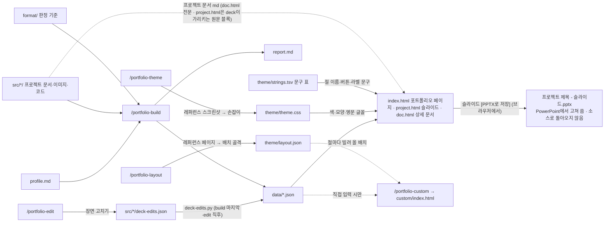

# CLAUDE.md — 포트폴리오 자동 작성 템플릿

이 레포는 **수강생의 원천 소스(프로젝트 문서·스크린샷·소스코드)를 조합해 포트폴리오 웹페이지를 만드는 템플릿**입니다.
기준은 「유니티 개발자 취업·기술 문서 작성 가이드 v2」(https://koohoo-dev.github.io/edu-lecture-portfolio-guide/)이며,
그 판정 기준 압축본이 `format/`에 있습니다.

사용자는 **유니티 게임 개발 지망 수강생**입니다(프로그래밍·게임 디자인을 가르지 않음). 정돈된 **경어체**로, 쉬운 말로 설명합니다.

이름이 바뀐 것: **프로젝트 문서**(예전 '기술 문서') · **포트폴리오 페이지**(예전 '포트폴리오 문서') · **슬라이드**(예전 '발표 덱').
수강생이 예전 이름으로 말해도 같은 것으로 알아듣고, 답할 때는 지금 이름을 씁니다. 파일·코드의 이름(`deck`, `deck-edits.json`, `project.html`)은 그대로입니다.

---

## 폴더 규약

```
├── profile.md               # ✍ 수강생이 직접 씀 — 이름·연락처·자기소개·페이지 설정
├── src/<NN-프로젝트>/        # ✍ 수강생의 원천 소스 (입력)
│   ├── 프로젝트문서.md       #    프로젝트 문서 (폴더 안의 .md 하나. README.md여도 됨. 예전 이름 기술문서.md도 그대로 읽음)
│   ├── images/              #    스크린샷·GIF
│   ├── code/                #    (선택) 핵심 소스코드 .cs
│   ├── deck-edits.json      #    (/portfolio-edit) 슬라이드 장면 고치기 — 요청을 받아 Claude가 씀, 커밋함, 프로젝트 문서가 아님, build는 읽기만
│   └── _intake/             #    (/portfolio-intake) 재료집·촬영목록·발표자료(.pptx에서 꺼낸 글 + pptx/ 그림) + 수강생이 넣은 자료/(기획서·회의록·AI 대화 기록 등) — 프로젝트 문서가 아님, git 제외, build가 읽지 않음(check는 재료 점검표를 위해 파일 목록과 체크박스 수만 셈)
├── docs/                    # 📘 사람이 읽는 문서 — 포트폴리오란(1-portfolio) · 전체 흐름(2-workflow) · 문서 쓰는 법(3-writing) · 도구 설명(tools/) · 문제 해결 · 참고 · 스크린샷(img/). README가 입구
├── format/                  # 📏 가이드 판정 기준 (읽기 전용)
├── data/                    # 🤖 /portfolio-build가 생성 (portfolio.json, projects/*.json)
├── index.html               # 🖥 고정 렌더러 — 포트폴리오 페이지 (아래로 읽는 한 페이지, A4 인쇄 = 제출 PDF)
├── project.html             # 🖥 고정 렌더러 — 슬라이드 (?p=<폴더 이름>, data/의 deck이 가리키는 프로젝트 문서 원문 블록을 그대로 그림)
├── doc.html                 # 🖥 고정 렌더러 — 프로젝트 상세 문서 (?p=<폴더 이름>, src/의 프로젝트 문서 md를 직접 읽음)
├── assets/                  # 🖥 렌더러 CSS·JS (포트폴리오 페이지·슬라이드 키트·장면 키트·상세 문서·md-blocks.js = 프로젝트 문서 md 해석과 원문 블록 찾기, 슬라이드·상세 문서 공용 · strings.js = UI 문구 기본값과 문구 표 읽기 · deck-pptx.js = 슬라이드 [PPTX로 저장], 그린 장면을 재서 PowerPoint 개체로)
├── theme/theme.css          # 🎨 /portfolio-theme 결과 — 색·모양·영문 글꼴 손잡이(--t-*). 세 페이지가 마지막에 싣음. 비어 있으면 기본 테마, /portfolio-update가 건드리지 않음
├── theme/strings.tsv        # ✍ 문구 표(스트링 테이블) — 절 이름·버튼·라벨 문구. 수강생이 맨 끝 "내 문구" 칸을 직접 고침(빈 칸 = 기본 문구). /portfolio-update는 없을 때만 만듦
├── theme/layout.json        # 🎨 /portfolio-layout 결과 — 배치 레퍼런스(내 절마다 빌려 올 단 나눔·카드 격자·그림 쪽). /portfolio-custom만 읽음(렌더러는 안 읽음). 템플릿에 없음, /portfolio-update가 건드리지 않음
├── custom/                  # 🎨 /portfolio-custom 결과 (직접 생성 모드)
├── report.md                # 📋 점검 리포트 (git 제외, 로컬 전용)
└── report-intake.md         # 📋 /portfolio-intake 리포트 (git 제외 — 비밀값 위치·작성자 정보)
```

- `src/` 아래에서 이름이 `_`로 시작하는 폴더는 무시합니다(초안·보관용).
- 템플릿에는 샘플 프로젝트 4개(`00-example-crafting`, `0-Tidy-Mommy`, `1-action-platformer`, `2-Yggdrasil`)가 들어 있고,
  `data/`에는 그중 `00-example-crafting`을 뺀 3개의 빌드 결과가 들어 있습니다. 수강생 프로젝트가 생기면 샘플 폴더를 지우고 다시 빌드하라고 안내합니다
  (지운 프로젝트의 `data/projects/*.json`도 함께 정리). 샘플은 동의를 받은 선배 작품이므로 내용을 수강생 문서에 옮기지 않습니다.

## 데이터 흐름



## 명령 (스킬)

| 명령 | 하는 일 |
|---|---|
| `/portfolio-build [폴더]` | 소스를 읽어 `data/` 생성 + 점검 리포트 + 미리보기. 폴더를 주면 그 프로젝트만 |
| `/portfolio-check [폴더]` | 프로젝트 문서를 가이드 기준으로 점검만 (데이터는 안 건드림) |
| `/portfolio-edit [폴더] [장면] [요청]` | 슬라이드 장면 하나의 배치(틀·원문 블록 고르기·줄 범위·나누기·합치기·숨기기·순서)를 고침. `src/<NN>/deck-edits.json`에 써서 다시 빌드해도 남음. 말로 요청해도 되지만 **장면 카드로 확인받은 뒤에만** 씀. 내용(사실·설명) 문제는 프로젝트 문서로 안내 |
| `/portfolio-theme [되돌리기\|요청]` | 첨부한 웹페이지 스크린샷에서 색·모양·영문 글꼴·효과를 정해진 규칙으로 뽑아 `theme/theme.css`에 씀(세 페이지가 함께 바뀜). 렌더러는 안 건드림. 말로 "이 사이트 느낌으로", "버튼 덜 둥글게"라고 해도 됨 |
| `/portfolio-layout [주소\|스크린샷\|되돌리기]` | 레퍼런스 페이지의 배치 골격(띠·단 나눔·카드 격자·그림 쪽·콘텐츠 폭)을 `measure-layout.js`로 재거나(브라우저 도구) 스크린샷으로 어림해, 내 절에 맞춘 뒤 **확인받고** `theme/layout.json`에 씀. 글·그림·로고·이름은 안 가져옴. 페이지에는 `/portfolio-custom`이 반영(`index.html`·제출 PDF는 그대로) |
| `/portfolio-custom [디자인 요청]` | 직접 생성 모드. `theme/layout.json`이 있으면 그 배치를 따름. **사용자가 직접 입력했을 때만** 실행 |
| `/portfolio-update [되돌리기]` | 템플릿 원본에서 렌더러·스킬·`format/`·`docs/`·`CLAUDE.md`만 받아 반영(`src/`·`profile.md`·`data/`·`custom/`은 안 건드림). **사용자가 직접 입력했을 때만** 실행 |
| `/portfolio-intake <레포 주소\|폴더\|발표.pptx>` | GitHub 레포에서 핵심 `.cs`·재료집(사실 + 질문)·촬영 목록을 `src/<NN>/`에 만듦. `.pptx`면 슬라이드 글·표·노트·그림을 그대로 `_intake/발표자료.md`·`_intake/pptx/`로 꺼냄(`pptx-extract.py`, 표준 라이브러리만). 프로젝트 문서는 만들지 않음. **사용자가 직접 입력했을 때만** 실행 |

### 업데이트가 덜 된 레포 알아채기

`docs/` 폴더가 없으면(이 파일과 README가 `docs/…`를 가리키는데 폴더가 없음) 예전 `/portfolio-update`로 한 번 받은 레포입니다 — 예전 명령은 `docs/`를 받지 않았습니다.
세션에서 처음 알아챈 때 한 번, 하던 답 끝에 이렇게 알립니다: "템플릿의 안내 문서 폴더(`docs/`)가 아직 들어오지 않았습니다. `/portfolio-update`를 한 번 더 입력하면 들어옵니다(내 문서·데이터는 그대로입니다)."
`/portfolio-update`는 직접 입력 전용이라 Claude가 실행하지 않습니다. 그동안 흐름을 물으면 `docs/2-workflow.md` 대신 템플릿 원본의 같은 문서(https://github.com/krKooHoo/portfolio-template/blob/main/docs/2-workflow.md, 폴더는 `…/tree/main/docs`)를 가리키고, 내용이 필요하면 그 주소에서 읽습니다.

---

## 반드시 지킬 원칙

1. **지어내지 않는다.** `data/`의 모든 값은 `profile.md`·프로젝트 문서·코드에서 **찾을 수 있는 사실**이어야 합니다.
   요약·압축은 되지만 새로운 사실·수치·기술명·성과를 만들지 않습니다. 없으면 비워 두고 리포트에 적습니다.
2. **수강생 문서를 대신 고쳐 쓰지 않는다.** `src/`와 `profile.md`는 수강생의 것입니다. 점검 결과는 리포트로
   **문제와 방향**만 알려 주고, 수강생이 명시적으로 "고쳐 줘"라고 요청한 부분만 수정합니다.
   (가이드 원칙: *"이해 없이 복붙 금지"* — 프로젝트 문서의 목적은 "내가 만든 것을 설명할 줄 안다"를 보여주는 것)
3. **Claude가 요약한 문장은 표시한다.** 원문을 그대로 옮기지 않고 Claude가 압축한 문장(한 줄 소개, 기술 스택 근거 등)은
   리포트의 "확인해 주세요" 목록에 넣어 수강생이 직접 검토하게 합니다.
4. **고칠 곳은 소스다.** 페이지 내용이 틀리면 `data/`를 손으로 고치기보다 `src/`·`profile.md`를 고치고 다시 빌드하도록 안내합니다.
   슬라이드의 **장면 배치**(프로젝트 문서를 읽는 사람에게는 달라질 필요가 없는 것: 틀·어떤 원문 블록을 보일지·나누기·합치기·숨기기·순서)는
   `/portfolio-edit`가 `src/<NN>/deck-edits.json`에 씁니다. 이 파일도 소스이고, 글은 원문 그대로이거나 줄인 것(→ "확인해 주세요")뿐입니다.
5. **렌더러는 건드리지 않는다.** `index.html`, `project.html`, `doc.html`, `assets/`는 사용자가 요청할 때만 수정합니다.
   디자인 변경 요청은 ① `profile.md`의 강조색 ② `theme/strings.tsv`(문구 표 — 절 이름·버튼·라벨 문구) ③ `/portfolio-theme`(레퍼런스 화면 → `theme/theme.css`, 색·모양·영문 글꼴) ④ `/portfolio-custom`(배치까지 새로 — 따라 할 레퍼런스 배치가 있으면 먼저 `/portfolio-layout` → `theme/layout.json`) 순으로 안내합니다.
   `theme/theme.css`·`theme/strings.tsv`·`theme/layout.json`은 렌더러가 아니라 수강생의 파일입니다(테마는 `/portfolio-theme`, 배치 레퍼런스는 `/portfolio-layout`이 씀).
   **문구 표**는 UI 문구만 바꿉니다(사실·설명은 프로젝트 문서). 수강생이 직접 고치는 것이 기본이고, "고쳐 줘"라고 하면 그 줄의 맨 끝 "내 문구" 칸만 고칩니다
   (키·보이는 곳·기본 문구 칸, 칸 사이 탭은 그대로. `{name.deck}`처럼 점이 있는 자리표시는 다른 줄의 문구, `{n}`처럼 점이 없는 자리표시는 페이지가 넣는 값이라 지우지 않음).
   기본 문구 자체는 `assets/strings.js`(렌더러)에 있습니다.
6. **경로는 상대경로, 대소문자 정확히.** GitHub Pages(리눅스)는 대소문자를 구분합니다.

## 판단 기준 (format/)

| 파일 | 언제 읽나 |
|---|---|
| `format/01-portfolio.md` | 요약·상세 페이지에 무엇이 들어가야 하는지, 체크리스트 |
| `format/02-tech-document.md` | 프로젝트 문서 5단 구조(뼈대) + 선택 모듈([팀]·[기획]·[일정]) 점검 |
| `format/03-diagrams.md` | 다이어그램 점검·제안 |
| `format/04-layout-patterns.md` | 렌더러 구성 / 직접 생성 모드의 레이아웃 |
| `format/05-custom-page-prompts.md` | 직접 생성 모드 규칙 |
| `format/06-deploy.md` | 배포 안내·문제 해결 |
| `format/07-materials.md` | 뼈대 칸마다 필요한 자료 — `/portfolio-check`의 재료 점검표, 문서가 없는 프로젝트 안내 |

수강생이 다이어그램을 그려 달라고 **직접 요청하면** `format/03-diagrams.md` 「소스에서 읽히는 것 → 다이어그램」 표로 종류를 고르고(데이터·필드 → ERD, 여러 클래스를 차례로 부름 → 시퀀스, 한 규칙의 갈림길 → 플로우차트, 상태 → 상태, 상속·협력 → 클래스),
그 부분의 코드(`code/`·문서 코드 블록)를 읽어 실제 이름으로 그립니다. 고른 종류와 이유를 한 줄 덧붙이고, 문서에 넣는 것은 수강생이 하거나 "넣어 줘"라고 할 때만 합니다(원칙 2).

수강생이 전체 흐름(무엇을 어떤 순서로 하는지, 지금 어느 단계인지)을 물으면 `docs/2-workflow.md`를 따라 안내합니다. 명령마다의 자세한 사용법은 `docs/tools/`에 있습니다.

## 미리보기

`fetch()`로 데이터를 읽으므로 파일 더블클릭(`file://`)으로는 열리지 않습니다. 로컬 서버로 엽니다.

- `python -m http.server 4600` (Windows에서 `python`이 없으면 `py -m http.server 4600`) → http://localhost:4600
- JetBrains IDE(Rider·WebStorm): `index.html` 우클릭 → **Open in → Browser** (내장 서버)
- Claude 데스크톱 앱: `.claude/launch.json`의 `portfolio` 구성으로 미리보기
- 슬라이드 아래 띠의 빨간 숫자(미리보기 배치 점검)를 물으면 데이터를 다시 만들지 않고, 그 슬라이드(`project.html?p=<id>`)에서
  `await PFScene.whenReady()` 뒤 `PFScene.report().audit`을 읽어 `.claude/skills/portfolio-build/SKILL.md` §7-1처럼 장면마다 1건으로
  묶어 알려 줍니다. 브라우저 도구가 없으면 headless Chrome으로
  `chrome --headless=new --virtual-time-budget=30000 --dump-dom "http://localhost:4600/project.html?p=<id>&pf-audit=1"`
  을 실행해 `#pf-audit`의 base64 JSON(= `report()`)을 읽고, `ready`가 `yes`인지 확인합니다.
  포트폴리오 페이지(`index.html`)는 장면이 없는 흐르는 페이지라 빨간 띠가 없고, `await PFPage.whenReady()` 뒤 `PFPage.report()`
  (깨진 이미지 `images.broken`·가로 넘침 `overflowX`·`errors`)를 봅니다. headless는 `index.html?pf-audit=1`로 같은 방법입니다.
  상세 문서(`doc.html?p=<id>`)는 `await PFDoc.whenReady()` 뒤 `PFDoc.report()`(`errors`·깨진 이미지 `images.broken`·그리지 못한 다이어그램 `diagrams.failed`)를 봅니다. headless는 `doc.html?p=<id>&pf-audit=1`로 같은 방법이고(그림까지 받은 뒤 씀), 상세 문서의 `ready`는 `true`입니다.
  슬라이드의 빨간 띠(원문 블록을 찾지 못함·여러 곳·바뀜)도 `audit`에 함께 나오고, `info.mode`가 `auto`면 예전 데이터로 자동 구성된 슬라이드이므로 `/portfolio-build`를 다시 실행하도록 안내합니다.
- 슬라이드의 **[PPTX로 저장]**(`assets/deck-pptx.js`)은 렌더러 기능이라 데이터를 다시 만들지 않습니다. 결과가 이상하다고 하면 그 슬라이드에서 `await PFScene.whenReady()` 뒤
  `(await PFPptx.build()).report`(내려받지 않음)의 `warnings`(넣지 못한 그림 등)·`slides`(슬라이드별 글상자·도형·그림·표·코드 개수)·`fonts`(들어간 글꼴 이름)를 봅니다.
  PowerPoint에서 글꼴·줄바꿈이 다르면 대개 그 PC에 Pretendard·D2Coding이 없는 것입니다(설치 또는 [홈 → 바꾸기 → 글꼴 바꾸기]). PPTX에서 고친 것은 소스로 돌아오지 않으므로 내용 문제는 프로젝트 문서로 안내합니다.
- 문구 표(`theme/strings.tsv`)가 제대로 읽혔는지는 세 페이지 report의 `strings`로 봅니다 — 포트폴리오 페이지 `PFPage.report().strings`, 슬라이드 `PFScene.report().info.strings`,
  상세 문서 `PFDoc.report().strings`. `issues`의 `type`: `spaces`(탭 대신 공백 — 그 줄은 기본 문구) · `unknown-key` · `duplicate` · `default-edited`(기본 문구 칸을 고침) ·
  `extra-cols` · `too-long`(권장 글자 수 초과) · `hangul-in-en`(영문 라벨 칸에 한글) · `missing-var`/`unknown-var`/`unknown-ref`/`ref-loop`(자리표시) · `encoding`(CP949·UTF-16) · `no-file`.
  `line`이 그 표의 줄 번호입니다. 줄마다 무엇을 고치면 되는지 `detail`대로 알려 줍니다.
