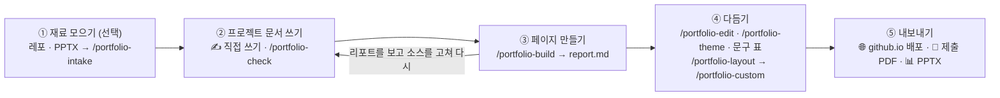

# 포트폴리오 자동 작성 템플릿 (Claude Code)

프로젝트마다 **프로젝트 문서** 한 편을 쓰면, Claude가 그 문서를 읽어 **포트폴리오 웹페이지 세 가지**와 **점검 리포트**를 만들어 줍니다.
기준은 「[유니티 개발자 취업·기술 문서 작성 가이드 v2](https://koohoo-dev.github.io/edu-lecture-portfolio-guide/)」입니다.
결과물은 GitHub Pages로 바로 배포되고, 제출용 PDF와 PowerPoint 파일(PPTX)로도 저장할 수 있습니다.

**예시 보기** → https://krkoohoo.github.io/portfolio-template/
(이 레포에 들어 있는 샘플 프로필과 선배 수강생 작품 3편으로 만든 페이지입니다.)

> 포트폴리오가 무엇이고 무엇을 써야 하는지부터 알고 싶다면 → **[포트폴리오와 프로젝트 문서](docs/1-portfolio.md)**

## 무엇이 만들어지나요

| 결과 | 주소 | 무엇인가요 | 어디에 쓰나요 |
|---|---|---|---|
| **포트폴리오 페이지** | `index.html` | 아래로 읽는 한 페이지. 자기소개 → 기술 스택 → 프로젝트마다 소개·기능 소개 → 한눈에 보기 → 연락처 | 지원서에 넣는 링크, **제출용 PDF**(A4) |
| **슬라이드** | `project.html?p=<폴더 이름>` | 프로젝트 문서를 바탕으로 한 16:9 발표 슬라이드. 프로젝트마다 하나 | 면접·발표, 프로젝트별 PDF, PowerPoint에서 고쳐 쓰는 **PPTX** |
| **프로젝트 상세 문서** | `doc.html?p=<폴더 이름>` | 프로젝트 문서 전문을 읽기 좋게 보여 주는 긴 문서 | 더 깊이 읽고 싶은 사람에게 |
| **점검 리포트** | `report.md` (내 PC에만) | 가이드 기준으로 프로젝트 문서를 점검한 결과(필수 · 권장 · 참고)와 더 필요한 자료 | 프로젝트 문서를 고칠 때 |

| 포트폴리오 페이지 | 슬라이드 | 프로젝트 상세 문서 |
|---|---|---|
|  |  |  |

더 많은 화면은 [세 페이지 자세히](docs/reference.md#세-페이지-자세히)에 있습니다.

## 어떻게 진행되나요

> **이 템플릿이 대신 해 주지 않는 것**: 프로젝트 문서를 *써 주는 것*. Claude는 여러분이 쓴 내용을 **정리·점검**할 뿐,
> 없는 사실을 지어내거나 문서를 고쳐 쓰지 않습니다. 프로젝트 문서의 목적은 *"내가 만든 것을 설명할 줄 안다"* 를 보여주는 것이니까요.

## 문서

처음이라면 위에서부터 차례로 읽으세요.

| 순서 | 문서 | 내용 |
|---|---|---|
| 1 | [포트폴리오와 프로젝트 문서](docs/1-portfolio.md) | 포트폴리오가 무엇인지, 읽는 사람이 무엇을 보는지, 프로젝트 문서를 왜 직접 쓰는지 |
| 2 | [전체 흐름](docs/2-workflow.md) | 재료에서 제출까지 단계마다 무엇을 하고, 끝났는지 어떻게 확인하는지 |
| 3 | [프로젝트 문서 쓰는 법](docs/3-writing.md) | 뼈대, 칸마다 좋은 예와 나쁜 예, 쓴 글이 페이지에서 어떻게 보이는지 |

필요할 때 찾아 읽는 문서입니다.

| 문서 | 내용 |
|---|---|
| [도구 한눈에](docs/tools/README.md) | 하고 싶은 일마다 어떤 명령·버튼·파일을 쓰는지 |
| 도구 설명 — [재료 모으기](docs/tools/intake.md) · [점검받기](docs/tools/check.md) · [페이지 만들기](docs/tools/build.md) · [장면 고치기](docs/tools/edit.md) · [디자인 바꾸기](docs/tools/design.md) · [내보내기](docs/tools/export.md) · [템플릿 업데이트](docs/tools/update.md) | 명령마다 언제 쓰나 · 바뀌는 것 · 되돌리기 |
| [문제 해결](docs/troubleshooting.md) | 증상별 원인과 해결 |
| [참고](docs/reference.md) | 세 페이지 자세히, 폴더 구조, 스킬 구성, 기준 문서 |

## 빠른 시작

1. 이 레포를 **Fork**해서 내 PC에 clone합니다.
   - clone하자마자 [미리보기](docs/tools/build.md#미리보기)를 열면 샘플로 만든 결과를 바로 볼 수 있습니다. 어떤 모양이 나오는지 먼저 보세요.
2. 내 프로젝트 폴더(예: `src/1-my-game/`)에 `프로젝트문서.md`와 `images/`를 넣고, 내 프로젝트가 들어가면 `src/`의 샘플 프로젝트 4개를 지웁니다. → [프로젝트 문서 쓰는 법](docs/3-writing.md#프로젝트-문서와-소스-넣기)
   - 프로젝트 문서가 아직 없다면 [`/portfolio-intake`](docs/tools/intake.md#재료-모으기)로 GitHub 레포나 발표 자료(.pptx)에서 재료부터 뽑고, 쓰는 중에는 [`/portfolio-check`](docs/tools/check.md#쓰는-중에-점검받기)로 점검받습니다.
3. `profile.md`의 예시 값(홍길동 등)을 내 정보로 바꿉니다. → [profile.md 채우기](docs/tools/build.md#profilemd-채우기)
4. 레포 폴더에서 Claude Code를 열고 `/portfolio-build`를 입력합니다. → [포트폴리오 만들기](docs/tools/build.md#포트폴리오-만들기)
5. `report.md`를 읽고 **원본(`src/`·`profile.md`)을 고친 뒤** 다시 `/portfolio-build` — 만족할 때까지 되풀이합니다.
6. 미리보기로 확인하고 commit · push → GitHub **Settings → Pages**에서 `main` / `(root)`로 배포합니다. → [배포하기](docs/tools/export.md#배포하기)
7. 배포된 주소에서 **[PDF로 저장]** 버튼으로 제출용 PDF를 만듭니다. → [PDF로 제출하기](docs/tools/export.md#pdf로-제출하기)

## 준비물

| 준비물 | 비고 |
|---|---|
| GitHub 계정 | 무료 플랜은 **공개(Public) 레포**에서만 Pages가 동작합니다 |
| Git | `/portfolio-intake`·`/portfolio-update`도 Git을 씁니다 |
| [Claude Code](https://claude.com/claude-code) | **이 레포 폴더를 열고** 써야 `/portfolio-…` 명령이 보입니다 |
| Python 3.8 이상 (권장) | 미리보기 서버, 빌드 중 검사, 테마 점검, 발표 자료(.pptx) 재료 꺼내기에 씁니다. 슬라이드 장면 고치기(`/portfolio-edit`)에는 **꼭 필요**합니다 |
| Windows PC의 Chrome 또는 Edge | 제출용 PDF 저장이 보장되는 환경입니다 |

---

기준 가이드: 「유니티 개발자 취업·기술 문서 작성 가이드 v2」 — 김재훈 (Jay / KooHoo) · https://koohoo-dev.github.io/edu-lecture-portfolio-guide/
