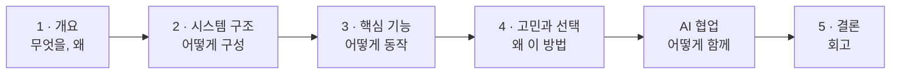

# 기준 ② 프로젝트 문서 5단 구조 — 뼈대 + 선택 모듈

> 원본: 「유니티 개발자 취업·기술 문서 작성 가이드 v2」 **Part 2 프로젝트 문서 작성 가이드**
> (https://koohoo-dev.github.io/edu-lecture-portfolio-guide/guide.html#2)
> 이 파일은 Claude가 `src/*/프로젝트문서.md`를 **읽고 점검**할 때 쓰는 판정 기준 압축본입니다.
> 비유·예시·저자 조언 전문은 원본을 읽으세요.

**프로젝트 문서**는 프로젝트를 **만든 뒤에** 쓰는, **채용 담당자가 읽는** 문서입니다 (만들기 전에 쓰는 기획서와 다릅니다. 예전 이름: 기술 문서).
무엇을 만들었는지보다 **무엇을 왜 그렇게 정했는지**(고민과 선택)가 본체이고, 구현·게임 디자인·일정 어느 쪽의 판단이든 담을 수 있습니다.

## 무엇을 평가하나

점검은 **내용**과 **구조** 두 축입니다. 자세한 기준은 아래 각 절에 있습니다.

| 축 | # | 평가 질문 | 어디서 보나 |
|---|---|---|---|
| 내용 | 1 | 프로젝트를 설명했는가 | 1 · 개요 |
| 내용 | 2 | 목표한 유저 경험은 어떻게 됐는가 | 1 · 개요(목표한 경험) + 5 · 결론(돌아보기) |
| 내용 | 3 | 핵심 기능은 무엇이고 어떻게 구현했는가 — 게임 디자인 서술도, 기술 서술도 인정 | 2 · 3 (기능 단위) |
| 내용 | 4 | 무엇을 고민했고, 어떤 대안 중 무엇을 골랐는가 | 4 · 고민과 선택 |
| 내용 | 5 | AI와 어떻게 협업했고 무엇을 겪었는가 | AI 협업 |
| 내용 | 6 | 결론 — 개인이 느낀 회고 | 5 · 결론 |
| 구조 | 1 | 개요가 비개발 직군에게도 읽히는가 | 문서 구조 판정 기준 |
| 구조 | 2 | 장이 제목 + 내용으로 짜여 있고, 소제목이 바로 읽히는가 | 문서 구조 판정 기준 |
| 구조 | 3 | 같은 내용을 반복하지 않는가 | 문서 구조 판정 기준 |

취업용 프로젝트 문서는 아래 논리 흐름을 뼈대로 삼습니다.



규모에 따라 유연하게 변형합니다. **법칙이 아닙니다.** 유형을 고르지 않고, **모든 문서가 갖는 뼈대**에 **조건이 맞는 모듈**을 붙입니다.

## 뼈대 — 모든 문서에 공통

5단은 네 덩어리로 읽습니다. 덩어리마다 읽는 사람의 질문 하나에 답합니다.

| 덩어리 | 단계 | 읽는 사람의 질문 |
|---|---|---|
| **개요** | 1 | 이게 무엇이고, 이 사람이 무엇을 했나 |
| **기능 단위** | 2 · 3 · 4 (구조 · 기능 · 고민과 선택) | 어떻게 만들었고, 왜 그렇게 했나 |
| **AI 협업** | (번호 없음, 결론 앞) | AI와 어떻게 일했나 |
| **결론** | 5 | 그래서 어땠나, 무엇을 알게 됐나 |

- **기능 단위는 기능 수만큼 반복**합니다. 기능이 하나면 1 → 2 → 3 → 4 → 5를 한 번, 여러 개면 개요 → (기능별로 구조·기능·고민과 선택 반복) → 결론입니다.
- 5단의 단계 이름은 **점검하는 틀의 이름**입니다. 문서의 제목으로 그대로 쓸 필요가 없습니다(→ 문서 구조 판정 기준).
- 공통 구조 장(2장) 뒤에 기능별 장이 반복되는 형태도 같은 뼈대입니다.
- 섹션 제목이 달라도 됩니다. "고민과 선택"이 각 기능 안에 흩어져 있어도 같은 역할을 하면 인정합니다. 판정은 **제목이 아니라 내용**으로 합니다.
- **기능 단위는 두 종류**입니다. 섞어도 되고 한 종류만 있어도 됩니다. 지원 직군을 묻지 않고, **단위마다 그 종류의 기준**으로 봅니다.

  | 단위 종류 | 무엇 | 2 · 구조 | 3 · 기능 | 4 · 고민과 선택 |
  |---|---|---|---|---|
  | **구현 단위** | 코드로 만든 시스템·기능 | 아키텍처 다이어그램, 클래스의 역할 분담 | 핵심 코드와 본인의 설명 | 공통 |
  | **기획 단위** | 설계한 규칙·밸런스·레벨 | 규칙·수치의 관계(표·그림) | 플레이에서 보이는 모습(화면·영상)과 본인의 설명 | 공통 |

- 👍 기능이 많으면 **대안이 있었던 기능 2~4개**만 깊게 쓰고, 나머지는 표 한 줄로 정리합니다 (선택이 없었던 기능은 깊게 쓸 내용이 없습니다). 기능마다 장을 하나씩 주면 슬라이드도 장 표지가 그만큼 늘어 30장을 넘기 쉽습니다.
- 👎 모든 기능을 같은 깊이로 반복해 기능 목록이 된 문서

## 선택 모듈 — 조건이 맞을 때만 붙임

| 모듈 | 붙이는 조건 | 어디에 | 붙는 내용 |
|---|---|---|---|
| **[팀]** | 개발 인원이 2명 이상 — **조건이 맞으면 필수** | 개요 뒤 | 팀·역할 소개 → 담당 파트 개요 |
| **[기획]** | 무엇을 만들지를 **본인이 정했고**, 그 판단을 문서에 싣는다 — 선택 | 개요 뒤 ([팀]보다 앞) | 플레이 소개 → 코어 루프 (목표한 경험은 뼈대의 개요에 있음) |
| **[일정]** | 계획을 세우고 중간에 바꾼 기록이 있다 — 선택 | 결론 안 | 계획 대비 실제 · 범위를 줄인 결정 |

```
개요 (목표한 경험 포함)
 └ [기획] 플레이 소개 → 코어 루프
 └ [팀]   팀·역할 소개 → 담당 파트 개요
기능 단위 (기능 수만큼 반복)
AI 협업
결론
 └ [일정] 계획 대비 실제 · 범위를 줄인 결정
```

- **[기획]·[일정]은 붙였을 때만 점검합니다.** 안 붙였으면 지적하지 않고, 필수·권장·참고 어디에도 넣지 않습니다.
  남이 정한 기획을 구현만 했다면 [기획]을 붙이지 않습니다.
- 붙였는지는 **제목이 아니라 내용**으로 봅니다. 플레이 소개나 코어 루프를 **절 하나로 설명**했으면 [기획]을, 일정(단계·마일스톤)의 계획과 실제를 비교했으면 [일정]을 붙인 것으로 봅니다.
  개요 안의 한 줄 언급만으로는 모듈을 붙인 것으로 보지 않습니다. 기획 항목과 구현 결과를 대조한 표(무엇을 만들고 무엇을 뺐나)는 일정 비교가 아니므로 [일정]으로 보지 않습니다.
  점검은 붙였는지만 봅니다 — [기획]을 붙였으면 누가 기획을 정했는지(혼자·팀)는 묻지 않고 [기획] 기준으로 봅니다.
- [기획]과 [팀]을 둘 다 붙이면 **[기획]이 먼저**입니다. 게임이 무엇인지 알아야 그 안에서 담당 파트의 위치가 이해됩니다.
- 모듈은 짧게 씁니다 — [팀] 반 화면, [기획] 한 화면, [일정] 표 하나 안팎. 어느 조합에서든 문서의 본체는 **기능 단위**입니다.
- 리포트의 **문서 구성**은 `뼈대`, `뼈대 + [팀]`, `뼈대 + [기획] + [일정]`처럼 적습니다.

---

## 단계별 판정 기준

### 1 · 개요 — 무엇을, 왜

- [ ] **무엇을 만들었는지**와 **왜 만들었는지**(어떤 문제·목적)가 개요의 **글 안에서** 읽힌다 — 왜 만들었는지가 없으면 **필수**
      내용으로 판정합니다. 절을 따로 나눌 필요가 없고, 한 문단 안에 함께 있어도 됩니다.
- 👎 "What", "Why", "무엇을 만들었나 (What)"를 **제목·소제목·문단 머리 라벨**로 쓴 문서 — 틀의 이름이 드러나 글이 서툴러 보입니다(→ 문서 구조 판정 기준, **권장**)
- 리포트에도 "What"·"Why"라는 말을 쓰지 않고 "무엇을 만들었는지"·"왜 만들었는지"로 적습니다.
- [ ] **목표한 경험**: 이 프로젝트로 유저가 무엇을 느끼거나 할 수 있기를 바랐는지 **한 문장**으로 적혀 있다 — 없으면 **권장**
      (장르 이름·기능 목록 ✗ → "쫓기는 긴장 속에서 한 수 앞을 읽는 재미" ○). 왜 만들었는지를 쓴 글이 이 내용을 담고 있으면 인정합니다.
      게임이 아닌 시스템·툴이면 '유저'는 그것을 쓰는 사람(플레이어나 다른 개발자)입니다.
- [ ] 개발 환경(엔진 버전·도구·기간)과 링크(영상·GitHub)가 있다
- 👍 왜 만들었는지에 적은 문제가 **측정 가능**하다 ("느리다" ✗ → "로딩 15초" ○)

### 2 · 시스템 구조 — 어떻게 구성

- [ ] **아키텍처 다이어그램**이 있다 (클래스·시퀀스 등 → 기준 ③)
- [ ] 핵심 클래스의 **역할 분담**(책임)이 설명돼 있다
- [ ] **왜 이렇게 나눴는지** 한두 줄이라도 있다 ("MVC 썼다" ✗ → "UI 변경이 잦아 로직과 분리" ○)
- 👎 모든 클래스를 다 그린 다이어그램 / 기술 이름만 나열한 스택
- **기획 단위**는 위 다이어그램·클래스 항목 대신, **규칙·수치의 관계**가 표나 그림으로 보이는지와 **왜 그렇게 짰는지**를 봅니다

### 3 · 핵심 기능 — 어떻게 동작

- [ ] **핵심 동작**은 핵심 로직만 선별한 코드로 보인다 — 상세 문서 한 블록 **50줄 안팎**, 슬라이드 한 장면 **20줄 안팎**
      (20줄을 넘으면 렌더러가 "계속" 장면으로 나누고 참고 지표 `long-code`를 남김. 지적이 아니라 안내)
- [ ] 코드에 **본인의 설명**이 붙어 있다 (왜 이 순서·이 구조인지)
- 👍 예외 상황(재료 부족·레시피 없음 등) 방어 코드를 보여준다
- 👍 다른 코드가 이 기능을 어떻게 쓰는지(무엇을 호출하면 무엇이 나오는지) 보인다
- 👎 수백 줄 코드 덤프, 설명 없는 코드
- **기획 단위**는 위 코드 항목 대신, **플레이에서 보이는 모습**(화면·영상)과 **본인의 설명**(왜 이 규칙·이 수치인지)을 봅니다

### 4 · 고민과 선택 (Trade-offs) — 왜 이 방법

- [ ] **대안 2개 이상을 비교**했다 (비교 표 권장)
- [ ] 상황(기간·규모·팀)을 근거로 **선택 이유**를 밝혔다
- [ ] "그냥", "검색에 나와서" 같은 표현이 없다
- 면접관이 가장 보고 싶어 하는 부분. **틀려도 괜찮고, 판단의 근거가 중요**합니다.

### AI 협업 — 어떻게 함께 했나 (결론 앞, 번호 없음)

- [ ] **협업 방식**: AI에게 맡긴 것과 **내가 직접 판단한 것**이 구분돼 있다
- [ ] **확인 방법**: AI가 낸 결과를 어떻게 확인했는지 밝혔다 (읽고 이해함 · 테스트 · 플레이로 확인 등)
- [ ] **경험**: 잘 된 것과 안 된 것이 구체적으로 있다 (아래 회고와 같은 기준)
- 절이 없으면 **권장**입니다. AI를 쓰지 않았으면 "쓰지 않았다"는 한 줄이면 됩니다.
- 👎 "AI를 활용해 효율적으로 개발했다" 한 줄 / 선택 이유가 "AI가 그렇게 짜 줘서"

### 5 · 결론 — 회고

형식은 자유입니다. **개인이 느낀 회고**가 본체입니다.

- [ ] **회고가 있다** — 없으면 **필수**. 아래 세 가지가 읽히면 됩니다
  - 무엇을 겪었는가 (문서 앞에서 다룬 결정·사건)
  - 거기서 무엇을 알게 됐는가
  - 다음에는 무엇을 다르게 할 것인가
- [ ] 회고가 **이 문서에 나온 구체적인 일**을 가리킨다 — 일반론뿐이면 **권장**
      판정 질문: *"이 문장을 다른 프로젝트 문서에 그대로 붙여도 말이 되는가?"* 말이 되면 일반론입니다.
      ("협업의 중요성을 느꼈다" ✗ → "씬 파일 병합 충돌이 마감 주에 몰렸다. 다음에는 씬을 담당자별로 나누고 시작하겠다" ○)
- [ ] **목표한 경험이 어떻게 됐는지** 돌아보는 말이 있다 (개요의 목표한 경험과 짝) — 없으면 **권장**. 확인하지 못했으면 못 했다고 밝힙니다
- 유저 피드백 · 측정값 · 개선할 사항은 회고의 **근거로 쓰는 선택 항목**입니다. 없어도 지적하지 않습니다.
- 문제 해결 사례(문제 → 원인 → 해결 → 결과)는 그 문제가 생긴 **기능 단위 안**에 쓰는 편이 자연스럽습니다. 별도 장에 있어도 그대로 인정합니다(기준 ① 이슈 해결 사례).
- 슬라이드의 회고 장면은 이 절에서 **달성 · 아쉬운 점 → 계획**을 뽑아 그립니다(`retro`).
  "목표한 경험이 어떻게 됐는지"가 달성, "겪은 것 → 다음에는"이 아쉬운 점 → 계획에 해당합니다.

---

## 모듈별 판정 기준

모듈은 절을 더할 뿐 아니라 **뼈대를 쓰는 방식도 바꿉니다.** 아래 항목 중 "기능 단위"·"결론"에 걸린 것은 그 단계 안에서 확인합니다.

### [팀] — 개발 인원 2명 이상이면 필수

- [ ] 팀 구성과 **내 역할·담당 범위**가 분리돼 있다 — 없으면 **필수**
- [ ] **담당 파트 개요**: 전체에서 내 파트가 어디인지 보인다
- [ ] 기능 단위는 **내가 만든 부분만** 다루고, 팀원이 만든 부분은 다루지 않음을 밝혔다
- [ ] 결론에서 **팀의 결과와 내 기여**를 구분했다
- 👍 협업에서 생긴 문제(인터페이스 합의·병합 충돌 등)가 고민과 선택에 있다

### [기획] — 붙였을 때만 점검 (모두 권장)

목표한 경험(개요)과 그 돌아보기(결론)는 뼈대에서 봅니다. 모듈은 그 사이를 잇는 부분입니다.

- [ ] **플레이 소개**: 한 판이 어떻게 흘러가는지 실제 플레이 화면(영상·GIF·스크린샷)으로 보인다
- [ ] **코어 루프**: 플레이어가 반복하는 행동이 그림이나 한 줄 흐름으로 있고, 그 반복이 **목표한 경험을 어떻게 만드는지** 설명돼 있다
- [ ] 기능 단위마다 그 기능이 **목표한 경험(또는 코어 루프의 어느 행동)에 어떻게 기여하는지** 한 줄이 있다
- 👍 기획 단위가 있는 문서는 [기획]을 붙이면 그 단위들이 **무엇을 위한 것인지** 읽힙니다 (기획 단위 자체는 모듈 없이도 쓸 수 있습니다)
- 👎 목표한 경험과 기능이 따로 노는 문서 — 앞에서 경험을 말하고 뒤에서는 한 번도 돌아오지 않음

### [일정] — 붙였을 때만 점검 (모두 권장)

- [ ] **계획 대비 실제**: 단계(마일스톤)마다 계획과 실제가 표로 나란히 있다
- [ ] **범위를 줄인 결정**: 무엇을 · 언제 · 왜 뺐는지 밝혔다
- 👎 일정표 그림만 있고 판단이 없는 문서

---

## 문서 구조 판정 기준

내용과 따로, **읽히는 문서인지**를 봅니다. 모두 **권장**입니다.

- [ ] **개요가 비개발 직군에게도 읽힌다** — 전문 용어가 없거나 풀어 썼고, 게임 개발을 모르는 사람도 무엇을 만들었는지 안다
- [ ] **장이 제목 + 내용으로 짜여 있고, 소제목이 바로 읽힌다**
  - 틀의 이름을 붙이지 않는다 — "What", "Why", "기능 A", "사용법 -", "핵심 기능 -" 같은 분류 라벨을 뺀다
  - 구현 용어 대신 **읽는 사람이 보는 것**으로 쓴다
  - 수식어를 덜어 짧게 쓴다
  - 제목 아래에는 반드시 내용이 있다. 제목 없이 긴 내용이 이어지지도 않는다

  | 👎 | 👍 |
  |---|---|
  | 1.1 무엇을 만들었나 (What) · 1.2 왜 만들었나 (Why) | (소제목 없이 개요 글 안에 풀어 씀) |
  | 2. 기능 A - 물리 기반 염동력 | 2. 기능 - 염동력 |
  | 2.2 사용법 - 조작 입력과 물체 상태 | 2.2 조작과 물체 상태 |
  | 2.3 핵심 기능 - 화면 중심 기반 타겟 선택 | 2.3 조준과 선택 |

  슬라이드의 장과 목차는 문서의 제목으로 만들어지므로, 제목이 읽히면 슬라이드 목차도 읽힙니다.
- [ ] **같은 내용을 반복하지 않는다** — 한 내용은 한 곳에 쓰고, 다른 곳에서는 가리키기만 한다

---

## 있으면 좋은 항목 (필수는 아닙니다)

게임 프로젝트 문서에서 **있으면 읽는 사람이 더 빨리 이해하는** 항목입니다. **제목이 아니라 내용**으로 판정합니다
(예: "원작과 다른 점"이 적혀 있으면 레퍼런스가 있는 것). 없으면 리포트 **참고**로 한 줄만 적고, 필수·권장 개수에는 넣지 않습니다.

| 항목 | 어디에 | 무엇을 |
|---|---|---|
| **레퍼런스** | 1. 개요 | 참고한 게임·작품과, 내 프로젝트가 **그것과 다른 점** |
| **조작법** | 1. 개요 또는 3. 핵심 기능 | 키·버튼과 그 결과. 영상·스크린샷을 읽는 데 필요한 만큼만 |
| **As-Is / To-Be 비교** | 4. 고민과 선택 · 5. 결론 | 바꾸기 전과 뒤를 **표로 나란히** (수치가 있으면 수치로). 슬라이드에서는 큰 표 장면(`full`)으로 |

---

## 점검 리포트에서 쓰는 심각도

| 심각도 | 의미 | 예 |
|---|---|---|
| **필수** | 없으면 포트폴리오 목적(역량 증명)을 못 이룸. 슬라이드에서는 **빨간 띠**(배포·PDF에도 보임) | 왜 만들었는지 없음, 고민과 선택 없음, 다이어그램 없음, 회고 없음 / 장면 잘림 `clipped`, 원문 블록을 못 찾음 `visual-missing`·여러 곳 `visual-ambiguous`·원문이 바뀜 `visual-changed`, `key-invalid` |
| **권장** | 있으면 확실히 좋아짐 | 목표한 경험 없음, AI 협업 없음, 회고가 일반론뿐, 문서 구조 항목(개요가 어려움·소제목·반복), 붙인 [기획]·[일정] 모듈의 빠진 항목 |
| **참고** | 취향·다듬기 + **장면 점검 지표**(빨간 배지가 아닌 안내) | 표현 다듬기, 섹션 순서, 있으면 좋은 항목 없음 / 채움률 60% 미만 `low-fill`, 다이어그램 실효 글자 10px 미만 `tiny-diagram`, 코드 20줄 초과로 나뉨 `long-code`, 장면 30장 초과 `many-scenes`, 글자 하한(본문 14px · 코드 12px · 라벨 11px)에 걸려 더 못 줄임 `font-floor`, 예전 데이터로 자동 구성 `auto-mode` |

> 장면 점검 지표는 미리보기의 `PFScene.report()`에서 옵니다 — `audit`(필수, 빨간 띠)과 `info.notes[]`(참고, `{scene, id, type, value, detail}`).
> 참고는 쉬운 말로 한 줄씩 씁니다. 예: "[참고] 슬라이드 7번째 장면(§3.2)의 다이어그램이 작아 보입니다(약 8px). 둘로 나누거나 가로(LR)로 바꿔 보세요."
> `auto-mode`(예전 데이터) 때는 리포트에 장면 수·채움률 참고(`many-scenes`·`low-fill`)를 옮기지 않고 "다시 빌드" 권장 1건만 적습니다.

> 리포트는 **문제를 짚고 방향을 제시**할 뿐, 학생 문서를 대신 고쳐 쓰지 않습니다.
> 목적은 *"만들 줄 안다"* 가 아니라 *"내가 만든 것을 설명할 줄 안다"* 를 보여주는 것이기 때문입니다.
