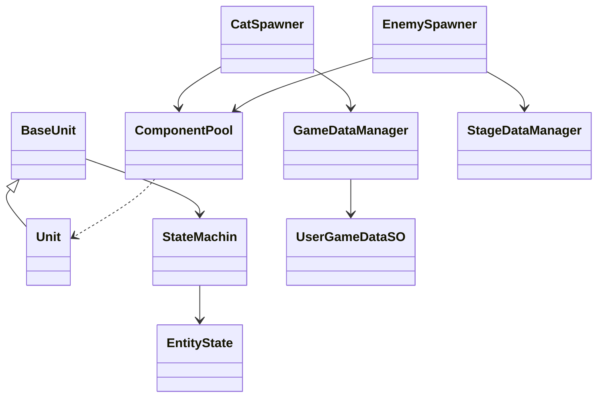

# 냥코 디펜스 — 원본과 지금의 나

> 개인 학습용 모작이며, 그림·사운드는 원작(냥코 대전쟁)의 것입니다.
> 처음 만든 디펜스 게임이라 아쉬운 코드가 많습니다. 이 문서는 **원본을 그대로 남기고**, 그 뒤 다른 프로젝트를 거치며 배운 것으로 **지금 다시 고친 코드**를 나란히 보여 줍니다.


## 1. 개요

### 무엇을 만들었나

스테이지마다 정해진 적이 정해진 방식으로 소환되는 디펜스 게임입니다.

냥코 대전쟁의 실시간 소환 디펜스 구조를 기반으로 제작했으며, 조작 가능한 플레이어블 요소 한 가지를 추가해 보았습니다. 플레이어는 스테이지에서 아군을 소환해 스폰되는 적을 막고, 필요한 경우 플레이어블 냥코를 직접 조작해 전투에 개입합니다. 적 기지를 파괴하면 스테이지가 클리어되며, 획득한 경험치로 신규 캐릭터가 해금되고 보유 전투 요소를 레벨업·편성해 다음 스테이지에 대비합니다.

### 왜 만들었나

<!-- ✍ Claude 초안: 재료집 답("적 데이터들을 정의하고 언제 어떻게 스폰하는지에 대한 구조")을 문장으로 이었습니다 -->
정립된 디펜스 장르의 설계를 배워 보려고 만든 학습용 프로젝트입니다. 특히 **적 데이터를 어떻게 정의하고, 그 적을 언제·어떻게 스폰하는지**의 구조를 직접 만들어 보는 것이 목표였습니다.

### 개발 환경

| 항목 | 내용 |
|---|---|
| 장르 | 2D 횡스크롤 소환 디펜스 |
| 기간 | 본 개발 2026.06.24 ~ 2026.07.04 (11일) · 보완 2026.07.05 ~ 2026.07.21 · 회고 수정 2026.11 |
| 인원 | 1인 개발 (기획 · 구현 전체) |
| 엔진 | Unity 6000.3.15f1 |
| 주요 패키지 | URP 17.3.0 · Input System 1.19.0 · 2D Animation 13.0.4 |
| 외부 에셋 | DOTween — 유닛의 이동·경직·튕겨나감·죽음 애니메이션 |
| 글꼴 | Pretendard (Kil Hyung-jin, SIL Open Font License 1.1) |
| 그림·사운드 | 원작(냥코 대전쟁)의 것 — 개인 학습용 |
| GitHub | https://github.com/KooHoo-Dev/3rd-2D-Project-krr6606 (원본 태그 `v1.0-project-end` · 회고 브랜치 `retrospective-fixes`) |
| 시연 영상 | 준비 중 |

### 원작과 다른 점 · 핵심 루프 · 조작법

- **원작과 다른 점**: 조작 가능한 플레이어블 냥코 한 명을 더했습니다.
- **핵심 루프**: 아군 소환 → 적 저지 → 적 기지 파괴(클리어) → 경험치 획득 → 신규 캐릭터 해금 · 레벨업 · 편성 → 다음 스테이지
<!-- ✍ Claude 초안: 조작 키는 코드(HeroIdle.cs·HeroMove.cs·HeroAttack.cs)에서 읽었습니다 -->
- **조작법**: 플레이어블 냥코는 `A`·`D`(또는 `←`·`→`)로 이동, `Z`로 공격합니다. 아군 소환은 화면 아래 슬롯을 클릭합니다.

### 이 문서에서 다루는 것

<!-- ✍ Claude 초안: 강사님 포인트("원본과 비교, 성장 가능성 강조")에 맞춰 다시 정했습니다 -->
1. **시스템 구조** — 데이터를 두 매니저로 나눈 구조와 유닛·스폰 클래스
2. **핵심 기능 2가지** — AI 자동 공격 · 캐릭터 편성 (원본 그대로)
3. **원본과 지금의 나** — 원본에서 아쉬운 3곳을 지금 다시 고친 전후 코드
4. **결과와 배운 점** — 당시의 문제 해결, 그리고 이 프로젝트 이후 무엇이 달라졌는지


## 2. 시스템 구조

### 클래스 구조

<!-- ✍ Claude 초안: 아래 한 줄 설명 -->
유닛이 상태 머신으로 움직이는 부분(왼쪽)과, 두 스포너가 같은 오브젝트 풀을 쓰고 데이터는 두 매니저에서만 받아 오는 부분(오른쪽)을 보면 됩니다.



<!-- ✍ Claude 초안: 재료집 답의 순서대로 클래스에 맞췄습니다 -->
| 클래스 | 맡은 일 |
|---|---|
| `BaseUnit` | 모든 유닛이 공유하는 이동·공격·피격 구조 |
| `Unit` (`Hero`) | 유닛마다 다른 수치나 방식의 이동·공격 디테일 |
| `StateMachin` | 현재 상태를 실제로 전환 (`Exit` → `Enter`) |
| `EntityState` | 모든 상태(Idle·Walk·Attack·HitBack·Die)가 공유하는 기본 구조 |
| `CatSpawner` · `EnemySpawner` | 아군 · 적 유닛의 실제 스폰 (적은 웨이브 진행) |
| `ComponentPool` | 각 오브젝트의 풀링 — 두 스포너가 함께 사용 |
| `StageDataManager` | 미리 정의된 스테이지·스폰 데이터의 관리와 중계 |
| `GameDataManager` | 현재 플레이어의 주요 데이터(해금·레벨·편성) 중계와 관리 |
| `UserGameDataSO` | 실제로 저장되어 있는 플레이어의 주요 데이터 |

### 왜 이렇게 나눴나

'플레이어에 의해 바뀔 수 있는 데이터를 관리하는 매니저'(`GameDataManager`)와 '개발자가 미리 정해 놓은, 바뀌지 않는 데이터를 관리하는 매니저'(`StageDataManager`)를 따로 정의하고, 각 데이터가 그에 맞는 흐름으로 이동하기를 바랐습니다. 데이터가 오가는 길이 너무 여러 갈래로 나뉘면 일관성이 깨지거나 참조가 꼬일 수 있어서, 다른 시스템은 **이 두 매니저만 거쳐서** 데이터에 접근하도록 했습니다.


## 3. 핵심 기능

### 3.1 AI 자동 공격 — 사거리 판정부터 애니메이션 이벤트 타격까지

**사용법**: `Attack()`을 호출하면 각 유닛의 수치와 방식(단일 대상 / 범위)에 맞는 공격이 나갑니다. 직접 부르지 않고, 공격 애니메이션의 이벤트가 부릅니다.

**① 사거리 판정 → 공격 상태로** (`Idle.cs`)

```csharp
    public override void Update()
    {
        base.Update();
        stateTimer -= Time.deltaTime;
        // (문서에서 읽기 쉽게 인자마다 줄을 나눴습니다)
        RaycastHit2D hit = Physics2D.Raycast(entity.transform.position,
            Vector2.right * (entity.useData.isCat ? -1f : 1f),
            entity.useData.Range * entity.multiplier, entity.TargetLayer);
        if(hit.collider == null )
        {
            stateMachine.ChangeState(entity.WalkState);
            return;
        }
        else if( hit.collider != null && stateTimer <= 0 )
        {
            stateMachine.ChangeState(entity.AttackState);
        }
        else if (stateTimer <= 0)
        {
            stateMachine.ChangeState(entity.WalkState);
        }
    }
```

**② 애니메이션 이벤트가 판정을 부름** (`OnAnimetionTrigger.cs` → `BaseUnit.cs`)

```csharp
    public void OnAttackTrigger()
    {
        entity.OnHit();
        entity.OnEndAttack();
    }

    protected virtual void Attack()
    {

        float dir = useData.isCat ? -1f : 1f;
        if (useData.IsOneTarget)
        {
            RaycastHit2D hit = Physics2D.Raycast(transform.position + Vector3.right * dir * (useData.AttackRangeStart * multiplier), Vector2.right * dir, useData.AttackRangeEnd * multiplier, TargetLayer);
            if (hit.collider == null) return;
            IDamagable damagable = hit.collider.GetComponent<IDamagable>();
            if (damagable == null) return;
            damagable.TakeDamage(useData.DefaultDamage, ElementalType.normal, transform);
        }
        else
        {
            RaycastHit2D[] hitList = Physics2D.RaycastAll(transform.position + Vector3.right * dir * (useData.AttackRangeStart * multiplier), Vector2.right * dir, useData.AttackRangeEnd * multiplier, TargetLayer);
            if (hitList.Length == 0) return;
            foreach (RaycastHit2D hit in hitList)
            {
                IDamagable damagable = hit.collider.GetComponent<IDamagable>();
                if (damagable == null) continue;
                damagable.TakeDamage(useData.DefaultDamage, ElementalType.normal, transform);
            }
        }
        animatorHit.gameObject.SetActive(true);
    }
```

**동작 원리**: 적이 사거리에 들어오고 대기 시간(`stateTimer`)이 끝나면 Idle이 Attack 상태로 전환됩니다. 사거리 안에 적이 없으면 바로 Walk로 돌아갑니다. 실제 데미지는 Update가 아니라, 공격 애니메이션 클립에 심어 둔 애니메이션 이벤트가 `OnAttackTrigger()`를 호출하는 시점에 들어갑니다.

판정 시점을 코드가 아닌 애니메이션에 맡긴 이유는, 타격 프레임과 실제 판정 프레임이 어긋나지 않게 맞추기 위해서입니다.

### 3.2 캐릭터 편성 — 드래그 앤 드롭과 임시 커서 슬롯

**사용법**: `OnPointerDown`·`OnDrag`·`OnPointerUp`은 Unity의 이벤트 인터페이스라서, 입력이 들어오면 Unity가 알아서 호출합니다.


```csharp
        public void OnPointerDown(PointerEventData eventData)
        {

            startSlot = GetSlotOrNull(eventData);

            if (startSlot == null) return;  //검색된 슬롯이 없거나
            if (startSlot.catName == CatName.None) return;   //검색된 슬롯이 빈 슬롯인 경우
            if(InvenManager.Instance.GetInventoryOrNull(startSlot).invenType == InvenType.PickInven)
            {
                cursorSlot.gameObject.SetActive(true);
                cursorSlot.SetNormalSlotData(startSlot.catName);

            }
            else if(InvenManager.Instance.GetInventoryOrNull(startSlot).invenType == InvenType.ResultInven)
            {
                cursorSlot.gameObject.SetActive(true);
                cursorSlot.SetResultSlotData(startSlot.catName);
                startSlot.SetResultSlotData(CatName.None);

                GameDataManager.Instance.userGameDataSO.CatSlotArray[startSlot.ResultSlotIndex] = CatName.None;
            }
            scroll.enabled = false;
            cursorSlot.SetPosition(eventData.position);
        }
```

<!-- ✍ Claude 초안: 코드에 맞게 고쳐 쓴 설명입니다 -->
**동작 원리**: 드래그를 시작하면 원본 슬롯의 고양이를 복제해 '커서 슬롯'이라는 임시 슬롯 하나를 켜고, 이후로는 이 임시 슬롯만 마우스를 따라다니게 합니다. 실제 편성 데이터(`CatSlotArray`)는 손을 뗀 시점(`OnPointerUp`)에 놓인 위치에 따라 반영됩니다. 편성 슬롯에서 시작하면 그 슬롯을 먼저 비우고, 놓칠 곳에 놓으면 원래 슬롯에 되돌려서 원래 편성이 흐트러지지 않습니다.

## 4. 원본과 지금의 나

<!-- ✍ Claude 초안: 이 장은 재료집 답("지금 다시 만든다면", "아쉬운 점")을 실제 코드로 옮긴 것입니다. 원본은 태그 v1.0-project-end, 고친 코드는 retrospective-fixes 브랜치에 한 건에 커밋 하나씩 있습니다. Unity에서 열어 컴파일·플레이를 직접 확인해 주세요 -->
당시에는 다른 방법을 따로 비교하지 않았고, 기한 안에 끝내기 위해 가장 쉬운 방안을 골랐습니다. 그 뒤 서버 프로젝트에서 **설정 파일과 데이터 표(TSV)로 게임 데이터를 관리**해 보면서, 이 프로젝트에서 무엇이 아쉬웠는지 보이기 시작했습니다. 원본은 태그 `v1.0-project-end`로 그대로 두고, 아쉬운 세 곳을 `retrospective-fixes` 브랜치에서 다시 고쳤습니다.

| # | 원본의 문제 | 당시의 나 | 지금의 나 | 커밋 |
|---|---|---|---|---|
| 1 | 골드 버퍼가 정확히 1일 때 반영되지 않음 | "1이 넘으면"으로 조건을 씀 | 경계값은 "같을 때"까지 확인해야 함 | `fa24a39` |
| 2 | 고양이 데이터를 enum 값을 배열 인덱스로 찾음 | enum과 배열 순서를 맞춰 두면 된다고 생각 | 순서가 바뀌거나 하나 빠지면 엉뚱한 데이터가 나옴 → 데이터가 스스로 자기 키를 가짐 | `8bfcd39` |
| 3 | 스폰 데이터가 스테이지 SO의 인스펙터에 흩어져 있음 | 스테이지마다 SO를 만들어 인스펙터에서 입력 | 웨이브를 한 장의 데이터 표로 모으고 코드가 읽음 | `6c67196` |

### 4.1 골드 버퍼 — 경계값

**바꾸기 전** (`InGameEconomyManager.cs`)

```csharp
    public void IncreaseGold(float amount)
    {

        goldBuffer += amount;
        if(goldBuffer > 1)
        {
            int goldToAdd = Mathf.FloorToInt(goldBuffer);
            goldBuffer -= goldToAdd;
            gold += goldToAdd;
        }
```

**바꾼 뒤**

```csharp
        if(goldBuffer >= 1)
```

<!-- ✍ Claude 초안 -->
골드는 매 프레임 소수 단위로 버퍼에 쌓였다가 정수만큼 떼어 반영됩니다. 조건이 `> 1`이면 버퍼가 딱 1.0일 때 그 프레임에는 반영되지 않습니다. 작은 차이지만, **경계값을 어떻게 다룰지**를 코드에 정확히 쓰는 습관을 서버 프로젝트의 회고(입장 인원 "최대 + 1", 방 개수 상한)에서 배웠습니다.

### 4.2 데이터 조회 — enum 인덱스에서 데이터가 가진 키로

**바꾸기 전** — enum 값을 그대로 배열 인덱스로 씀 (`GameDataManager.cs`, 같은 식이 다른 파일 4곳에도)

```csharp
    // CatName과 CatSO를 연결하는 배열, CatName을 인덱스로 사용하여 CatSO를 가져올 수 있음
    public EntitySO[] CatSOArray;

            for (int i = 0; i < userGameDataSO.UnLockList.Count; i++)
            {
                CatLevelDic.Add(userGameDataSO.UnLockList[i], CatSOArray[(int)userGameDataSO.UnLockList[i]].unitdata.Level);
            }
```

**바꾼 뒤** — 각 SO가 자기 `CatName`을 갖고, 찾을 때는 그 값으로

```csharp
// EntitySO.cs
public class EntitySO : ScriptableObject
{
    // 배열 순서가 아니라 이 값으로 고양이 데이터를 찾는다 (GameDataManager.GetCatSO)
    public CatName catName;
   public Unitdata unitdata;
    public Sprite SlotSprite;
}

// GameDataManager.cs
    // 각 SO에 적힌 CatName을 키로 묶는다 (배열 순서·enum 값에 묶이지 않게)
    private void BuildCatSODic()
    {
        catSODic = new Dictionary<CatName, EntitySO>();
        foreach (EntitySO so in CatSOArray)
        {
            if (so == null) continue;
            if (!catSODic.TryAdd(so.catName, so))
                Debug.LogWarning($"CatName {so.catName}이 두 SO에 들어 있습니다: {so.name}");
        }
    }
    public EntitySO GetCatSO(CatName catName)
    {
        if (catSODic == null) BuildCatSODic(); // 다른 스크립트의 Awake가 먼저 불러도 되게
        if (catSODic.TryGetValue(catName, out EntitySO so)) return so;
        Debug.LogWarning($"Cat SO for {catName} not found.");
        return null;
    }
```

<!-- ✍ Claude 초안 -->
`CatSOArray[(int)catName]`은 enum의 순서와 인스펙터 배열의 순서가 **반드시 같아야** 동작합니다. 이제 배열 순서와 상관없이, 각 데이터에 적힌 키로 사전(`Dictionary`)에서 찾습니다. 같은 키가 두 번 들어 있거나 없는 키를 찾으면 경고를 남겨, 데이터 실수가 조용히 넘어가지 않게 했습니다.

### 4.3 스폰 데이터 — SO 인스펙터에서 데이터 표로

**바꾸기 전** — 스테이지마다 SO 하나, 웨이브는 인스펙터에서 한 칸씩 입력 (`_Stage.cs`, `EnemySpawner.cs`)

```csharp
    public List<StageWaveData> waves;

        stage = StageDataManager.Instance.GetStageData(currentStageName);

        waveList = stage.waves;
```

**바꾼 뒤** — 모든 스테이지의 웨이브를 표 한 장에 (`Resources/Data/StageWave.txt`, 일부)

```text
Stage	Order	EnemyName	MinSpawnInterval	IsRandomTime	MaxSpawnInterval	SpawnCount	MaxLoopCount	NextWaveIndex
Stage1	0	Dog	0	false	0	1	0	1
Stage1	1	Dog	20	false	0	1	0	2
Stage1	2	Dog	6	true	10	1	10000	3
Stage1	3	Dog	6	true	10	1	10000	2
```

```csharp
// StageWaveTable.cs — 표를 읽어 스테이지별로 묶음
    public static List<StageWaveData> GetWaves(StageName stageName)
    {
        if (wavesByStage == null) Load();
        return wavesByStage.TryGetValue(stageName, out List<StageWaveData> waves) ? waves : new List<StageWaveData>();
    }

// EnemySpawner.cs — 웨이브는 표에서
        waveList = StageDataManager.Instance.GetWaves(currentStageName);
```

<!-- ✍ Claude 초안: 재료집 답("dto, def, 데이터 테이블 구조로 뺀 다음 스테이지마다 필요한 데이터를 동적으로 읽어서")을 이번 수정에 맞춰 옮겼습니다 -->
서버 프로젝트에서 장르·키워드·아이템을 TSV 표로 두고 `DataManager`가 읽게 했던 구조를 그대로 가져왔습니다. 이제 웨이브를 고칠 때 스테이지 SO를 하나씩 열지 않고 표 한 장만 고치면 되고, 모든 스테이지의 스폰 흐름을 한눈에 비교할 수 있습니다. 표의 값은 원본 SO 4개의 웨이브 20개를 그대로 옮겨, 게임 동작은 바뀌지 않게 했습니다.

## 5. 결과와 배운 점

### 결과

어떤 기능이든 구현하는 방식은 여러 가지가 있다는 것과, 구현한다면 어떤 패턴과 구조가 맞는지 배울 수 있었습니다.

ScriptableObject 데이터를 다루면서, 게임에 어떤 외부 데이터(레벨 · 이름 · 스폰 정보 · 설명 등)가 필요한지, 설계한 구조에 맞으려면 데이터가 어떤 형태여야 하는지 스스로 판단할 수 있게 됐습니다. 당시에도 레벨 데이터의 `switch`를 걷어 내고 enum 인덱스 목록으로 바꾸는 리팩토링을 했습니다(`0b8c761`).

### 문제 해결 1 — 풀에서 다시 꺼낸 유닛이 공격받지 않음

<!-- ✍ Claude 초안: 커밋 cf5adde(2026-07-04)의 코드 변경에서 읽은 것입니다 -->
- **문제**: 오브젝트 풀에서 다시 꺼내 쓴 유닛의 콜라이더가 꺼진 채로 나왔습니다.
- **원인**: 유닛이 죽을 때 `Die` 상태에서 콜라이더를 끄는데, 풀은 오브젝트를 비활성화했다가 다시 켜서 쓰기 때문에 꺼 둔 콜라이더가 그대로 남아 있었습니다.
- **해결**: 유닛이 다시 켜질 때(`OnEnable`) 상태·체력과 함께 콜라이더를 켜도록 했습니다.

```csharp
    private void OnEnable()
    {
        stateMachine.Initialize(WalkState);
        CurrentHealth = useData.DefaultHealth;
        collider2d.enabled = true;
    }
```

- **배운 점**: 풀링을 쓰면 "죽을 때 바꾼 값"을 "다시 꺼낼 때" 되돌려야 합니다.

### 문제 해결 2 — 씬마다 빠지는 인스펙터 할당

<!-- ✍ Claude 초안: 커밋 e59a483(07-07)·c7f3374(07-08)의 변경에서 읽은 것입니다 -->
- **문제**: 스테이지 씬마다 버튼·스포너에 연결해야 할 참조가 빠져 있었습니다.
- **원인**: 스테이지마다 같은 연결을 인스펙터에서 손으로 반복해야 하는 구조였습니다.
- **해결**: 아군 풀의 부모를 인스펙터 대신 코드에서 직접 찾아 연결했습니다(`c7f3374`).

```csharp
    void Awake()
    {
       PoolParnt = GameObject.Find("CatUnitPool").GetComponent<Transform>();
    }
```

- **남은 점**: `GameObject.Find`는 이름 문자열에 기대므로, 오브젝트 이름이 바뀌면 다시 깨집니다. 4.3에서 데이터를 표로 옮긴 것도 "인스펙터에 손으로 넣는 것을 줄인다"는 같은 방향입니다.

### 이 프로젝트 이후 달라진 것

<!-- ✍ Claude 초안: 세 프로젝트의 흐름으로 정리했습니다 -->
| | 냥코 디펜스 (원본) | 이후 프로젝트에서 | 이 프로젝트에 다시 적용 |
|---|---|---|---|
| 데이터 | SO 인스펙터에 흩어짐 | 서버: 설정 파일 + TSV 표 + `DataManager` | 웨이브를 표 한 장으로 (4.3) |
| 조회 | enum 값 = 배열 인덱스 | 서버: ID로 표에서 찾기 | 데이터가 가진 키로 찾기 (4.2) |
| 경계값 | "넘으면"만 확인 | 서버 회고: "최대 + 1"까지 테스트 | `>=`로 (4.1) |

### 아직 남은 것

<!-- ✍ Claude 초안: 회고 브랜치에서 일부러 고치지 않은 곳을 코드에서 찾아 적었습니다 -->
- **프리펩 목록**(`GetCatPrefab`)과 **레벨 데이터**(`levelDataList[(int)levelName]`)는 아직 enum 순서에 기대고 있습니다. 4.2와 같은 방식으로 바꿀 수 있습니다.
- `GameDataLevelDic`은 시작할 때 한 번 복사한 값이라, 게임 중 레벨이 오르면 실제 값과 달라집니다. 값을 한 곳에서만 갖도록 정리해야 합니다.
- 고양이별 설명 텍스트가 코드에 하드코딩되어 있습니다. 웨이브처럼 표로 옮기면 수정이 쉬워집니다.
- 기획적으로는 플레이어블 요소가 더 돋보일 장치(스킬, 타워를 직접 공격하지 못하게 하기 등)를 넣어 보고 싶습니다.
