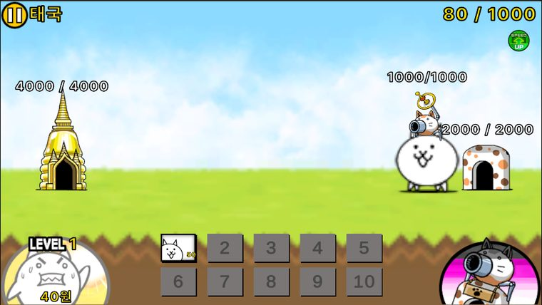
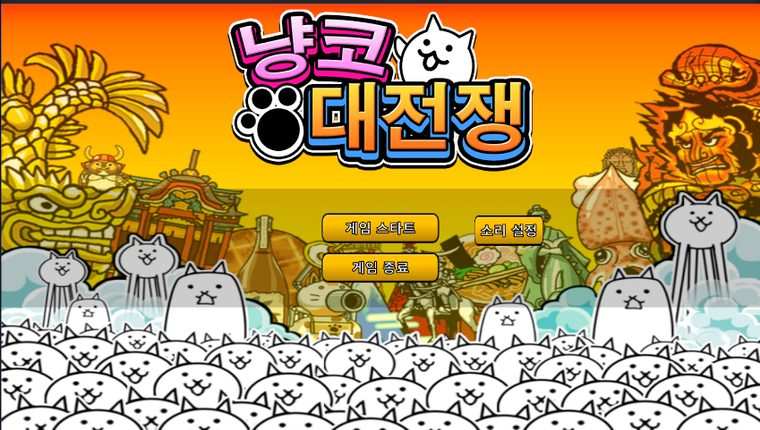
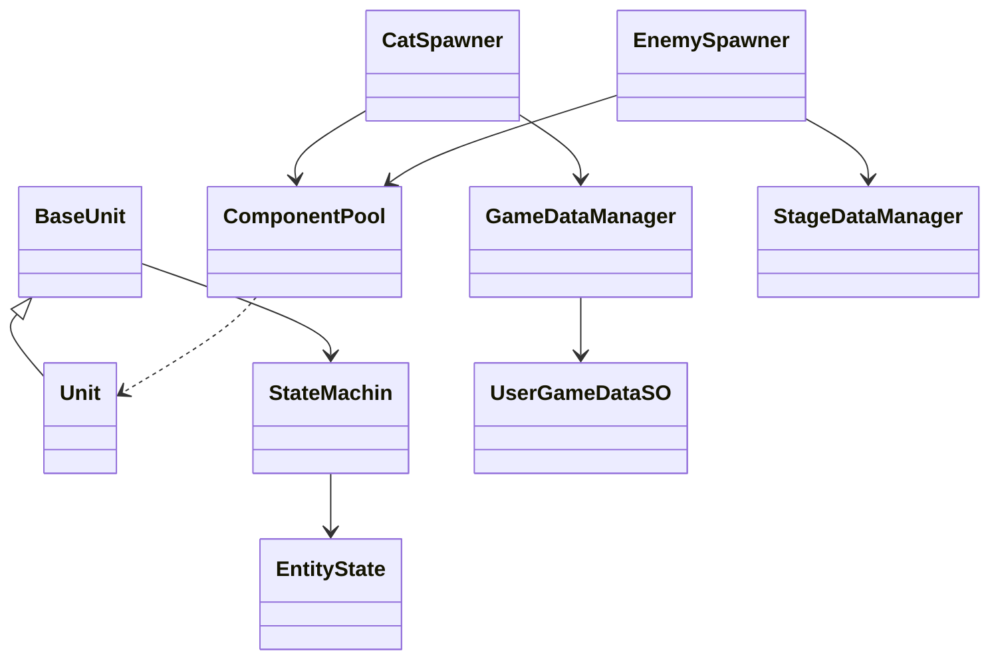
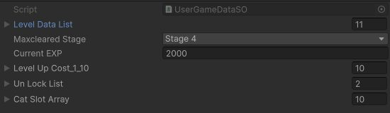
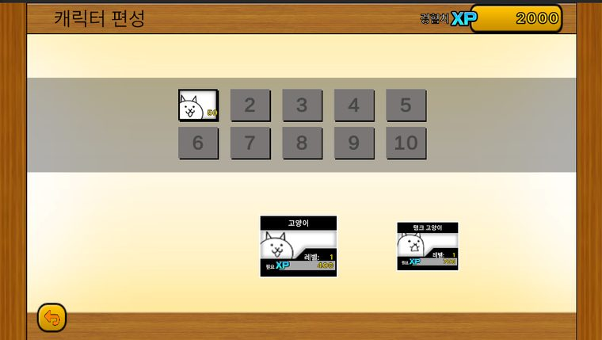
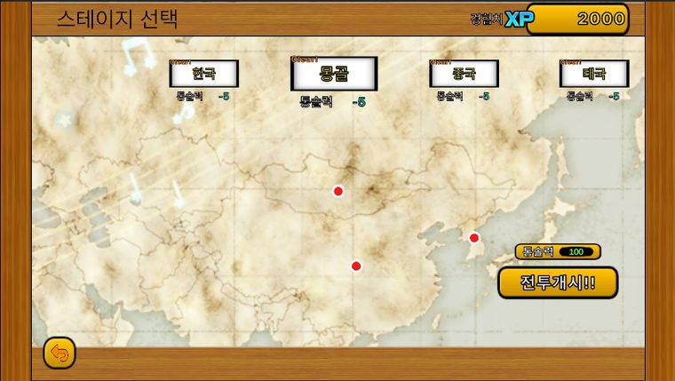
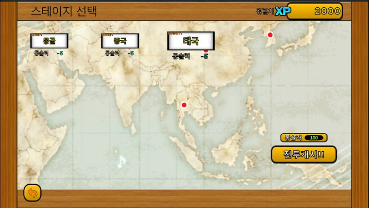

# 냥코 디펜스 — 2D 횡스크롤 소환 디펜스

> 개인 학습용 모작이며, 그림·사운드는 원작(냥코 대전쟁)의 것입니다.



## 1. 개요

### 무엇을 만들었나

스테이지마다 정해진 적이 정해진 방식으로 소환되는 디펜스 게임입니다.

냥코 대전쟁의 실시간 소환 디펜스 구조를 기반으로 제작했으며, 조작 가능한 플레이어블 요소 한 가지를 추가해 보았습니다. 플레이어는 스테이지에서 아군을 소환해 스폰되는 적을 막고, 필요한 경우 플레이어블 냥코를 직접 조작해 전투에 개입합니다. 적 기지를 파괴하면 스테이지가 클리어되며, 획득한 경험치로 신규 캐릭터가 해금되고 보유 전투 요소를 레벨업·편성해 다음 스테이지에 대비합니다.

### 왜 만들었나

<!-- ✍ Claude 초안: 재료집 답("적 데이터들을 정의하고 언제 어떻게 스폰하는지에 대한 구조")을 문장으로 이었습니다. 직접 고쳐 쓰세요 -->
정립된 디펜스 장르의 설계를 배워 보려고 만든 학습용 프로젝트입니다. 특히 **적 데이터를 어떻게 정의하고, 그 적을 언제·어떻게 스폰하는지**의 구조와, 아군 유닛을 성장시키는 로직을 직접 만들어 보는 것이 목표였습니다.

### 개발 환경

| 항목 | 내용 |
|---|---|
| 장르 | 2D 횡스크롤 소환 디펜스 |
| 기간 | 본 개발 2026.06.24 ~ 2026.07.04 (11일) · 보완 2026.07.05 ~ 2026.07.21 |
| 인원 | 1인 개발 (기획 · 구현 전체) |
| 엔진 | Unity 6000.3.15f1 |
| 주요 패키지 | URP 17.3.0 · Input System 1.19.0 · 2D Animation 13.0.4 |
| 외부 에셋 | DOTween — 유닛의 이동·경직·튕겨나감·죽음 애니메이션 |
| 글꼴 | Pretendard (Kil Hyung-jin, SIL Open Font License 1.1) |
| 그림·사운드 | 원작(냥코 대전쟁)의 것 — 개인 학습용 |
| GitHub | https://github.com/KooHoo-Dev/3rd-2D-Project-krr6606 |
| 시연 영상 | 준비 중 |

### 원작과 다른 점 · 핵심 루프 · 조작법

- **원작과 다른 점**: 조작 가능한 플레이어블 냥코 한 명을 더했습니다.
- **핵심 루프**: 아군 소환 → 적 저지 → 적 기지 파괴(클리어) → 경험치 획득 → 신규 캐릭터 해금 · 레벨업 · 편성 → 다음 스테이지
<!-- ✍ Claude 초안: 조작 키는 코드(HeroIdle.cs·HeroMove.cs·HeroAttack.cs)에서 읽었습니다. 스킬 발동 방법은 직접 채우세요 -->
- **조작법**: 플레이어블 냥코는 `A`·`D`(또는 `←`·`→`)로 이동, `Z`로 공격합니다. 아군 소환은 화면 아래 슬롯을 클릭합니다.

### 이 문서에서 다루는 것

<!-- ✍ Claude 초안: 재료집 답("추천하는 범위")에 따라 정했습니다 -->
1. **시스템 구조** — 데이터를 두 매니저로 나눈 구조와 유닛·스폰 클래스
2. **핵심 기능 4가지** — AI 자동 공격 · 인게임 머니 · 캐릭터 편성 · 스테이지 선택
3. **고민과 선택** — 플레이어블 이동 범위 · 프리펩 할당 방식 · 데이터 조회 방식
4. **결과와 회고** — 버그 해결 사례와, 지금 다시 본 아쉬운 점



## 2. 시스템 구조

### 클래스 구조

<!-- ✍ Claude 초안: 아래 한 줄 설명 -->
유닛이 상태 머신으로 움직이는 부분(왼쪽)과, 두 스포너가 같은 오브젝트 풀을 쓰고 데이터는 두 매니저에서만 받아 오는 부분(오른쪽)을 보면 됩니다.



<!-- ✍ Claude 초안: 재료집 답의 순서대로 클래스에 맞췄고, EntityState·GameDataManager 줄은 코드에 맞게 고쳤습니다 -->
| 클래스 | 맡은 일 |
|---|---|
| `BaseUnit` | 모든 유닛이 공유하는 이동·공격·피격 구조 |
| `Unit` (`Hero`) | 유닛마다 다른 수치나 방식의 이동·공격 디테일 |
| `StateMachin` | 현재 상태를 실제로 전환 (`Exit` → `Enter`) |
| `EntityState` | 모든 상태(Idle·Walk·Attack·HitBack·Die)가 공유하는 기본 구조 — `Enter`·`Update`·`Exit`, 상태 타이머, 애니메이션 전환 |
| `CatSpawner` | 아군 유닛의 실제 스폰 |
| `EnemySpawner` | 적 유닛의 실제 스폰 (웨이브 진행) |
| `ComponentPool` | 각 오브젝트의 풀링 — 두 스포너가 함께 사용 |
| `StageDataManager` | 미리 정의된 스테이지·스폰 데이터의 관리와 중계 |
| `GameDataManager` | 현재 플레이어의 주요 데이터(해금·레벨·편성) 중계와 관리, 유닛 데이터(`EntitySO`)·프리펩 목록 보관 |
| `UserGameDataSO` | 실제로 저장되어 있는 플레이어의 주요 데이터 |

### 왜 이렇게 나눴나

'플레이어에 의해 바뀔 수 있는 데이터를 관리하는 매니저'(`GameDataManager`)와 '개발자가 미리 정해 놓은, 바뀌지 않는 데이터를 관리하는 매니저'(`StageDataManager`)를 따로 정의하고, 각 데이터가 그에 맞는 흐름으로 이동하기를 바랐습니다. 데이터가 오가는 길이 너무 여러 갈래로 나뉘면 일관성이 깨지거나 참조가 꼬일 수 있어서, 다른 시스템은 **이 두 매니저만 거쳐서** 데이터에 접근하도록 했습니다.



### 전체 흐름

| 층 | 클래스 | 하는 일 |
|---|---|---|
| 데이터 | `GameDataManager` · `StageDataManager` · `UserGameDataSO` · `EntitySO`/`Unitdata` | 유닛 스탯, 스테이지 웨이브, 유저 저장 데이터를 각각 소유·캐싱 |
| 스테이지 진행 · UI | `StageManager` · `Tower` · `StageMapControll` · `SceneChangeButton` | 현재 스테이지 데이터를 들고 승패를 판정, 씬 전환과 진행도 표시 |
| 경제 · 인벤토리 | `InGameEconomyManager` · `SlotData` · `InventoryInput` | 골드 획득·소비, 드래그로 편성 슬롯 조작 |
| 스폰 | `EnemySpawner` · `CatSpawner` · `CatSpawnSlot` | 웨이브 타이머와 UI 클릭을 입구로 받지만, 이후에는 같은 오브젝트 풀 구조로 유닛을 생성 |
| 유닛 전투 | `BaseUnit` → `Unit`/`Hero` · 상태 5개 | 상태 머신으로 이동·공격·피격·사망을 전환하고, 애니메이션 이벤트로 실제 판정 시점을 맞춤 |

## 3. 핵심 기능

### 3.1 AI 자동 공격 — 사거리 판정부터 애니메이션 이벤트 타격까지

**사용법**: `Attack()`을 호출하면 각 유닛의 수치와 방식(단일 대상 / 범위)에 맞는 공격이 나갑니다. 직접 부르지 않고, 공격 애니메이션의 이벤트가 부릅니다.


**① 사거리 판정 → 공격 상태로** (`Idle.cs`)

```csharp
    public override void Update()
    {
        base.Update();
        stateTimer -= Time.deltaTime;
        RaycastHit2D hit = Physics2D.Raycast(entity.transform.position, Vector2.right * (entity.useData.isCat ? -1f : 1f), entity.useData.Range * entity.multiplier, entity.TargetLayer);
        if(hit.collider == null )
        {
            stateMachine.ChangeState(entity.WalkState);
            return;
        }
        else if( hit.collider != null && stateTimer <= 0 )
        {
            stateMachine.ChangeState(entity.AttackState);
        }
        else if (stateTimer <= 0)
        {
            stateMachine.ChangeState(entity.WalkState);
        }
    }
```

**② 애니메이션 이벤트가 판정을 부름** (`OnAnimetionTrigger.cs` → `BaseUnit.cs`)

```csharp
    public void OnAttackTrigger()
    {
        entity.OnHit();
        entity.OnEndAttack();
    }

    protected virtual void Attack()
    {

        float dir = useData.isCat ? -1f : 1f;
        if (useData.IsOneTarget)
        {
            RaycastHit2D hit = Physics2D.Raycast(transform.position + Vector3.right * dir * (useData.AttackRangeStart * multiplier), Vector2.right * dir, useData.AttackRangeEnd * multiplier, TargetLayer);
            if (hit.collider == null) return;
            IDamagable damagable = hit.collider.GetComponent<IDamagable>();
            if (damagable == null) return;
            damagable.TakeDamage(useData.DefaultDamage, ElementalType.normal, transform);
        }
        else
        {
            RaycastHit2D[] hitList = Physics2D.RaycastAll(transform.position + Vector3.right * dir * (useData.AttackRangeStart * multiplier), Vector2.right * dir, useData.AttackRangeEnd * multiplier, TargetLayer);
            if (hitList.Length == 0) return;
            foreach (RaycastHit2D hit in hitList)
            {
                IDamagable damagable = hit.collider.GetComponent<IDamagable>();
                if (damagable == null) continue;
                damagable.TakeDamage(useData.DefaultDamage, ElementalType.normal, transform);
            }
        }
        animatorHit.gameObject.SetActive(true);
    }
```

**동작 원리**: 적이 사거리에 들어오고 대기 시간(`stateTimer`)이 끝나면 Idle이 Attack 상태로 전환됩니다. 사거리 안에 적이 없으면 바로 Walk로 돌아갑니다. 실제 데미지는 Update가 아니라, 공격 애니메이션 클립에 심어 둔 애니메이션 이벤트가 `OnAttackTrigger()`를 호출하는 시점에 들어갑니다.

판정 시점을 코드가 아닌 애니메이션에 맡긴 이유는, 타격 프레임과 실제 판정 프레임이 어긋나지 않게 맞추기 위해서입니다. 실제 판정이 먼저이고 애니메이션이 뒤따라오면 예측하기 어렵고, 타이밍을 자연스럽게 정확히 맞추기 어려울 것 같았습니다.

<!-- ✍ Claude 초안: 아래 한 줄은 코드에서 읽은 사실입니다 -->
**예외 처리**: 레이캐스트에 맞은 것이 없거나 `IDamagable`이 아니면 데미지를 주지 않고 넘어갑니다.

### 3.2 인게임 머니 — 초당 증가하는 골드를 정수로 반영

**사용법**: `IncreaseGold(amount)`를 호출하면 매개변수로 들어간 증가량만큼 골드가 늘어납니다. `Update`가 매 프레임 `초당 골드 × Time.deltaTime`을 넣어 부릅니다.

```csharp
    private void Update()
    {
        IncreaseGold(goldPerSec * Time.deltaTime * GameDataManager.Instance.userGameDataSO.levelDataList[(int)GameLevelDataName.goldPerSecLevel].level + ((maxEconomyLevel - 1) * DefaultIncreaseAmountGoldPerSec * Time.deltaTime ));
        UpdateGoldUI();
    }

    public void IncreaseGold(float amount)
    {

        goldBuffer += amount;
        if(goldBuffer > 1)
        {
            int goldToAdd = Mathf.FloorToInt(goldBuffer);
            goldBuffer -= goldToAdd;
            gold += goldToAdd;
        }

        if (gold > MaxGold)
        {
            gold = MaxGold;
        }

    }
```

**동작 원리**: 골드는 초당 `goldPerSec`만큼 계속 들어오는데, 매 프레임 `Time.deltaTime`만큼 아주 작은 소수 단위로 쌓입니다. 이 값을 그대로 정수 골드에 더하면 반올림 오차가 프레임마다 누적되므로, `goldBuffer`에 소수분을 모아 뒀다가 1이 넘는 순간에만 정수로 떼어 `gold`에 반영합니다. 최대치(`MaxGold`)도 매 호출마다 확인해 상한을 넘지 않게 막습니다.

> 다시 보니 `goldBuffer > 1`이라서, 버퍼가 정확히 1일 때는 버퍼에만 담기고 실제 골드는 오르지 않을 수 있습니다. `>=`로 고치는 것이 맞습니다 → 5. 회고

### 3.3 캐릭터 편성 — 드래그 앤 드롭과 임시 커서 슬롯

**사용법**: `OnPointerDown`·`OnDrag`·`OnPointerUp`은 Unity의 이벤트 인터페이스(`IPointerDownHandler`·`IDragHandler`·`IPointerUpHandler`)라서, 입력이 들어오면 Unity가 알아서 호출합니다.



```csharp
        public void OnPointerDown(PointerEventData eventData)
        {

            startSlot = GetSlotOrNull(eventData);

            if (startSlot == null) return;  //검색된 슬롯이 없거나
            if (startSlot.catName == CatName.None) return;   //검색된 슬롯이 빈 슬롯인 경우
            if(InvenManager.Instance.GetInventoryOrNull(startSlot).invenType == InvenType.PickInven)
            {
                cursorSlot.gameObject.SetActive(true);
                cursorSlot.SetNormalSlotData(startSlot.catName);

            }
            else if(InvenManager.Instance.GetInventoryOrNull(startSlot).invenType == InvenType.ResultInven)
            {
                cursorSlot.gameObject.SetActive(true);
                cursorSlot.SetResultSlotData(startSlot.catName);
                startSlot.SetResultSlotData(CatName.None);

                GameDataManager.Instance.userGameDataSO.CatSlotArray[startSlot.ResultSlotIndex] = CatName.None;
            }
            scroll.enabled = false;
            cursorSlot.SetPosition(eventData.position);
        }

        public void OnPointerUp(PointerEventData eventData)
        {
            // 3. 드래그가 종료되면 상황에 따라 알맞은 처리를 한다.
            //  3.1 종료된 위치의 Slot이 빈 Slot인 경우 : Cursor의 아이템을 Slot에 Set한다.
            //  3.2 종료된 위치의 Slot이 아이템이 존재하는 Slot인 경우 : Cursor의 아이템과 Slot의 아이템을 서로 교환한다.
            //  3.3 종료된 위치가 Slot이 아닌 경우 : Cursor의 아이템을 원래 Slot에 Set한다.

            if (startSlot == null) return;
            if(cursorSlot.catName == CatName.None) {Debug.Log("드래그 종료: cursorSlot이 빈 슬롯입니다."); return;}
            endSlot = GetSlotOrNull(eventData);
            Swipe_Slot startInven = InvenManager.Instance.GetInventoryOrNull(startSlot);
            Swipe_Slot endInven = InvenManager.Instance.GetInventoryOrNull(endSlot);
            if (endSlot == null)
            {

                if(startInven.invenType == InvenType.ResultInven)
                {
                    startSlot.SetResultSlotData(cursorSlot.catName);
                    GameDataManager.Instance.userGameDataSO.CatSlotArray[startSlot.ResultSlotIndex] = cursorSlot.catName;

                }

                ResetCursor();
                return; //종료된 위치가 Slot이 아닌 경우
            }
            // … 편성 슬롯끼리 바꾸기 · 빈 슬롯에 넣기 분기 (103~142줄)
            ResetCursor();
        }
```

<!-- ✍ Claude 초안: 예전 문서의 "드래그 도중에는 원본 데이터를 건드리지 않는다"는 설명이 편성 슬롯(ResultInven)에서 시작할 때는 코드와 달라서, 코드에 맞게 고쳤습니다. 직접 확인하고 고쳐 쓰세요 -->
**동작 원리**: 드래그를 시작하면 원본 슬롯의 고양이를 복제해 '커서 슬롯'이라는 임시 슬롯 하나를 켜고, 이후로는 이 임시 슬롯만 마우스를 따라다니게 합니다. 실제 편성 데이터(`CatSlotArray`)는 손을 뗀 시점(`OnPointerUp`)에 놓인 위치에 따라 반영됩니다.

- **보유 캐릭터 목록에서 시작**하면 드래그하는 동안 원본을 건드리지 않습니다.
- **편성 슬롯에서 시작**하면 그 슬롯을 먼저 비웁니다(`CatName.None`). 슬롯이 아닌 곳에 놓거나 같은 캐릭터가 이미 있는 목록에 놓으면 원래 슬롯에 되돌리고, 다른 편성 슬롯 위에 놓으면 두 슬롯을 서로 바꿉니다. 그래서 놓치거나 취소돼도 원래 편성이 흐트러지지 않습니다.

**예외 처리**: 시작 슬롯이 없거나 빈 슬롯이면 드래그를 시작하지 않고, 커서 슬롯이 비어 있으면 놓아도 아무것도 바꾸지 않습니다.

### 3.4 스테이지 선택 — 클리어한 만큼만 열리고, 가장 가까운 스테이지로 스냅

**사용법**: Unity의 `Start`·`Update`에서 동작합니다. 씬에 `Swipe_Slot`과 `StageMapControll`을 두면 됩니다.



```csharp
// StageMapControll.cs
        int maxclearedStage = (int)GameDataManager.Instance.userGameDataSO.maxclearedStage;
        for (int i = 0; i < MapPoints.Length; i++)
        {
            if (i <= maxclearedStage)
            {
                MapPoints[i].SetActive(true);
            }
            else
            {
                MapPoints[i].SetActive(false);
            }
        }

// Swipe_Slot.cs
    private void Update()
    {
        if (invenType == InvenType.None||invenType == InvenType.ResultInven) return;
        if (Mouse.current.leftButton.isPressed)
        {
            isDragging = true;

        }
        else
        {

            // 드래그를 막 놓은 순간 → 가장 가까운 인덱스 1회 계산
            if (isDragging)
            {
                isDragging = false;
                SlotChangeSound();
                targetIndex = GetNearestIndex(scrollbar.value);
            }
            // 매 프레임 target 위치로 Lerp
            scrollbar.value = Mathf.Lerp(scrollbar.value, pos[targetIndex], 0.1f);
        }
        // … 선택된 칸 크기 키우기 (111~122줄)
    }

    int GetNearestIndex(float value)
    {
        int nearest = 0;
        float minDist = float.MaxValue;

        for (int i = 0; i < pos.Length; i++)
        {
            float dist = Mathf.Abs(value - pos[i]);
            if (dist < minDist)
            {
                minDist = dist;
                nearest = i;
            }
        }
        return nearest;
    }
```

**동작 원리**: 클리어한 스테이지 인덱스(`maxclearedStage`)까지만 지도 위 지점을 활성화해, 아직 깨지 않은 스테이지는 아예 보이지 않게 막습니다.

드래그를 놓은 순간에는 스크롤 값을 그대로 쓰지 않고 가장 가까운 스테이지 인덱스로 스냅시키는데, 어중간한 위치에서 손을 떼도 항상 스테이지 하나에 딱 맞춰 멈추게 하기 위해서입니다. 매 프레임 `Lerp`로 보간해 스냅되는 움직임도 자연스럽게 이어집니다. 이 기능은 파워업, 캐릭터 편성 창에도 들어가 있습니다.



## 4. 고민과 선택

<!-- ✍ Claude 초안: 이 장 머리말과 세 표는 재료집 답과 예전 문서의 문장을 표로 옮긴 것입니다 -->
세 가지 모두 당시에는 다른 방법을 따로 비교하지 않았고, 기한 안에 끝내기 위해 가장 쉬운 방안을 골랐습니다. 아래 표는 당시의 선택과, 지금 다시 본다면 어떻게 할지를 나란히 놓은 것입니다.

### 4.1 플레이어블 유닛의 이동 범위

**문제**: 플레이어블 냥코는 자유롭게 이동할 수 있어 적을 그대로 지나쳐 버릴 수 있습니다. 이 경우 적이 죽지 않은 채 맵 밖으로 빠져나가거나, 플레이어가 적 기지보다 뒤로 넘어가면 스테이지가 영영 끝나지 않는 상황이 생길 수 있었습니다.

| 방법 | 내용 | 남은 점 |
|---|---|---|
| 이동 범위 제한 | 플레이어블 냥코가 갈 수 있는 범위를 막음 | 선택하지 않음 |
| **아군 타워 (선택)** | 타워가 파괴되면 패배 — 이동과 무관하게 "적을 반드시 막아야 이긴다"는 조건을 타워 하나로 강제 | 플레이어블이 적 타워를 직접 공격할 수 있음 |
| 다음에 해 볼 것 | 플레이어블은 타워를 직접 공격하지 못하게 | — |

유닛의 이동을 제한하는 대신, 승패 조건 쪽에 안전장치를 둔 선택입니다.

### 4.2 프리펩 데이터 할당 방식

**문제**: 처음에는 스테이지마다 아군 스포너가 필요한 프리펩 데이터를 하나하나 직접 할당받는 구조였습니다. 스테이지와 아군 유닛 종류가 늘어날수록 수동으로 연결해야 할 작업도 함께 늘어났습니다.

| 방법 | 내용 | 남은 점 |
|---|---|---|
| 스테이지마다 수동 할당 (처음) | 스테이지 씬마다 인스펙터에서 프리펩을 연결 | 스테이지·유닛이 늘수록 작업이 늘어남 |
| **씬 단위로 `GameDataManager`에서 조회 (선택)** | 현재 씬에 필요한 프리펩을 `GameDataManager`에서 조회 (`GetCatPrefab`) | 씬에 당장 필요 없는 데이터까지 메모리에 올라감 |
| 다음에 해 볼 것 | 데이터를 DTO·Def·데이터 테이블 구조로 빼고, 스테이지마다 필요한 데이터만 테이블에서 동적으로 읽어 메모리에 올림 | — |

```csharp
    public GameObject GetCatPrefab(CatName catName)
    {
        int index = (int)catName - 1;
        if (index >= 0 && index < CatPrefabList.Count)
        {
            return CatPrefabList[index];
        }
        else
        {
            Debug.LogWarning($"Cat prefab for {catName} not found.");
            return null;
        }
    }
```

### 4.3 데이터 조회 방식 — switch에서 enum 인덱스로

**문제**: 게임 데이터의 여러 레벨 값을 각각 `int` 필드로 저장하고, 불러올 때는 enum 매개변수를 받아 `switch` 문으로 매칭했습니다. 새 데이터를 추가할 때마다 `switch` 코드도 함께 손봐야 해서, 데이터가 늘어날수록 이 매칭 코드가 계속 말썽이었습니다.

**개선**: enum 값과 리스트의 인덱스를 맞추고, 인스펙터에서 어떤 변수인지 바로 드러나도록 enum과 int를 묶은 데이터 클래스(`GameLevelData`)를 만들어 `List`에 순서대로 담았습니다. `switch` 매칭을 `(int)enum` 인덱스 매칭으로 바꾼 뒤로는, 코드를 건드리지 않고 데이터만 추가해도 함수 하나로 값을 불러올 수 있게 됐습니다.

<!-- ✍ Claude 초안: 표의 숫자와 코드는 커밋 0b8c761(2026-07-09)의 바뀌기 전후에서 옮겼습니다 -->
| | 바꾸기 전 (As-Is) | 바꾼 뒤 (To-Be) |
|---|---|---|
| 저장 | `UserGameDataSO`에 레벨 `int` 필드 10개 | `List<GameLevelData>` (enum + int) |
| 레벨 업 | `SlotData.UserDataLevelUp`의 `switch` — enum 10개마다 같은 `case` 반복 | `UserGameDataSO.LevelUp(levelName)` 한 줄 호출 |
| 값 읽기 | `GameDataManager.GetLevelData`의 `switch` | `levelDataList[(int)levelName]`, `Dictionary` 조회 |
| 데이터 추가 시 | enum · 필드 · `switch` 여러 곳을 함께 고침 | enum과 데이터만 추가 |

**바꾸기 전** (`SlotData.cs`, 커밋 0b8c761 이전)

```csharp
    public void UserDataLevelUp(GameLevelDataName levelName)
    {
        switch (levelName)
        {
            case GameLevelDataName.maxGoldLevel:
                if (gameDataManager.userGameDataSO.maxGoldLevel < gameDataManager.userGameDataSO.LevelUpCost_1_10.Length)
                {
                gameDataManager.userGameDataSO.maxGoldLevel++;
                }
                break;
            case GameLevelDataName.goldPerSecLevel:
                if (gameDataManager.userGameDataSO.goldPerSecLevel < gameDataManager.userGameDataSO.LevelUpCost_1_10.Length)
                {
                gameDataManager.userGameDataSO.goldPerSecLevel++;
                }
                break;
            // … 나머지 enum 8개도 같은 case 반복
        }
    }
```

**바꾼 뒤** (`UserGameDataSO.cs` · `SlotData.cs`)

```csharp
     [SerializeField] public List<GameLevelData> levelDataList;
    public void LevelUp(GameLevelDataName levelName)
    {
        GameLevelData levelData = levelDataList.Find(data => data.levelName == levelName);
        if (levelData == null) return;
        if(levelData.level >= LevelUpCost_1_10.Length) return;
        levelData.level++;


    }

    public void UserDataLevelUp(GameLevelDataName levelName)
    {
        gameDataManager.userGameDataSO.LevelUp(levelName);
        SetUserDataUI(levelName);


    }
```

<!-- ✍ Claude 초안: 아래 한 줄 -->
다만 이 방식은 enum의 순서와 리스트의 순서가 반드시 같아야 동작합니다. 이 한계는 5. 회고의 아쉬운 점으로 이어집니다.

## 5. 결과와 배운 점

### 결과

어떤 기능이든 구현하는 방식은 여러 가지가 있다는 것과, 구현한다면 어떤 패턴과 구조가 맞는지 배울 수 있었습니다.

ScriptableObject 데이터를 다루면서, 게임에 어떤 외부 데이터(레벨 · 이름 · 스폰 정보 · 설명 등)가 필요한지, 설계한 구조에 맞으려면 데이터가 어떤 형태여야 하는지(예: enum 매칭을 위해 class로 묶어 배열에 담는 구조) 스스로 판단할 수 있게 됐습니다. 이 과정에서 실제로 데이터 구조를 리팩토링해, switch문을 걷어 내고 enum 인덱스로 곧장 불러오는 방식으로 바꿀 수 있었습니다.

### 문제 해결 1 — 풀에서 다시 꺼낸 유닛이 공격받지 않음

<!-- ✍ Claude 초안: 이 절 전체는 커밋 cf5adde(2026-07-04)의 코드 변경에서 읽은 것입니다. 증상은 기억나는 대로 직접 확인하고 고쳐 쓰세요 -->
- **문제**: 오브젝트 풀에서 다시 꺼내 쓴(재활용한) 유닛의 콜라이더가 꺼진 채로 나왔습니다.
- **원인**: 유닛이 죽을 때 `Die` 상태에서 콜라이더를 끕니다(`Die.cs` `entity.collider2d.enabled = false`). 풀은 오브젝트를 파괴하지 않고 비활성화했다가 다시 켜서 쓰기 때문에, 꺼 둔 콜라이더가 그대로 남아 있었습니다.
- **해결**: 유닛이 다시 켜질 때(`OnEnable`) 콜라이더를 켜도록 했습니다. 지금은 `Unit.OnEnable`에서 상태·체력과 함께 초기화합니다.

```csharp
    private void OnEnable()
    {
        stateMachine.Initialize(WalkState);
        CurrentHealth = useData.DefaultHealth;
        collider2d.enabled = true;
    }
```

- **결과**: 재활용한 유닛도 처음 만든 유닛과 같은 상태로 전투에 나옵니다.
- **배운 점**: 풀링을 쓰면 "죽을 때 바꾼 값"을 "다시 꺼낼 때" 되돌려야 합니다. 초기화를 `OnEnable` 한곳에 모았습니다.

### 문제 해결 2 — 씬마다 빠지는 인스펙터 할당

<!-- ✍ Claude 초안: 이 절 전체는 커밋 e59a483(07-07)·c7f3374(07-08)의 변경에서 읽은 것입니다. 직접 확인하고 고쳐 쓰세요 -->
- **문제**: 스테이지 씬마다 버튼·스포너에 연결해야 할 참조가 빠져 있었습니다(커밋 e59a483 "할당 미스 버그 수정" — Stage02~04 · Start 씬과 일시정지 패널 수정).
- **원인**: 스테이지마다 같은 연결을 인스펙터에서 손으로 반복해야 하는 구조였습니다. 고쳐도 다른 씬에서 또 빠졌습니다.
- **해결**: 다음 날 아군 풀의 부모(`PoolParnt`)를 인스펙터 대신 코드에서 직접 찾아 연결했습니다(커밋 c7f3374 "할당 버그 진짜 수정").

```csharp
    void Awake()
    {
       PoolParnt = GameObject.Find("CatUnitPool").GetComponent<Transform>();
    }
```

- **결과**: 씬마다 손으로 연결하지 않아도 스포너가 풀 부모를 찾습니다.
- **남은 점**: `GameObject.Find`는 이름 문자열에 기대므로, 오브젝트 이름이 바뀌면 다시 깨집니다. 4.2의 수동 할당 문제와 같은 뿌리입니다.

### 완성 뒤 보완 (2026.07.05 ~ 07.21)

<!-- ✍ Claude 초안: 커밋 메시지를 표로 옮겼습니다 -->
| 날짜 | 커밋 | 한 일 |
|---|---|---|
| 07-05 | 41ad960 · a284c14 | 버그 수정, 사운드 매니저 구현, 사운드 조절 |
| 07-06 | 9a50425 | 유닛 버그 수정, 아군 타워 체력 추가, 쿨타임 업그레이드 추가 |
| 07-07 | fde4e80 · e59a483 | 타격 VFX 위치 조정, 할당 미스 수정 |
| 07-08 | c7f3374 · ed5f801 · e859344 | 풀 부모 할당 수정, 사운드 설정을 SO 데이터로 저장, 타이틀 화면 소리 설정 |
| 07-09 | 0b8c761 · 0f5d64c | 레벨 데이터 구조 리팩토링(4.3), 딕셔너리 버그 수정 |
| 07-16 | ec220e4 | DOTween 사용 |
| 07-21 | ee51453 · 6672c96 · c193c7f · 9ac6432 | 더미 코드 정리, 인스펙터 오류·일시정지 패널 버그 수정 |

### 회고 — 당시의 판단과 지금의 판단

<!-- ✍ Claude 초안: 재료집 답을 표로 옮겼습니다 -->
| 주제 | 당시 | 지금 |
|---|---|---|
| 골드 버퍼 | `goldBuffer > 1`일 때만 반영 | 버퍼가 정확히 1이면 골드가 오르지 않을 수 있음 → `>=`가 맞음 |
| 레벨 데이터 | `int` 필드 + `switch` → enum 인덱스 `List`로 리팩토링 | enum과 리스트 순서에 묶여 있음 → 순서와 상관없이 연동되는 방법을 찾고 싶음 |
| 프리펩 · 스폰 데이터 | 씬 단위로 `GameDataManager`에서 조회 | 인스펙터와 SO에 나뉜 데이터를 테이블로 빼고, 필요한 것만 동적으로 읽기 |

### 아쉬운 점과 개선 계획

- 스폰 데이터가 지금은 인스펙터와 SO 데이터로 나뉘어 있습니다. 유지보수성과 확장성이 좋은 스폰 데이터 구조로, 데이터의 흐름을 더 일관성 있게 하나로 묶고 싶습니다.
- enum과 배열 순서로 매칭하는 대신, 종속성이 덜하고 순서와 상관없이 데이터가 연동되는 방법을 찾아 적용해 보고 싶습니다.
- 고양이별 설명 텍스트 같은 데이터가 아직 코드에 하드코딩되어 있습니다. 각 고양이 데이터에 붙여서 불러오게 만들면 수정이 훨씬 쉬워질 것 같습니다.
- 기획적인 부분에서는 플레이어블 요소가 더 돋보일 수 있는 장치를 충분히 넣지 못한 점이 아쉽습니다. 플레이어블 캐릭터에 스킬을 추가하거나, 플레이어블은 타워를 직접 공격하지 못하게 하는 등의 개선을 시도해 볼 생각입니다.
