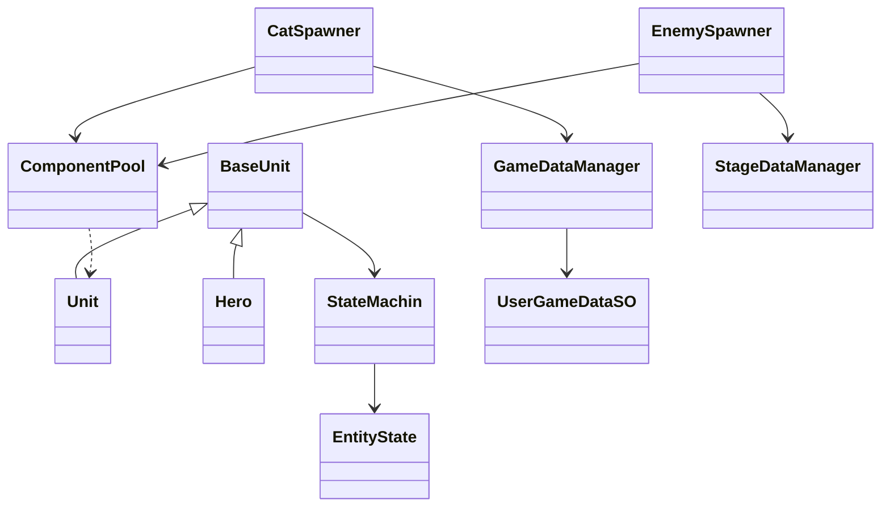

# 냥코 디펜스 — 2D 소환 디펜스

> 개인 학습용 모작이며, 그림·사운드는 원작(냥코 대전쟁)의 것입니다.
> 처음 만든 디펜스 게임입니다.


## 1. 개요

### 무엇을 만들었나

스테이지마다 정해진 적이 정해진 방식으로 소환되는 디펜스 게임입니다.

냥코 대전쟁의 실시간 소환 디펜스 구조를 기반으로 제작했으며, 조작 가능한 플레이어블 요소 한 가지를 추가해 보았습니다. 플레이어는 스테이지에서 아군을 소환해 스폰되는 적을 막고, 필요한 경우 플레이어블 냥코를 직접 조작해 전투에 개입합니다. 적 기지를 파괴하면 스테이지가 클리어되며, 획득한 경험치로 신규 캐릭터가 해금되고 보유 전투 요소를 레벨업·편성해 다음 스테이지에 대비합니다.

### 왜 만들었나


정립된 디펜스 장르의 설계를 배워 보려고 만든 학습용 프로젝트입니다. 특히 **적 데이터를 어떻게 정의하고, 그 적을 언제·어떻게 스폰하는지**의 구조를 직접 만들어 보는 것이 목표였습니다.

### 개발 환경

| 항목 | 내용 |
|---|---|
| 장르 | 2D 횡스크롤 소환 디펜스 |
| 기간 | 2026.06.24 ~ 2026.07.09 (16일) |
| 인원 | 1인 개발 (기획 · 구현 전체) |
| 엔진 | Unity 6000.3.15f1 |
| 주요 패키지 | URP 17.3.0 · Input System 1.19.0 · 2D Animation 13.0.4 |
| 외부 에셋 | DOTween — 유닛의 이동·경직·튕겨나감·죽음 애니메이션 |
| 글꼴 | Pretendard (Kil Hyung-jin, SIL Open Font License 1.1) |
| 그림·사운드 | 원작(냥코 대전쟁)의 것 — 개인 학습용 |
| GitHub | https://github.com/krr6606/3rd-2D-Project-krr6606 |
| 시연 영상 | 준비 중 |

### 원작과 다른 점 · 핵심 루프 · 조작법

- **원작과 다른 점**: 조작 가능한 플레이어블 냥코 한 명을 더했습니다.
- **핵심 루프**: 아군 소환 → 적 저지 → 적 기지 파괴(클리어) → 경험치 획득 → 신규 캐릭터 해금 · 레벨업 · 편성 → 다음 스테이지

- **조작법**: 플레이어블 냥코는 `A`·`D`(또는 `←`·`→`)로 이동, `Z`로 공격합니다. 아군 소환은 화면 아래 슬롯을 클릭하거나 숫자 키를 눌러 소환합니다.


## 2. 시스템 구조

### 클래스 구조

유닛은 상태 머신으로 움직이고, 두 스포너는 같은 오브젝트 풀을 쓰며 데이터는 두 매니저에서만 받아 옵니다.



| 클래스 | 맡은 일 |
|---|---|
| `BaseUnit` | 모든 유닛이 공유하는 이동·공격·피격 구조 |
| `Unit` · `Hero` | 유닛마다 다른 수치나 방식의 이동·공격 디테일 (`Hero`는 플레이어블 냥코) |
| `StateMachin` | 현재 상태를 실제로 전환 (`Exit` → `Enter`) |
| `EntityState` | 모든 상태(Idle·Walk·Attack·HitBack·Die)가 공유하는 기본 구조 |
| `CatSpawner` · `EnemySpawner` | 아군 · 적 유닛의 실제 스폰 (적은 웨이브 진행) |
| `ComponentPool` | 각 오브젝트의 풀링 — 두 스포너가 함께 사용 |
| `StageDataManager` | 미리 정의된 스테이지·스폰 데이터의 관리와 중계 |
| `GameDataManager` | 현재 플레이어의 주요 데이터(해금·레벨·편성) 중계와 관리 |
| `UserGameDataSO` | 실제로 저장되어 있는 플레이어의 주요 데이터 |

### 왜 이렇게 나눴나

'플레이어에 의해 바뀔 수 있는 데이터를 관리하는 매니저'(`GameDataManager`)와 '개발자가 미리 정해 놓은, 바뀌지 않는 데이터를 관리하는 매니저'(`StageDataManager`)를 따로 정의하고, 각 데이터가 그에 맞는 흐름으로 이동하기를 바랐습니다. 데이터가 오가는 길이 너무 여러 갈래로 나뉘면 일관성이 깨지거나 참조가 꼬일 수 있어서, 다른 시스템은 **이 두 매니저만 거쳐서** 데이터에 접근하도록 했습니다.


## 3. 핵심 기능

### 3.1 AI 자동 공격 — 사거리 판정부터 애니메이션 이벤트 타격까지

**사용법**: `Attack()`을 호출하면 각 유닛의 수치와 방식(단일 대상 / 범위)에 맞는 공격이 나갑니다. 직접 부르지 않고, 공격 애니메이션의 이벤트가 부릅니다.

**① 사거리 판정 → 공격 상태로** (`Idle.cs`)

```csharp
    public override void Update()
    {
        base.Update();
        stateTimer -= Time.deltaTime;
        RaycastHit2D hit = Physics2D.Raycast(entity.transform.position,
            Vector2.right * (entity.useData.isCat ? -1f : 1f),
            entity.useData.Range * entity.multiplier, entity.TargetLayer);
        if(hit.collider == null )
        {
            stateMachine.ChangeState(entity.WalkState);
            return;
        }
        else if( hit.collider != null && stateTimer <= 0 )
        {
            stateMachine.ChangeState(entity.AttackState);
        }
        else if (stateTimer <= 0)
        {
            stateMachine.ChangeState(entity.WalkState);
        }
    }
```

**② 애니메이션 이벤트가 판정을 부름** (`OnAnimetionTrigger.cs` → `BaseUnit.cs`)

```csharp
    public void OnAttackTrigger()
    {
        entity.OnHit();
        entity.OnEndAttack();
    }

    protected virtual void Attack()
    {

        float dir = useData.isCat ? -1f : 1f;
        if (useData.IsOneTarget)
        {
            RaycastHit2D hit = Physics2D.Raycast(transform.position + Vector3.right * dir * (useData.AttackRangeStart * multiplier), Vector2.right * dir, useData.AttackRangeEnd * multiplier, TargetLayer);
            if (hit.collider == null) return;
            IDamagable damagable = hit.collider.GetComponent<IDamagable>();
            if (damagable == null) return;
            damagable.TakeDamage(useData.DefaultDamage, ElementalType.normal, transform);
        }
        else
        {
            RaycastHit2D[] hitList = Physics2D.RaycastAll(transform.position + Vector3.right * dir * (useData.AttackRangeStart * multiplier), Vector2.right * dir, useData.AttackRangeEnd * multiplier, TargetLayer);
            if (hitList.Length == 0) return;
            foreach (RaycastHit2D hit in hitList)
            {
                IDamagable damagable = hit.collider.GetComponent<IDamagable>();
                if (damagable == null) continue;
                damagable.TakeDamage(useData.DefaultDamage, ElementalType.normal, transform);
            }
        }
        animatorHit.gameObject.SetActive(true);
    }
```

**동작 원리**: 적이 사거리에 들어오고 대기 시간(`stateTimer`)이 끝나면 Idle이 Attack 상태로 전환됩니다. 사거리 안에 적이 없으면 바로 Walk로 돌아갑니다. 실제 데미지는 Update가 아니라, 공격 애니메이션 클립에 심어 둔 애니메이션 이벤트가 `OnAttackTrigger()`를 호출하는 시점에 들어갑니다.

판정 시점을 코드가 아닌 애니메이션에 맡긴 이유는, 타격 프레임과 실제 판정 프레임이 어긋나지 않게 맞추기 위해서입니다.

### 3.2 캐릭터 편성 — 드래그 앤 드롭과 임시 커서 슬롯

**사용법**: `OnPointerDown`·`OnDrag`·`OnPointerUp`은 Unity의 이벤트 인터페이스라서, 입력이 들어오면 Unity가 알아서 호출합니다.


```csharp
        public void OnPointerDown(PointerEventData eventData)
        {

            startSlot = GetSlotOrNull(eventData);

            if (startSlot == null) return;  //검색된 슬롯이 없거나
            if (startSlot.catName == CatName.None) return;   //검색된 슬롯이 빈 슬롯인 경우
            if(InvenManager.Instance.GetInventoryOrNull(startSlot).invenType == InvenType.PickInven)
            {
                cursorSlot.gameObject.SetActive(true);
                cursorSlot.SetNormalSlotData(startSlot.catName);

            }
            else if(InvenManager.Instance.GetInventoryOrNull(startSlot).invenType == InvenType.ResultInven)
            {
                cursorSlot.gameObject.SetActive(true);
                cursorSlot.SetResultSlotData(startSlot.catName);
                startSlot.SetResultSlotData(CatName.None);

                GameDataManager.Instance.userGameDataSO.CatSlotArray[startSlot.ResultSlotIndex] = CatName.None;
            }
            scroll.enabled = false;
            cursorSlot.SetPosition(eventData.position);
        }
```

**동작 원리**: 드래그를 시작하면 시작 슬롯의 고양이를 복제해 '커서 슬롯'이라는 임시 슬롯 하나를 켜고, 이후로는 이 임시 슬롯만 마우스를 따라다니게 합니다. 실제 편성 데이터(`CatSlotArray`)는 손을 뗀 시점(`OnPointerUp`)에 놓인 위치에 따라 반영됩니다. 편성 슬롯에서 시작하면 그 슬롯을 먼저 비우고, 놓칠 곳에 놓으면 원래 슬롯에 되돌려서 원래 편성이 흐트러지지 않습니다.

## 4. 적 스폰 구조

이 프로젝트의 목표였던 "적을 언제·어떻게 스폰하는지"를 만든 부분입니다. 스테이지 SO(`_Stage`)에 웨이브 목록을 적어 두면, `EnemySpawner`가 그 목록을 따라 적을 소환합니다.

### 4.1 웨이브 데이터 — 다음 웨이브를 가리키는 번호

**사용법**: 스테이지 SO의 인스펙터에서 웨이브를 한 칸씩 입력합니다. 각 웨이브에는 어떤 적을, 몇 초 뒤에, 몇 마리 소환할지와 **다음에 갈 웨이브 번호**(`NextWaveIndex`)를 적습니다.

```csharp
[Serializable]
public class StageWaveData
{
    [field: SerializeField] public EnemyName EnemyName {  get; private set; }
    [field: SerializeField] public float MinSpawnInterval { get; private set; }
    [field: SerializeField] public bool IsRandomTime { get; private set; }
    [field: SerializeField] public float MaxSpawnInterval { get; private set; }
    [field: SerializeField] public int SpawnCount { get; private set; }
    [field: SerializeField] public int MaxLoopCount { get; private set; }
    [field: SerializeField] public int NextWaveIndex {  get; private set; }
}
```

스테이지 1의 웨이브는 다음과 같습니다.

| 번호 | 적 | 대기 시간 | 소환 수 | 다음 웨이브 |
|---|---|---|---|---|
| 0 | Dog | 0초 | 1 | 1 |
| 1 | Dog | 20초 | 1 | 2 |
| 2 | Dog | 6~10초 (랜덤) | 1 | 3 |
| 3 | Dog | 6~10초 (랜덤) | 1 | 2 |

**동작 원리**: 웨이브가 끝나면 순서대로 다음 칸으로 가는 것이 아니라, `NextWaveIndex`가 가리키는 칸으로 갑니다. 그래서 2번과 3번이 서로를 가리키게 해 두면 그 구간이 스테이지가 끝날 때까지 반복됩니다. 처음 몇 마리는 정해진 시간에 나오고, 그 뒤로는 랜덤한 간격으로 계속 나오는 흐름을 코드 수정 없이 데이터만으로 만들 수 있습니다.

```csharp
                for (int i = 0; i < waveList[currentWaveIndex].SpawnCount; i++)
                {
                    Spawn(waveList[currentWaveIndex].EnemyName);
                    yield return WaitSpawnFrameDelay;
                }
                currentWaveIndex = waveList[currentWaveIndex].NextWaveIndex;
                SpawnTime = waveList[currentWaveIndex].IsRandomTime
                            ? Random.Range(waveList[currentWaveIndex].MinSpawnInterval, waveList[currentWaveIndex].MaxSpawnInterval)
                            : waveList[currentWaveIndex].MinSpawnInterval;
                CurrentSpawnTime = SpawnTime;
```

여러 마리를 한 번에 소환할 때는 한 마리마다 `SpawnFrameDelay`(0.2초)를 두어, 같은 자리에 완전히 겹쳐 나오지 않게 했습니다.

### 4.2 보스 등장 — 적 기지 체력에 따라

**사용법**: 스테이지 SO에 `BossTriggerHealthPercentage`와 `BossName`을 적으면, 적 기지 체력이 그 비율 아래로 떨어질 때 보스가 한 번 나옵니다. 스테이지 4는 50%로 설정했습니다.

```csharp
            if (BossTriggerHealthPercentage > 0 && isBossSpawned == false)
            {
                int currentHealthPercentage = Mathf.RoundToInt((float)stageManager.EnemyTower.CurrentHealth / stageManager.EnemyTower.MaxHealth * 100);
                if (currentHealthPercentage <= BossTriggerHealthPercentage) // 현재 체력 비율이 보스 스폰 조건 이하인 경우
                {
                    isBossSpawned = true;
                    EnemyName bossName = stage.BossName;
                    if (bossName == EnemyName.None)
                    {
                        Debug.LogError($"스테이지 {stage.name}의 BossName이 None으로 설정되어 있습니다. 올바른 값을 설정해주세요.");
                    }
                    else
                    {
                        Unit[] Cats = StageManager.Instance.catSpawner.GetAllCats();
                        for (int i = 0; i < Cats.Length; i++)
                        {
                            Cats[i].HitBack();
                        }
                        Hero hero = StageManager.Instance.hero;

                        hero.HitBack();
                        Unit boss = Spawn(bossName); // 보스 스폰
                        boss.useData.DefaultHealth *= 2; // 보스 체력 2배 증가
                        boss.CurrentHealth = boss.useData.DefaultHealth; // 현재 체력도 최대 체력으로 설정
                        boss.useData.DefaultDamage *= 1.1f; // 보스 공격력 1.1배 증가
                        StringSoundManager.Instance.PlaySFX("Snd-보스 등장");
                        StringSoundManager.Instance.PlayBGM("Bgm-전투-5-보스");
                    }
                }
            }
```

**동작 원리**: 보스가 나오는 순간 필드의 아군과 플레이어블 냥코를 모두 뒤로 밀쳐 내고(`HitBack`), 효과음과 배경음을 바꿔 분위기가 달라졌다는 것을 알립니다. 보스는 일반 적과 같은 프리펩을 쓰되 체력 2배, 공격력 1.1배로 올려서 소환합니다.

**이유**: 보스는 소환 방식만 일반 몬스터와 다르게 하면, 보스 자체는 기본 몬스터와 같은 구조를 써도 된다고 생각했습니다. 그래서 소환 데이터 구조에 보스를 소환하는 특수 트리거(기지 체력)를 넣고, 소환 방식과 연출에는 변주를 주되 능력치는 수치만 다르게 했습니다.

### 4.3 동시 출현 수 제한과 겹침 정리

필드에 살아 있는 적이 `MaxSpawnCount`(50) 이상이면 소환을 잠시 멈춥니다. 그리고 소환할 때마다 빈 자리 번호를 하나 받아, 그 번호만큼 y값을 조금씩 내리고 `sortingOrder`를 올립니다.

```csharp
    private void SetPositionY(GameObject enemy)
    {
        for (int i = 0; i < isSpawned.Length; i++)
        {
            if (isSpawned[i] == null)
            {
                enemy.transform.position = new Vector3(transform.position.x, transform.position.y - i * 0.025f, transform.position.z);
                isSpawned[i] = enemy;
                enemy.GetComponent<SpriteRenderer>().sortingOrder = i;
                break;
            }
        }
    }
```

횡스크롤에서 같은 적이 같은 높이로 나오면 한 마리처럼 겹쳐 보이기 때문에, 높이를 아주 조금씩 다르게 하고 그리는 순서도 함께 정해 여러 마리가 나란히 보이게 했습니다.

## 5. 결과와 배운 점

### 결과

어떤 기능이든 구현하는 방식은 여러 가지가 있다는 것과, 구현한다면 어떤 패턴과 구조가 맞는지 배울 수 있었습니다.

ScriptableObject 데이터를 다루면서, 게임에 어떤 외부 데이터(레벨 · 이름 · 스폰 정보 · 설명 등)가 필요한지, 설계한 구조에 맞으려면 데이터가 어떤 형태여야 하는지 스스로 판단할 수 있게 됐습니다. 개발 막바지에는 레벨 데이터의 `switch`를 걷어 내고 enum 인덱스 목록으로 바꾸는 리팩토링을 했습니다(`0b8c761`).

### 문제 해결 1 — 풀에서 다시 꺼낸 유닛이 공격받지 않음

- **문제**: 오브젝트 풀에서 다시 꺼내 쓴 유닛의 콜라이더가 꺼진 채로 나왔습니다.
- **원인**: 유닛이 죽을 때 `Die` 상태에서 콜라이더를 끄는데, 풀은 오브젝트를 비활성화했다가 다시 켜서 쓰기 때문에 꺼 둔 콜라이더가 그대로 남아 있었습니다.
- **해결**: 유닛이 다시 켜질 때(`OnEnable`) 상태·체력과 함께 콜라이더를 켜도록 했습니다.

```csharp
    private void OnEnable()
    {
        stateMachine.Initialize(WalkState);
        CurrentHealth = useData.DefaultHealth;
        collider2d.enabled = true;
    }
```

- **배운 점**: 풀링을 쓰면 "죽을 때 바꾼 값"을 "다시 꺼낼 때" 되돌려야 합니다.

### 문제 해결 2 — 씬마다 빠지는 인스펙터 할당


- **문제**: 스테이지 씬마다 버튼·스포너에 연결해야 할 참조가 빠져 있었습니다.
- **원인**: 스테이지마다 같은 연결을 인스펙터에서 손으로 반복해야 하는 구조였습니다.
- **해결**: 아군 풀의 부모를 인스펙터 대신 코드에서 직접 찾아 연결했습니다(`c7f3374`).

```csharp
    void Awake()
    {
       PoolParnt = GameObject.Find("CatUnitPool").GetComponent<Transform>();
    }
```

- **남은 점**: `GameObject.Find`는 이름 문자열에 기대므로, 오브젝트 이름이 바뀌면 다시 깨집니다.

### 아직 남은 것

- 고양이 데이터(`CatSOArray[(int)catName]`), 프리펩 목록, 레벨 데이터, 적 풀(`enemyPoolList[(int)enemyName - 1]`)이 모두 enum 순서를 배열 인덱스로 씁니다. enum에 값을 끼워 넣거나 인스펙터 배열 순서가 바뀌면 엉뚱한 데이터가 나옵니다.
- 웨이브의 `MaxLoopCount`는 데이터에만 있고 코드에서 쓰지 않습니다. 반복 구간은 지금 스테이지가 끝날 때까지 끝없이 돕니다.
- 골드 버퍼는 `goldBuffer > 1`일 때만 반영되어, 버퍼가 딱 1일 때는 그 프레임에 골드가 오르지 않습니다.
- 웨이브 데이터가 스테이지 SO마다 인스펙터에 흩어져 있어, 스테이지끼리 스폰 흐름을 비교하려면 SO를 하나씩 열어야 합니다.
- `GameDataLevelDic`은 시작할 때 한 번 복사한 값이라, 게임 중 레벨이 오르면 실제 값과 달라집니다.
- 고양이별 설명 텍스트가 코드에 하드코딩되어 있습니다.
- 기획적으로는 플레이어블 냥코가 더 돋보일 장치(타워를 직접 공격하지 못하게 하기 등)를 넣어 보고 싶습니다.

### 개선 계획

- 혹시 몰라서 나중에 쓸 것 같은 코드라도 사용하지 않는다면 삭제하고 불필요한 더러운 코드를 남기지 않겠습니다.
- 개선한다면 모든 인스펙터 데이터를 TSV 파일로 뺀 다음, DTO, Def, DataTable, DataManager 구조로 만들어서 데이터를 찾고 수정하기 쉽도록 만들고 싶습니다.
- dataManager 구조로 만들고 나면 enum 배열에서 배열 순서로 가져올 필요 없이 데이터 매니저에서 id값으로 가져올 수 있을 것입니다. 원래 고민했던 이유는 코드에서 데이터를 배열 순서값으로 불러오면 의미를 알기 어렵기에 유지보수 측면에서 안 좋다고 생각한 것이었지만, 데이터 매니저라는 한 가지 흐름으로 묶어놓으면 데이터를 불러올 때 함수의 이름과 id의 형식으로 불러오는 데이터가 뭔지 파악하기 쉬울 것입니다.
