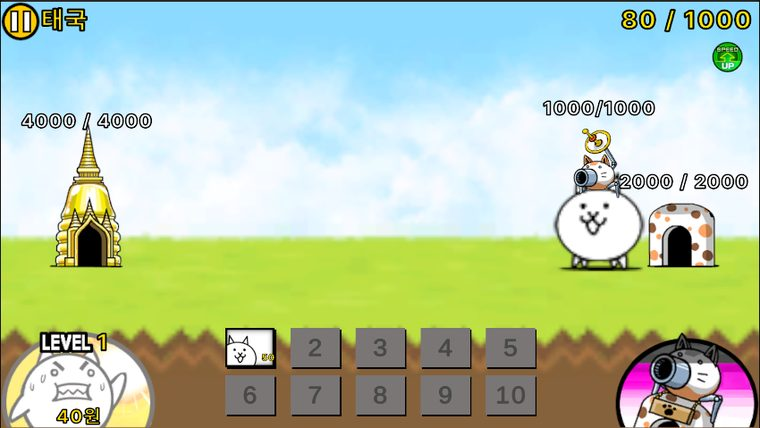
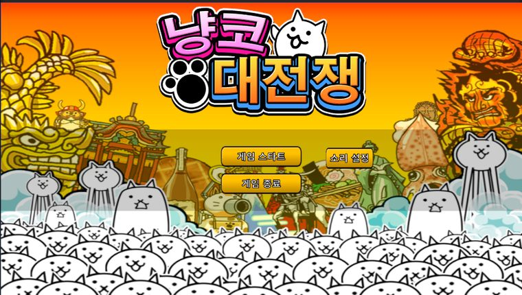
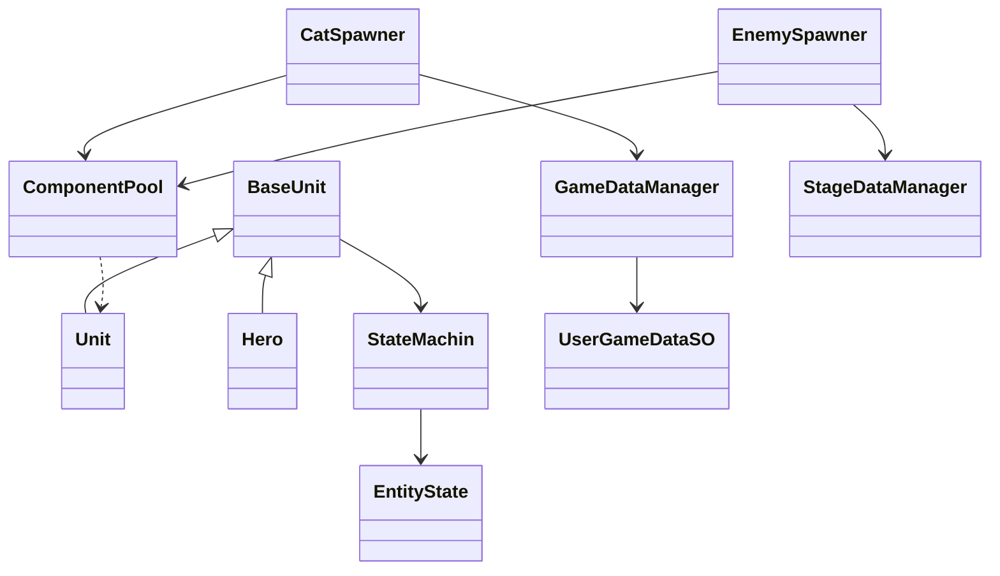
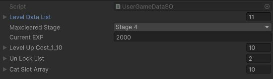
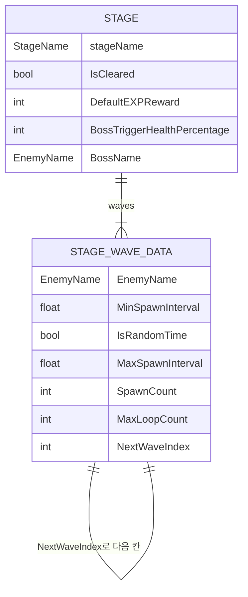
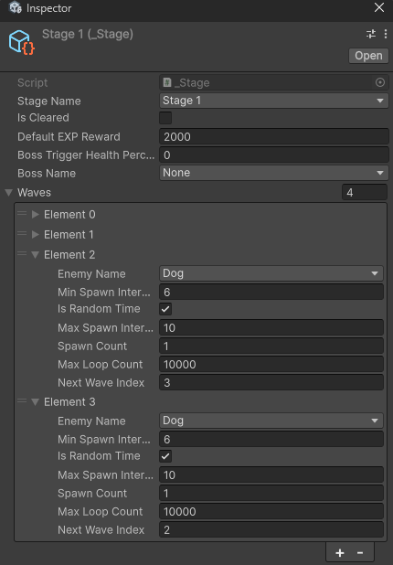
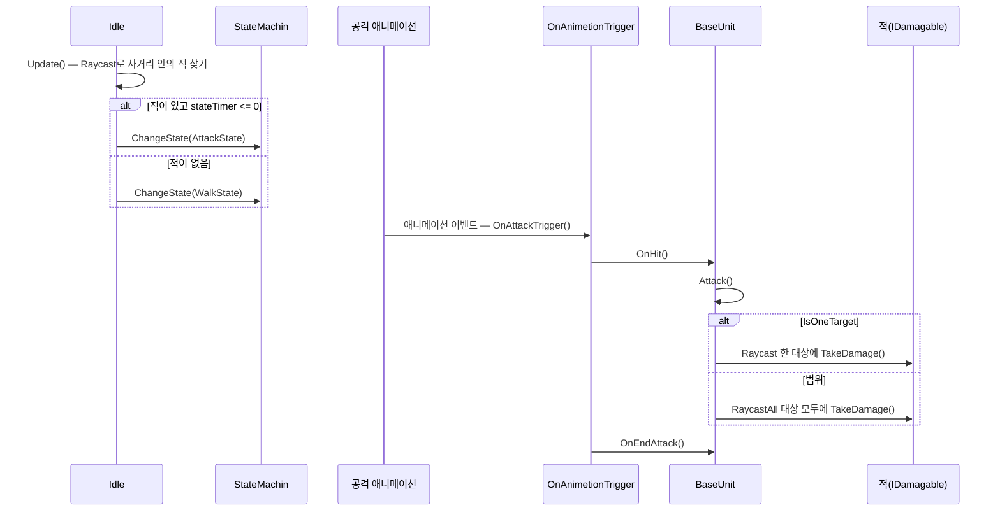
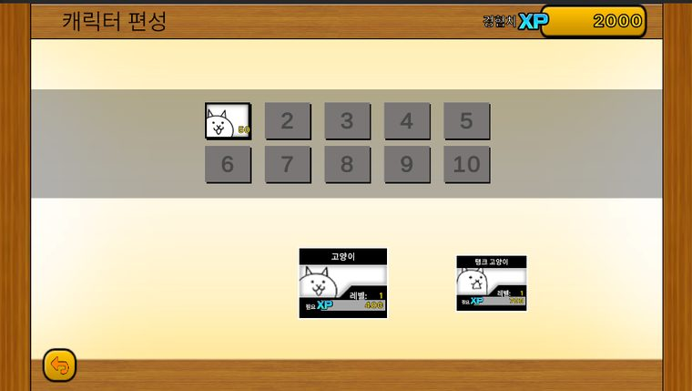
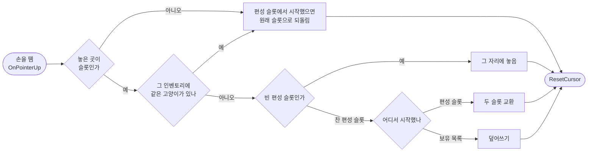
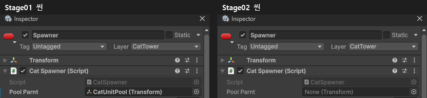

# 냥코 디펜스 — 2D 소환 디펜스

> AI를 쓰지 않은 개인 학습용 모작이며, 그림·사운드는 원작(냥코 대전쟁)의 것입니다.



## 1. 개요

스테이지마다 정해진 적이 정해진 방식으로 소환되는 디펜스 게임입니다.

냥코 대전쟁의 실시간 소환 디펜스 구조를 기반으로 제작했으며, 조작 가능한 플레이어블 요소 한 가지를 추가해 보았습니다. 플레이어는 스테이지에서 아군을 소환해 스폰되는 적을 막고, 플레이어블 냥코를 직접 조작해 전투에 개입합니다. 적 기지를 파괴하면 스테이지가 클리어되며, 획득한 경험치로 신규 캐릭터가 해금되고, 보유한 유닛을 편성하고 여러 요소(해금된 유닛의 스탯, 자원이 자동으로 오르는 속도, 기본 최대 자원, 유닛 재소환 쿨타임, 플레이어블 냥코의 체력·공격력·스킬 공격력·사거리 등)를 레벨업해 다음 스테이지에 대비합니다.

플레이어에게 주고 싶었던 경험은, 유닛과 여러 요소를 성장시키고 성장한 유닛들로 적들을 밀어붙이는 경험입니다.

정립된 디펜스 장르의 설계를 배워 보려고 만든 학습용 프로젝트입니다. 특히 **적 데이터를 어떻게 정의하고, 그 적을 언제·어떻게 스폰하는지**의 구조를 직접 만들어 보는 것이 목표였습니다.

### 개발 환경

| 항목 | 내용 |
|---|---|
| 장르 | 2D 횡스크롤 소환 디펜스 |
| 기간 | 2026.06.24 ~ 2026.07.09 (16일) |
| 인원 | 1인 개발 (기획 · 구현 전체) |
| 엔진 | Unity 6000.3.15f1 |
| 주요 패키지 | URP 17.3.0 · Input System 1.19.0 · 2D Animation 13.0.4 |
| 외부 에셋 | DOTween |
| 글꼴 | Pretendard (Kil Hyung-jin, SIL Open Font License 1.1) |
| 그림·사운드 | 원작(냥코 대전쟁)의 것 |
| GitHub | https://github.com/KooHoo-Dev/3rd-2D-Project-krr6606 |
| 시연 영상 | https://youtu.be/HqqZD-s-3rY (숏츠: https://youtube.com/shorts/in9jNq5RYYU) |

### 조작법

플레이어블 냥코는 `A`·`D`(또는 `←`·`→`)로 이동하고 `Z`로 공격합니다. 아군은 화면 아래 슬롯을 클릭하거나 숫자 키를 눌러 소환합니다.



## 2. 시스템 구조

### 클래스 구조

유닛은 상태 머신으로 움직이고, 두 스포너는 같은 오브젝트 풀을 쓰며 데이터는 두 매니저에서만 받아 옵니다.



| 클래스 | 맡은 일 |
|---|---|
| `BaseUnit` | 모든 유닛이 공유하는 이동·공격·피격 구조 |
| `Unit` · `Hero` | 유닛마다 다른 수치나 방식의 이동·공격 디테일 (`Hero`는 플레이어블 냥코) |
| `StateMachin` | 현재 상태를 실제로 전환 (`Exit` → `Enter`) |
| `EntityState` | 모든 상태(Idle·Walk·Attack·HitBack·Die)가 공유하는 기본 구조 |
| `CatSpawner` · `EnemySpawner` | 아군 · 적 유닛의 실제 스폰 (적은 웨이브 진행) |
| `ComponentPool` | 각 오브젝트의 풀링 — 두 스포너가 함께 사용 |
| `StageManager` | 지금 진행 중인 판의 상태(현재 스테이지 이름, 적 기지, 스포너, 플레이어블 냥코). 스테이지 데이터 자체는 `StageDataManager`가 가짐 |
| `StageDataManager` | 미리 정의된 스테이지·스폰 데이터의 관리와 중계 |
| `GameDataManager` | 현재 플레이어의 주요 데이터(해금·레벨·편성) 중계와 관리 |
| `UserGameDataSO` | 실제로 저장되어 있는 플레이어의 주요 데이터 |

### 데이터 매니저를 둘로 나눈 이유

데이터를 제 나름대로 정리해서 규격과 체계를 구현해보려고 했습니다.

'**플레이어에 의해 바뀔 수 있는 데이터**를 관리하는 매니저'(`GameDataManager`)와 '**개발자가 미리 정해 놓은, 바뀌지 않는 데이터**를 관리하는 매니저'(`StageDataManager`)를 따로 정의하고, 각 데이터가 그에 맞는 흐름으로 이동하기를 바랐습니다.

데이터가 오가는 길이 너무 여러 갈래로 나뉘면 일관성이 깨지거나 참조가 꼬일 수 있다고 생각해서, 다른 시스템은 **이 두 매니저만 거쳐서** 데이터에 접근하도록 했습니다.

매니저를 하나로 두지 않은 데는 저장 방식도 영향을 주었습니다. 당시에는 세이브·로드 기능을 만들기 어렵다고 판단해 넣지 않았고, 대신 SO 데이터에 유닛과 스테이지의 진행도를 저장했습니다. 그래서 인스펙터에서 미리 정해 둔 값과, 플레이하며 바뀌고 저장되는 SO 값을 따로 관리하는 편이 매니저 하나로 모두 관리하는 것보다 유지보수하기 편하다고 생각했습니다.


<!-- pf-marks "레벨 데이터|레벨":0.5,15.6,99,11.9 "해금 목록|해금":0.5,68.1,99,11.9 "편성 슬롯|편성":0.5,81.9,99,11.9 -->

## 3. 적 스폰 구조

이 프로젝트의 목표였던 "적을 언제·어떻게 스폰하는지"를 만든 과정입니다. 스포너보다 웨이브 데이터의 구조를 먼저 정하고, 스포너는 그 데이터가 가리키는 대로 소환하게 만들었습니다. 적이 계속 나오게 되면서 겹쳐 보이는 문제와 너무 많이 나오는 문제를 소환 단계에서 정리했고, 마지막으로 여러 스테이지와 보스까지 스테이지 데이터에 넣어 코드 수정 없이 데이터만으로 스폰을 고칠 수 있는 구조로 만들었습니다.

### 3.1 스포너보다 데이터를 먼저 정했다

스포너를 만들기 전에 웨이브 데이터의 구조부터 정했습니다. 구체적으로 필요한 데이터의 구조를 먼저 세워야, 머릿속에 추상적으로만 있던 스포너의 구조가 확정될 것 같았기 때문입니다.

각 웨이브에는 어떤 적을, 몇 초 뒤에, 몇 마리 소환할지와 다음에 갈 웨이브 번호(`NextWaveIndex`)를 적습니다. `NextWaveIndex`는 처음 구상에는 없었습니다. 적이 끝없이 반복해서 나오는 흐름을 스포너가 아니라 데이터에서부터 조작할 수 있으면 편하겠다고 생각해 넣었습니다. `MaxLoopCount`는 같은 형태의 스폰을 정해진 횟수만큼 반복한 뒤 다음 웨이브로 넘어가게 하려고 넣은 값입니다. 같은 적을 데이터에 여러 번 적지 않고 횟수로 쓰려는 것이었습니다.

```csharp
[Serializable]
public class StageWaveData
{
    [field: SerializeField] public EnemyName EnemyName {  get; private set; }
    [field: SerializeField] public float MinSpawnInterval { get; private set; }
    [field: SerializeField] public bool IsRandomTime { get; private set; }
    [field: SerializeField] public float MaxSpawnInterval { get; private set; }
    [field: SerializeField] public int SpawnCount { get; private set; }
    [field: SerializeField] public int MaxLoopCount { get; private set; }
    [field: SerializeField] public int NextWaveIndex {  get; private set; }
}
```

스테이지 SO 하나가 웨이브 목록을 갖고, 각 웨이브는 다음에 갈 웨이브를 같은 목록 안에서 가리킵니다.



(`STAGE`는 `_Stage`, `STAGE_WAVE_DATA`는 `StageWaveData`입니다.)

웨이브 데이터를 정할 때 코드에 직접 적는 하드코딩이나, 인스펙터에서 값을 고치는 방법도 떠올렸습니다. 하지만 모든 스테이지가 같은 형식의 데이터를 쓰고 초기값을 공유하면서 디테일만 바뀌므로, 스크립터블 오브젝트가 가장 알맞다고 판단했습니다.

### 3.2 스포너는 데이터가 가리키는 대로 소환한다

데이터가 정해진 뒤, 스포너(`EnemySpawner`)는 스테이지의 웨이브 목록을 받아 0번 웨이브부터 차례로 소환하게 만들었습니다. 한 웨이브의 소환이 끝나면 순서대로 다음 칸으로 가는 것이 아니라, `NextWaveIndex`가 가리키는 칸으로 갑니다.

`EnemySpawner.cs`의 `WaveCo`

```csharp
                for (int i = 0; i < waveList[currentWaveIndex].SpawnCount; i++)
                {
                    Spawn(waveList[currentWaveIndex].EnemyName);
                    yield return WaitSpawnFrameDelay;
                }
                currentWaveIndex = waveList[currentWaveIndex].NextWaveIndex;
                SpawnTime = waveList[currentWaveIndex].IsRandomTime
                            ? Random.Range(waveList[currentWaveIndex].MinSpawnInterval, waveList[currentWaveIndex].MaxSpawnInterval)
                            : waveList[currentWaveIndex].MinSpawnInterval;
                CurrentSpawnTime = SpawnTime;
```

여러 마리를 한 번에 소환할 때는 한 마리마다 `SpawnFrameDelay`(0.2초)를 두어, 같은 자리에 완전히 겹쳐 나오지 않게 했습니다.

스테이지 1의 웨이브는 다음과 같습니다.

| 번호 | 적 | 대기 시간 | 소환 수 | 다음 웨이브 |
|---|---|---|---|---|
| 0 | Dog | 0초 | 1 | 1 |
| 1 | Dog | 20초 | 1 | 2 |
| 2 | Dog | 6~10초 (랜덤) | 1 | 3 |
| 3 | Dog | 6~10초 (랜덤) | 1 | 2 |

2번과 3번이 서로를 가리키게 해 두면 그 구간이 스테이지가 끝날 때까지 반복됩니다. 처음 몇 마리는 정해진 시간에 나오고, 그 뒤로는 랜덤한 간격으로 계속 나오는 흐름을 스포너 코드를 고치지 않고 데이터만으로 만들 수 있습니다.


<!-- pf-marks 1:13.5,66,85,3.4 2:13.5,92.1,85,3.4 3:13.5,49.8,85,9.7 -->

1. **Next Wave Index = 3** — 2번 웨이브가 끝나면 3번으로 갑니다
2. **Next Wave Index = 2** — 3번 웨이브가 끝나면 다시 2번으로 가서, 2·3번이 반복됩니다
3. **Is Random Time** — 켜져 있어 Min과 Max(6초와 10초) 사이에서 대기 시간을 뽑습니다

### 3.3 끝없이 나오는 적을 정리했다

반복 구간으로 적이 스테이지가 끝날 때까지 계속 나오게 되면서, 소환하는 순간에 두 가지를 더 정했습니다.

첫째는 겹침입니다. 횡스크롤에서 같은 적이 같은 높이로 나오면 한 마리처럼 겹쳐 보입니다. 그래서 소환할 때마다 빈 자리 번호를 하나 받아, 그 번호만큼 y값을 조금씩 내리고 `sortingOrder`를 올려 여러 마리가 나란히 보이게 했습니다.

```csharp
    private void SetPositionY(GameObject enemy)
    {
        for (int i = 0; i < isSpawned.Length; i++)
        {
            if (isSpawned[i] == null)
            {
                enemy.transform.position = new Vector3(transform.position.x, transform.position.y - i * 0.025f, transform.position.z);
                isSpawned[i] = enemy;
                enemy.GetComponent<SpriteRenderer>().sortingOrder = i;
                break;
            }
        }
    }
```

둘째는 동시에 나와 있는 적의 수입니다. 적이 너무 많이 쌓여 어려워지는 것을 막아 난이도를 조정하려고, 필드에 살아 있는 적이 `MaxSpawnCount`(50) 이상이면 소환을 잠시 멈추게 했습니다. 처음에는 풀 부모 오브젝트의 자식 수로 셌는데, 이 수에는 죽어서 꺼진 채 풀에 남은 적도 들어갑니다. 플레이어 입장에서 이유 없이 제한받는 것은 좋지 않다고 생각해, 소환할 때 기록해 둔 적 가운데 켜져 있는 적만 세도록 바꿨습니다. 프로토타입인 이 게임에서는 적이 50마리까지 쌓인 적이 없어서, 자식 수로 셀 때의 문제를 실제로 겪지는 않았습니다.

```csharp
            int activeCount = 0;
            for (int i = 0; i < isSpawned.Length; i++)
            {
                if (isSpawned[i] == null)
                {
                    continue;
                }
                if (isSpawned[i].activeSelf)
                {
                    activeCount++;
                }
            }
            isSpawnStopped = activeCount >= MaxSpawnCount;
            // …
            // 웨이브 스폰이 중지되었는지 확인
            if (isSpawnStopped)
            {
                yield return null;
                continue;
            }
```

### 3.4 스테이지와 보스를 데이터에 넣었다

처음 스포너는 스테이지 1의 데이터만 읽었습니다. 스테이지를 늘리면서, 지금 스테이지의 이름(`StageManager`의 `CurrentStageName`)으로 `StageDataManager`에서 그 스테이지의 데이터를 가져오게 바꿨습니다.

`EnemySpawner.cs`의 `Start`

```csharp
        StageName currentStageName = StageManager.Instance.CurrentStageName;

        stage = StageDataManager.Instance.GetStageData(currentStageName);

        waveList = stage.waves;
```

보스도 같은 방법으로 스테이지 데이터에 넣었습니다. 스테이지 SO에 `BossTriggerHealthPercentage`와 `BossName`을 적으면, 적 기지 체력이 그 비율 아래로 떨어질 때 보스가 등장합니다.

```csharp
            if (BossTriggerHealthPercentage > 0 && isBossSpawned == false)
            {
                int currentHealthPercentage = Mathf.RoundToInt((float)stageManager.EnemyTower.CurrentHealth / stageManager.EnemyTower.MaxHealth * 100);
                if (currentHealthPercentage <= BossTriggerHealthPercentage) // 현재 체력 비율이 보스 스폰 조건 이하인 경우
                {
                    isBossSpawned = true;
                    EnemyName bossName = stage.BossName;
                    // … BossName이 None이면 LogError로 알리고 소환하지 않음
                    // … 필드의 아군 고양이(GetAllCats)와 플레이어블 냥코(hero)를 모두 HitBack()으로 밀쳐 냄
                    Unit boss = Spawn(bossName); // 보스 스폰
                    boss.useData.DefaultHealth *= 2; // 보스 체력 2배 증가
                    boss.CurrentHealth = boss.useData.DefaultHealth; // 현재 체력도 최대 체력으로 설정
                    boss.useData.DefaultDamage *= 1.1f; // 보스 공격력 1.1배 증가
                    // … 보스 등장 효과음과 보스 배경음으로 바꿈 (StringSoundManager)
                }
            }
```

보스가 나오는 순간 필드의 아군과 플레이어블 냥코를 모두 뒤로 밀쳐 내고(`HitBack`), 효과음과 배경음을 바꿔 분위기가 달라졌다는 것을 알립니다. 보스는 일반 적과 같은 프리팹을 쓰되 체력 2배, 공격력 1.1배로 올려서 소환합니다.

보스는 소환 방식만 일반 적과 다르게 하면, 보스 자체는 일반 적과 같은 구조를 써도 된다고 생각했습니다. 그래서 소환 데이터 구조에 보스를 소환하는 특수 트리거(기지 체력)를 넣고, 소환 방식과 연출에는 변주를 주되 능력치는 수치만 다르게 했습니다.

적 이름으로 풀을 고르는 부분도 이때 바꿨습니다. 처음에는 `switch`로 적마다 풀 번호를 하나씩 적었는데, 새 적을 추가할 때 고칠 곳이 덜 생기도록 enum 값을 풀 번호로 바로 쓰게 했습니다. 다만 이 방식은 enum 순서와 인스펙터의 풀 목록 순서가 어긋나면 엉뚱한 적이 나옵니다.

```csharp
// 바꾸기 전 — 적마다 case 하나
switch (enemyName)
{
    case EnemyName.Dog:   enemy = enemyPoolList[0].Get(); break;
    case EnemyName.Snake: enemy = enemyPoolList[1].Get(); break;
    // … 적을 추가할 때마다 case를 하나씩 더함
}

// 바꾼 뒤 — enum 값을 풀 번호로
enemy = enemyPoolList[(int)enemyName - 1].Get();
```

웨이브 데이터가 스테이지 SO마다 흩어지는 이 방식은 개선할 여지가 있다고 생각했지만, 일단 먼저 **코드 수정 없이 데이터만으로** 수정할 수 있도록 하고 싶어서 이런 구조로 작성했습니다.

## 4. 유닛과 편성에서 고른 방법

### 4.1 데미지는 애니메이션 이벤트에서 넣는다

유닛은 플레이어가 조작하지 않아도 적이 사거리에 들어오면 스스로 공격합니다. 대기 상태(`Idle`)에서 앞쪽으로 사거리만큼 레이를 쏴서, 적이 있고 대기 시간(`stateTimer`)이 끝났으면 Attack 상태로 넘어가고, 적이 없으면 Walk로 돌아갑니다. 실제 데미지는 `Update`가 아니라, 공격 애니메이션 클립에 심어 둔 애니메이션 이벤트가 `OnAttackTrigger()`를 호출하는 시점에 들어갑니다. 공격 판정 함수 `Attack()`은 유닛마다 다른 수치와 방식(단일 대상 / 범위)으로 공격합니다.

판정 시점을 코드가 아닌 애니메이션에 맡긴 이유는, 타격 프레임과 실제 판정 프레임이 어긋나지 않게 맞추기 위해서입니다.

아래 그림은 적을 찾는 것부터 데미지가 들어가기까지 부르는 순서입니다.



### 4.2 편성은 복사본을 끌고 다닌다

편성 화면에서 고양이를 끌어다 편성 슬롯에 놓으면 편성이 바뀝니다.



슬롯을 클릭하면 시작 슬롯의 고양이 데이터를 복제해 '커서 슬롯'이라는 임시 슬롯 하나를 켜서 그 안에 복제한 데이터를 집어넣고, 이후로는 드래그 함수를 이용해 이 임시 슬롯만 마우스를 따라다니게 합니다. 실제 편성 데이터(`CatSlotArray`)는 손을 뗀 시점(`OnPointerUp`)에 놓인 위치에 따라 반영됩니다.



원본 데이터를 바로 옮기지 않고 복사본을 쓴 이유는, 사용자가 언제든 드래그를 취소하거나 옮기지 않을 수 있기 때문입니다. 원본을 옮겼다가 되돌리는 것보다, 언제든 쉽게 버릴 수 있는 복사본을 쓰는 편이 더 값이 싸다고 판단했습니다.

## 5. 고친 문제

### 풀에서 다시 꺼낸 유닛이 공격받지 않던 문제

오브젝트 풀에서 다시 꺼내 쓴 유닛의 콜라이더가 꺼진 채로 나와서, 그 유닛은 공격을 받지 않았습니다. 유닛이 죽을 때 `Die` 상태에서 콜라이더를 끄는데, 풀은 오브젝트를 비활성화했다가 다시 켜서 쓰기 때문에 꺼 둔 콜라이더가 그대로 남아 있었던 것입니다. 그래서 유닛이 다시 켜질 때(`OnEnable`) 상태와 체력을 처음으로 돌리면서 콜라이더도 함께 켜도록 했습니다.

```csharp
    private void OnEnable()
    {
        stateMachine.Initialize(WalkState);
        CurrentHealth = useData.DefaultHealth;
        collider2d.enabled = true;
    }
```

고친 뒤에는 다시 꺼낸 유닛에 공격이 들어오는 것을 로그로 찍어 확인했습니다. 풀링을 쓰면 죽을 때 바꾼 값은 다시 꺼낼 때 되돌려야 한다는 것을 이때 배웠습니다.

### 스테이지 씬마다 인스펙터 연결이 빠지던 문제

스테이지 씬마다 버튼과 스포너에 연결해야 할 참조가 빠져 있었습니다. 스테이지마다 같은 연결을 인스펙터에서 손으로 반복해야 하는 구조였기 때문입니다. 그래서 UI 버튼은 인스펙터에서 끌어다 연결하는 대신 코드에서 스스로 찾아 등록하게 하고, 아군 풀의 부모도 인스펙터 대신 코드에서 직접 찾아 연결했습니다.


<!-- pf-marks "참조가 빠져|빠져":52.5,88.1,46.9,9.9 "같은 연결|손으로":1.6,88.1,46.9,9.9 -->

```csharp
    void Awake()
    {
       PoolParnt = GameObject.Find("CatUnitPool").GetComponent<Transform>();
    }
```

다만 `GameObject.Find`는 이름 문자열에 기대기 때문에, 오브젝트 이름이 바뀌면 다시 깨질 수 있습니다.

## 6. 회고

### 결과

처음 정한 구조가 끝까지 가지 않았습니다. 스테이지 씬마다 인스펙터에서 손으로 잇던 참조가 빠져서 코드가 스스로 찾도록 바꿨고, 개발 막바지에는 레벨 데이터의 `switch`를 걷어 내고 enum 인덱스 목록으로 바꾸는 리팩토링을 했습니다. 두 번 모두 처음 구조로 만들어 둔 뒤에 고친 것이라, 구조는 처음에 완벽하게 정하기보다 문제가 드러난 자리에서 다시 설계하고 정리해야 한다는 것을 알게 됐습니다. 다만 그 리팩토링도 `switch`만 줄였을 뿐, 아래 「아직 남은 것」처럼 enum 순서를 배열 인덱스로 쓰는 문제는 남겼습니다.

웨이브 데이터(`StageWaveData`)와 플레이어 데이터(`UserGameDataSO`)를 ScriptableObject로 정의하면서, 게임에 어떤 외부 데이터(레벨 · 이름 · 스폰 정보 · 설명 등)가 필요한지, 설계한 구조에 맞으려면 데이터가 어떤 형태여야 하는지 스스로 판단할 수 있게 됐습니다.

기존에 구현해야겠다고 마음먹은 '적들이 랜덤, 또는 정해진 대로 웨이브가 몰려오는 기능'을 구현하는 데 성공했고, 그 덕분에 다양하고 많은 유닛이 대치하며 전선을 밀고 밀리는 느낌을 낼 수 있었습니다. 목표한 경험이었던, 유닛과 여러 요소를 성장시키고 그 유닛들로 적을 밀어붙이는 느낌도 의도대로 나왔습니다. 원본을 따라 만든 것이기 때문에 구현을 직접 해 본 것에 의의를 두고 싶습니다.

### 아직 남은 것

- 고양이 데이터(`CatSOArray[(int)catName]`), 프리팹 목록, 레벨 데이터, 적 풀(`enemyPoolList[(int)enemyName - 1]`)이 모두 enum 순서를 배열 인덱스로 씁니다. enum에 값을 끼워 넣거나 인스펙터 배열 순서가 바뀌면 엉뚱한 데이터가 나옵니다.
- 보스의 체력과 공격력을 올릴 때 그 적 오브젝트가 가진 값(`useData`)을 직접 바꾸는데, 오브젝트 풀은 이 값을 되돌리지 않습니다. 그래서 보스로 나왔던 오브젝트가 나중에 같은 종류의 일반 적으로 다시 나오면 체력 2배와 공격력 1.1배가 그대로 남습니다. 만들 때는 알아채지 못한 실수입니다.
- 웨이브의 `MaxLoopCount`는 데이터에만 있고 코드에서 쓰지 않습니다. 반복 구간은 지금 스테이지가 끝날 때까지 끝없이 돕니다.
- 골드 버퍼는 `goldBuffer > 1`일 때만 반영되어, 버퍼가 딱 1일 때는 그 프레임에 골드가 오르지 않습니다.
- 웨이브 데이터가 스테이지 SO마다 인스펙터에 흩어져 있어, 스테이지끼리 스폰 흐름을 비교하려면 SO를 하나씩 열어야 합니다.
- `GameDataLevelDic`은 시작할 때 한 번 복사한 값이라, 게임 중 레벨이 오르면 실제 값과 달라집니다.
- 고양이별 설명 텍스트가 코드에 하드코딩되어 있습니다.
- 기획적으로는 플레이어블 냥코가 더 돋보일 장치(적 기지를 직접 공격하지 못하게 하기 등)를 넣어 보고 싶습니다.

### 개선 계획

`MaxLoopCount`처럼 데이터에만 있고 코드에서 쓰지 않는 값이 남아, 데이터를 보는 사람이 동작을 잘못 읽을 수 있게 됐습니다. 앞으로는 나중에 쓸 것 같아도 지금 쓰지 않는 필드와 코드는 지우겠습니다.

개선한다면 인스펙터에 흩어져 있는 데이터를 모두 TSV 파일로 뺀 다음, DTO · Def · DataTable · DataManager 구조로 만들어서 데이터를 찾고 고치기 쉽게 만들고 싶습니다. enum 순서를 배열 인덱스로 쓰는 방식이 마음에 걸렸던 이유는, 코드에서 데이터를 배열 순서값으로 불러오면 무엇을 가져오는지 알기 어려워 유지보수에 좋지 않다고 생각했기 때문입니다. 데이터 매니저라는 한 가지 흐름으로 묶어 두면 enum 배열의 순서 대신 id로 데이터를 가져오게 되므로, 함수 이름과 id만 보고도 어떤 데이터를 불러오는지 알 수 있을 것입니다.

풀에서 다시 꺼낸 유닛이 공격받지 않던 문제에서 배운 것을 보스 능력치에서는 간과했습니다(「아직 남은 것」). 다음에는 풀에서 꺼내 쓰는 오브젝트의 값을 바꿀 때마다, 그 값을 `OnEnable`에서 되돌리는지 함께 확인하겠습니다.
