# 시장에 가면 — 라이어 게임 서버

> 4인 교육과정 팀 프로젝트에서 서버를 혼자 맡고, 클라이언트에서는 서버가 보낸 마트 아이템을 받아 매대에 놓는 부분을 만들었습니다. 마트에서 물건을 고르고, 그 물건을 키워드와 엮어 소개하는 라이어 게임의 ASP.NET Core WebSocket 서버입니다. 이 프로젝트에서는 AI를 쓰지 않았습니다.

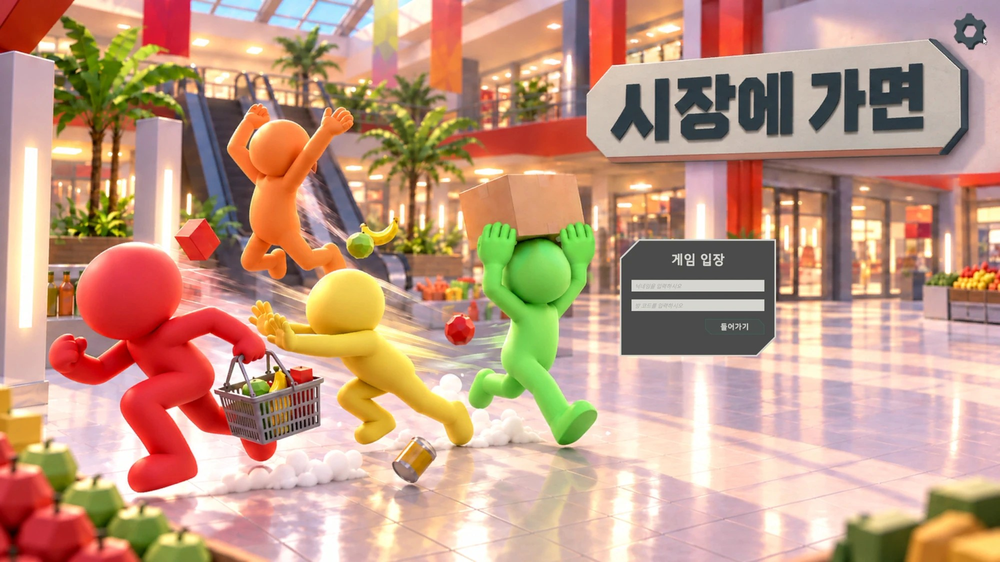

## 1. 개요

물건을 고르고 설명하는 라이어 게임입니다. 마트에서 물건을 골라, 장르에 맞는 키워드(라이어는 다른 키워드)와 연관 지어 소개합니다(3~4인). 고른 물건을 키워드와 연관 지어 설명할 때의 짜릿함을 플레이어에게 주는 것이 목표였습니다.

원래 라이어 게임과 다른 점은 세 가지입니다. 마트에서 물건을 고르는 턴이 있습니다. 인원이 적어 한 라운드 안에서 투표가 무효가 되면, 고른 물건 수만큼 최대 3번까지 발언 사이클이 돕니다. 그리고 라이어가 중간에 장르와 키워드를 알아내면, 위험도 보상도 큰 '라밍아웃 버튼'을 눌러 점수를 크게 얻거나 잃을 수 있습니다.

제가 맡은 부분은 서버입니다. 서버는 게임을 시작할 때 라이어와 장르·키워드를 정해 모두에게 보내고, 시간에 따라 라이어 게임의 턴(상태 22개)을 진행합니다. 마트에서 받은 움직임과 채팅은 모두에게 전달하고, 아이템 줍기는 서버가 판정해(먼저 온 한 명만) 다시 모두에게 보냅니다. 클라이언트에서는 서버가 보낸 마트 아이템 데이터를 받아 매대에 배치하는 부분과, 그 데이터를 읽는 구조를 만들었습니다.

### 왜 서버에서 진행하나

랜덤 요소, 시간, 현재 턴은 모든 클라이언트가 똑같이 봐야 하는 동기화 요소이면서, 서버가 권위를 가져야 하는 요소라고 판단해 서버에서 진행하도록 했습니다.

### 개발 환경

| 항목 | 내용 |
|---|---|
| 장르 | 마트에서 물건을 골라 키워드와 연관 지어 소개하는 라이어 게임 (3~4인) |
| 기간 | 2026.08.25 ~ 2026.09.10 (약 2.5주) |
| 인원 | 4인 팀 (서버 1 · 클라이언트 3) |
| 내 역할 | 서버 전체(1인) — 시간으로 진행하는 게임 턴(FSM)을 중심으로 메시지 설계 · 방과 연결까지. 클라이언트의 마트 아이템 배치 |
| 환경 | ASP.NET Core (.NET 10) · WebSocket · System.Text.Json · Unity(클라이언트) |
| 패키지 | CsvHelper 33.1.0 (TSV 데이터 테이블) |
| GitHub | 서버 https://github.com/KooHoo-Dev/3rd-TeamProject-SH-Server · 클라이언트 https://github.com/KooHoo-Dev/3rd-TeamProject-SH |
| 시연 영상 | https://youtu.be/qa76D4hZvSs (숏츠: https://youtube.com/shorts/Kq8cJ30VOf0) |

### 팀과 내 역할

| 팀원 | 담당 |
|---|---|
| 본인 | 서버 전체 · 클라이언트의 마트 아이템 배치 |
| 클라이언트 A | 맵 · UI |
| 클라이언트 B | 라이어 게임 로직 |
| 클라이언트 C | 마트 파트의 물리 |

서버 저장소의 커밋 219개 중 215개가 제 커밋입니다(08-25 ~ 09-10, 17일). 기능 하나, 버그 하나 단위로 작게 나눠 올렸습니다.

| 영역 | 만든 것 |
|---|---|
| 게임 진행 | `GameManager`, 시간으로 진행하는 FSM 상태 22개와 공통 부모 `BaseGameTurnState` |
| 메시지 설계 | 게임 전체 메시지 설계와 관리, 상태 메시지를 `TurnMessage` 하나로 통합 |
| 방과 연결 | 방당 4명 상한, 틱마다 게임 진행 연결, 마트 이동 상태에서만 위치 송출, 송수신 분리(Outbox), 수신 1MB 상한, 호스트 지정·위임, 준비·시작, 게임 중 이탈 처리, 게임 메시지 처리 약 10종 |
| 데이터 | `DataManager`·TSV 읽기, `appsettings.json` 설정 값 |
| 클라이언트 | 클라이언트 팀에 전달한 해석 매니저 `ParseNetworkManager.cs`, 마트 매대·그리드와 아이템 배치(`DisplayStandManager`), 클라이언트 쪽 TSV 데이터 구조 |

### 핵심 루프

게임을 시작하고, 마트에서 물건을 고르고, 라이어 게임을 진행해서, 점수를 얻거나 잃습니다. 한 판은 서버의 상태 22개를 분기별로 지나갑니다.

## 2. 시스템 구조

### 2.1 전체 구조

방 코드 하나로 매칭하고, 방마다 독립된 `GameManager`와 FSM을 가집니다. 상태별 제한 시간·라운드 수 같은 게임 규칙은 코드가 아니라 `appsettings.json`에, 장르·키워드·아이템은 TSV 표에 있습니다.

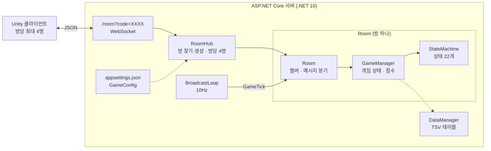

방마다 하나의 게임 흐름이 존재한다고 생각했기 때문에 이렇게 나눴습니다. `Room`(사람과 메시지)이 `GameManager`(그 방의 게임 상태와 점수)를 하나 갖고, `GameManager`가 그 방의 흐름을 진행하는 `StateMachine`을 하나 갖습니다.

### 2.2 시간으로 진행하는 상태 22개

서버가 권위를 가지는 게임 진행(시간에 따른 진행도와 분기)은 서버가 상태를 계산해서, 알맞은 때에 모든 클라이언트에게 다음으로 넘어갈 최대 시간 정보와 함께 보냅니다. 클라이언트는 받은 상태대로 화면만 바꿉니다. 상태마다 반복되는 시간 재기와 다음 상태로 넘기기는 부모 `BaseGameTurnState` 한 곳에 모으고, 상태 22개는 자기 할 일과 다음 상태만 선언하게 만들었습니다. 10Hz 진행 루프가 방마다 현재 상태의 `Tick()`을 부르고, 투표 결과나 사이클 수에 따라 갈라지는 상태만 `Tick()`을 다시 씁니다.

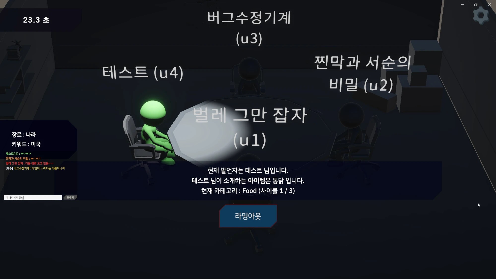

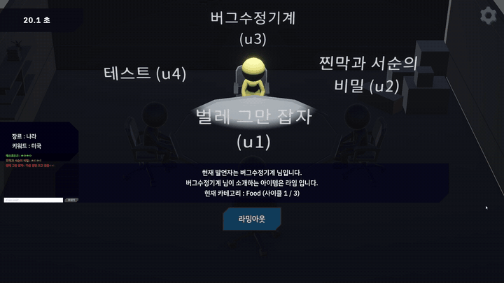

① 준비 · 마트

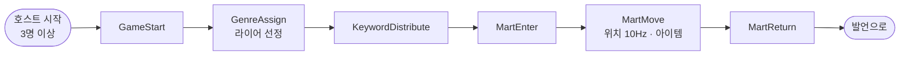

② 추리 — 발언 · 지목 · 변론 · 투표 (발언 사이클 최대 3회, 마지막 사이클은 지목만 반복)

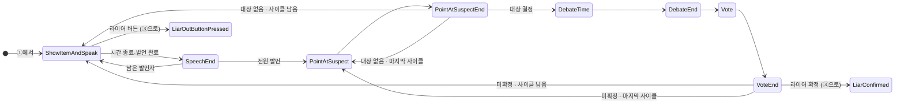

③ 판정 · 정산 (라운드 최대 3회)

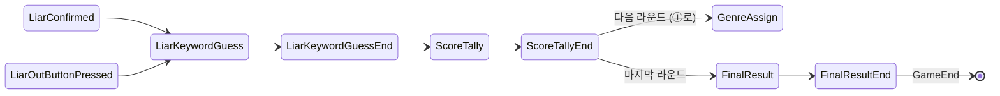

### 2.3 클라이언트에 보내는 묶음과 해석 매니저

상태가 바뀔 때마다 서버는 `TurnMessage` 하나를 모두에게 보냅니다. 공통 필드(상태 종류, 남은 시간, 사이클, 라운드)는 봉투에, 상태마다 다른 데이터만 `Parameter`(JSON)에 담습니다.

```csharp
        public class TurnMessage
        {
            public string Type { get; set; } = "turnMessage";
            public TurnMessageType TurnMessageType { get; set; }
            public float TimerMs { get; set; } // 모든 타임은 MS로 들어옴
            public int CurrentCycle { get; set; }
            public int CurrentRound { get; set; }

            // 타입별로 달라지는 나머지 필드 (없을 수도, JSON 객체 하나일 수도 있음)
            public string Parameter { get; set; }

            /// <summary>Parameter를 원하는 파라미터 클래스 타입으로 역직렬화. 없으면 null.</summary>
            public T GetParameter<T>() where T : class
            {
                if (string.IsNullOrEmpty(Parameter)) return null;
                return JsonSerializer.Deserialize<T>(Parameter);
            }
        }
```

클라이언트 쪽에서 쓰는 해석 매니저(`ParseNetworkManager.cs`)는 제가 만들어 클라이언트 팀에 전달했습니다. 이 매니저는 봉투를 받으면 상태 종류로 나눠 `Parameter`를 풀고, 상태마다 이벤트 하나를 부릅니다. 그래서 클라이언트 팀은 필요한 이벤트만 구독하면 됩니다.

```csharp
// 상태마다 이벤트 하나 (모두 남은 시간 · 사이클 · 라운드가 앞에)
    public static Action<float, int, int> OnGameStartState;
    // GenreId, CurrentOwnerID
    public static Action<float, int, int, int, string> OnGenreAssignAndLiarSelectState;
// 받은 봉투를 상태 종류로 나눠 Parameter를 풀고 이벤트 호출
    public static void MessageParse(Protocol.TurnMessage msg)
    {
        switch (msg.TurnMessageType)
        {
            case Protocol.TurnMessageType.GameStartState:
                OnGameStartState?.Invoke(msg.TimerMs, msg.CurrentCycle, msg.CurrentRound);
                break;
            case Protocol.TurnMessageType.GenreAssignAndLiarSelectState:
            {
                var p = Parse<Protocol.GenreAssignAndLiarSelectParameter>(msg.Parameter);
                OnGenreAssignAndLiarSelectState?.Invoke(msg.TimerMs, msg.CurrentCycle, msg.CurrentRound,
                    p.GenreId, p.CurrentOwnerID);
                break;
            }
            // … 상태 22개
```

전달할 때는 파일과 함께 사용법을 같이 남겼고, 서버가 새 메시지를 추가하면 이 파일을 다시 갱신해 전달했습니다.

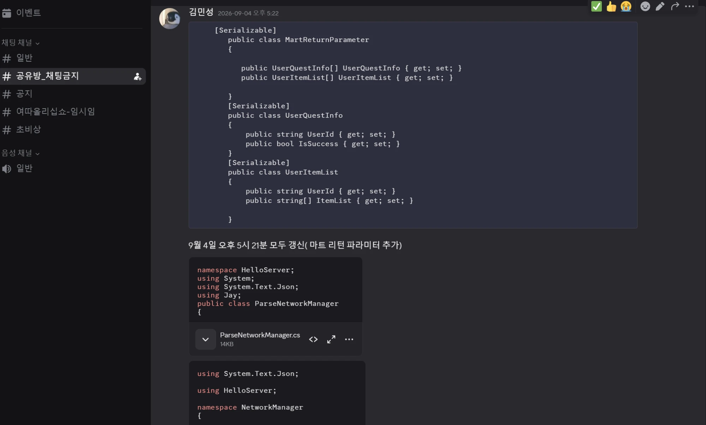

### 2.4 동시에 도는 루프와 공유 상태

서버 안에서는 멤버마다 수신 루프와 송신 루프가 하나씩, 서버 전체에 10Hz 진행 루프가 하나 돕니다. 서로 다른 루프가 같은 게임 상태를 건드리는 지점마다 보호 방법을 따로 골랐습니다.

| 공유 상태 | 보호 방법 | 이유 |
|---|---|---|
| 방 목록 (`RoomHub`) | `lock(gate)` | 방이 있는지 확인하고, 없으면 만들고, 인원을 늘리는 일이 한 번에 끝나야 함 |
| 입장 · 퇴장 (`Room`) | `SemaphoreSlim` | 구간 안에 `await`가 있어 `lock`을 쓸 수 없음 |
| 아이템 소유권 · 투표 | `ConcurrentDictionary.TryAdd` | 확인과 등록을 한 번에 하므로 먼저 온 요청만 성공 |
| 게임 시작 · 종료 플래그 | `Interlocked.CompareExchange` | 동시에 불려도 한 번만 실행 |
| 송신 | 멤버별 `Channel` + Writer 1개 | 한 소켓에 보내는 쪽이 하나뿐이라 동시에 보내는 일이 없고 순서가 지켜짐 |
| 데이터 표 조회 (`DataManager`) | `ReaderWriterLockSlim` | 여러 방이 동시에 읽기만 하므로 읽기는 함께, 쓰기(로드)만 혼자 |

## 3. 마트 아이템을 모두에게 똑같이 놓기

마트 파트에서는 서버가 랜덤으로 뽑은 아이템이 네 명의 화면에서 같은 매대, 같은 자리에 놓여야 했고, 같은 물건을 여러 명이 동시에 집으면 한 명만 가져가야 했습니다. 서버는 카테고리별 아이템 ID 묶음만 보내고, 클라이언트는 같은 TSV 표에서 아이템을 찾아 놓는 방식으로 정했고, 받는 쪽인 클라이언트 매대 배치까지 직접 만들었습니다. 연결해 보니 메시지가 마트 씬보다 먼저 도착하는 순서 문제, 구역마다 9개까지만 놓이는 문제, 클라이언트마다 다른 위치에 뜨는 문제가 차례로 나왔고, 이를 고쳐 네 명이 같은 마트를 보게 했습니다.

### 3.1 서버가 뽑고, ID 묶음만 보낸다

서버와 클라이언트가 같은 TSV 표를 갖고, 서버는 ID만 보냅니다. 클라이언트는 받은 ID로 자기 표에서 이름·그림을 찾습니다. 그래서 메시지가 작고, 표를 바꾸면 양쪽이 같은 데이터를 봅니다. 장르·키워드·아이템 표는 서버가 켜질 때 한 번 읽고, 카테고리마다 뽑을 아이템 수 같은 규칙 값은 `appsettings.json`에 둡니다.

마트에 들어가는 상태(`MartEnterState`)가 되면, 서버는 이번 라운드의 카테고리마다 아이템을 무작위로 뽑아 카테고리와 ID 목록을 짝지은 묶음으로 보냅니다.

```csharp
        public class MartEnterParameter
        {
            public CategoryItemArray[] AllCategoryItemArrays{ get; set; }
            public string TargetItemId { get; set; }
        }

        public class CategoryItemArray
        {
            public CategoryType Category { get; set; }
            public string[] ItemIds { get; set; }
        }
```

클라이언트에서는 해석 매니저가 이 묶음을 풀어 마트 진입 이벤트로 넘깁니다.

### 3.2 받는 쪽도 직접 만들었다

이 방법은 클라이언트 쪽도 같은 표를 읽어야 동작하기 때문에, 클라이언트 마트 부분의 데이터 로드는 클라이언트 담당자와 이야기해 허락을 구한 뒤 제가 기초 구조를 짜고 직접 수정했습니다. 장르·카테고리·키워드·아이템 표를 DTO → Def → DataTable → DataManager 구조로 읽고, 매대 프리팹 크기에 맞춰 칸을 자동으로 나누는 그리드와, 구역(Area)마다 매대에 아이템을 놓는 `DisplayStandManager`를 만들었습니다.

처음에는 클라이언트가 스스로 카테고리와 아이템을 무작위로 골라 놓았습니다. 서버와 연결하면서, 서버가 보낸 묶음의 카테고리 순서대로 구역을 정하고 그 카테고리의 아이템 ID를 그 구역의 매대에 놓도록 바꿨습니다. 묶음 안의 순서가 곧 구역 번호이므로, 같은 묶음을 받은 클라이언트는 모두 같은 구역에 같은 카테고리를 놓습니다.

```csharp
    public void SetCategoryAllArea(CategoryType[] categoryTypes)
    {
        if (categoryTypes.Length != Areas.Count)
        {
            Debug.LogError
                ($"[DisplayStandManager] : SetCategoryAllArea failed. " +
                 $"categoryTypes length {categoryTypes.Length} does not match AllArea count {Areas.Count}.");
            return;
        }

        CategoryDic.Clear(); //딕셔너리 초기화

        for (int i = 0; i < categoryTypes.Length; i++)
        {
            CategoryDic[categoryTypes[i]] = (AreaNum)i;
        }
    }
```

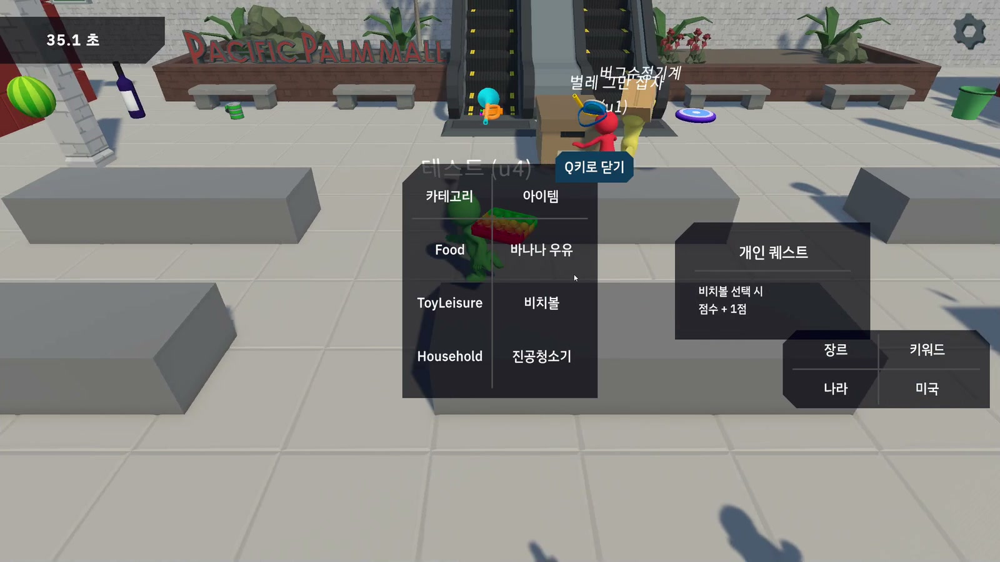

### 3.3 메시지가 마트 씬보다 먼저 도착했다

마트 진입 메시지를 받으면 클라이언트는 마트 씬을 불러온 뒤 아이템을 놓아야 합니다. 그런데 씬 로드는 비동기라서, 처음 구조에서는 씬과 `DisplayStandManager`가 준비되기 전에 아이템을 놓으려 할 수 있었습니다. 매니저 쪽도 데이터 표가 다 읽히기 전에 아이템 정의를 찾으면 안 됐습니다.

그래서 마트 진입 처리를 비동기 함수로 바꿔, 씬 로드를 기다리고 `DisplayStandManager`가 준비됐다는 표시(`IsReady`)가 켜질 때까지 기다린 뒤에 묶음을 넘기게 했습니다. 매니저도 데이터 매니저가 준비될 때까지 기다린 뒤 초기화하고, 매대 등록은 매니저가 준비된 뒤에 받게 했습니다.

```csharp
        private async UniTask OnMartEnterStateAsync(float timerMs, int cycle, int round, string questId, CategoryItemArray[] allCategoryItemArrays)
        {
            DoSetPhase(TurnMessageType.MartEnterState, timerMs, cycle, round);
            await DoLoadScene("02. NewMart");
            await UniTask.WaitUntil(() => DisplayStandManager.Instance != null && DisplayStandManager.Instance.IsReady);
            // … 받은 ID 문자열을 숫자로 바꿔 로그로 남김
            DisplayStandManager.Instance.SetItemIdBufferForArea(allCategoryItemArrays);
        }
```

### 3.4 9개만 놓이고, 클라이언트마다 다른 위치에 떴다

클라이언트로 직접 플레이하며 테스트해 보니 문제가 두 가지 남아 있었습니다. 클라이언트마다 구역마다 아이템이 9개까지만 놓이고 나머지 매대는 비어 있었고, 같은 아이템이 클라이언트마다 다른 위치에 떴습니다.

9개 문제는 클라이언트 쪽 버그였습니다. 구역의 매대를 하나씩 도는 반복문 안에서, 매대 번호(`j`) 대신 매대 한 개의 칸 수(3)까지 도는 번호(`k`)로 매대를 고르고 있었습니다. 그래서 어느 구역이든 앞의 매대 3개에만 3칸씩, 9개가 놓였습니다.

```csharp
// 바꾸기 전
for (int j = 0; j < area.DisplayStands.Count; j++)
{
    for (int k = 0; k < DisplayStand.ItemMaxCount; k++)
    {
        SetCategoryItemInStand(area.DisplayStands[k]);
    }
}
// 바꾼 뒤
for (int j = 0; j < area.DisplayStands.Count; j++)
{
    SetCategoryItemInStand(area.DisplayStands[j]);
}
```

위치 문제는 서버가 카테고리와 아이템을 담아 보낼 때의 버그였습니다. 서버는 카테고리 순서를 무작위로 한 칸씩 밀어서 아이템을 뽑았는데, 묶음에 붙이는 카테고리 이름은 밀지 않은 원래 순서로 붙이고 있었습니다. 그래서 아이템 목록과 카테고리 이름이 엇갈린 채로 보내졌습니다. 아이템을 뽑은 카테고리를 그대로 묶음에 붙이게 고쳤고, 다음 날에는 카테고리 순서를 밀지 않게 해서 마트의 구역 순서와 플레이어 가방의 칸 순서가 같은 카테고리 순서를 따르게 맞췄습니다.

### 3.5 같은 물건은 먼저 집은 한 명만

마트에서 같은 물건을 여러 명이 거의 동시에 집으면, 한 명만 가져가야 했습니다. 클라이언트는 집으려 한다는 요청만 보내고, 누가 가져갈지는 서버가 정합니다. 서버는 아이템 ID를 키로 하는 `ConcurrentDictionary`에 `TryAdd`로 소유자를 등록해서, 확인과 등록을 한 번에 처리합니다. 먼저 등록한 요청만 성공하고, 늦게 온 요청은 무시합니다.

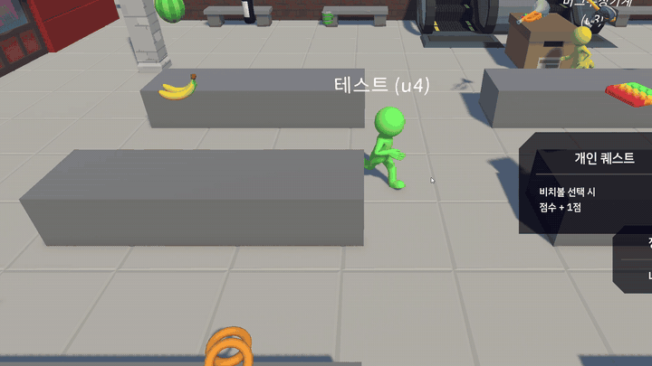

```csharp
            case Protocol.InteractionType.ItemHoldQuery:
            {
                bool won = gameManager.itemOwnersDic.TryAdd(interactionMessage.receivedId, member.User.Id);
                if (won == false)
                {
                    Console.WriteLine($"[레이스 컨디션으로 인한 리턴] 건드린 id {member.User.Id}, 건드려진 id{interactionMessage.receivedId}");
                    return;
                }
                // … 성공한 사람의 줍기를 모두에게 보냄
```

이 소유 기록은 처음에 `Room`에 있었는데, 라운드마다 마트에 다시 들어갈 때 지난 기록이 남지 않도록 `GameManager`로 옮기고 마트에 들어갈 때마다 비우게 했습니다.

## 4. 고민과 선택

큰 구조는 두 번 바꿨습니다. 한 번은 앞으로 더 편하게 개발하는 구조로 바꾸려고, 한 번은 코드 리뷰를 받고 바꿨습니다.

### 4.1 상태 메시지를 봉투 하나로 정리

처음에는 상태마다 메시지 클래스를 따로 만들었습니다. 그런데 상태가 22개로 늘면서 클래스와 분기가 서버와 클라이언트 양쪽에서 계속 늘어났습니다.

상태가 더 늘기 전에, 바꿀 거면 빨리 바꾸는 게 낫다고 판단했습니다. 다만 클라이언트 쪽 코드도 함께 바뀌는 일이라, 착수 전에 클라이언트 담당자에게 효과와 필요성을 설명하고 "일정 안에 어려우면 바꾸지 않겠다"는 선택지도 먼저 드렸고, 동의를 받은 뒤 09-02에 바꿨습니다. 해석 쪽은 클라이언트용 매니저를 직접 만들어 전달했습니다.

세 방법을 비교했습니다.

| 방법 | 장점 | 이 게임에서의 문제 |
|---|---|---|
| 상태마다 메시지 클래스 (처음) | 타입이 분명함 | 상태가 늘 때마다 서버·클라이언트 양쪽에 클래스와 분기가 늘어남 |
| 모든 필드를 담은 큰 클래스 하나 | 분기 없음 | 상태마다 쓰지 않는 필드가 섞여 무엇을 읽어야 하는지 흐려짐 |
| 공통 봉투 + `Parameter` JSON (선택) | 공통 필드는 한 곳, 상태별 데이터만 따로 | `Parameter`를 한 번 더 해석해야 함 |

바꾸기 전에는 상태마다 메시지 클래스를 하나씩(22개) 두고, 남은 시간·사이클·라운드를 클래스마다 다시 선언했습니다.

```csharp
// Protocol.cs (바꾸기 전) — 22개 중 두 개. 나머지도 같은 네 필드를 되풀이
    public class KeywordDistributeStateMessage
    {
        public string Type { get; set; } = "키워드 뿌리기 상태";
        public float TimerMs { get; set; }
        public int CurrentCycle { get; set; }
        public int CurrentRound { get; set; }
        public int KeywordId { get; set; } // 라이어는 라이어 키워드, 나머지는 일반
    }

    public class ShowItemAndSpeakStateMessage
    {
        // … Type · TimerMs · CurrentCycle · CurrentRound 네 필드를 위와 똑같이 다시 선언
        public string CurrentOwnerID { get; set; } // 현재 발언 차례인 유저
        public string CurrentCategory { get; set; } // 현재 사이클의 아이템 카테고리
    }
```

바꾼 뒤에는 공통 필드는 봉투(`TurnMessage`) 하나에 두고, 상태마다 다른 값만 파라미터 클래스로 따로 담습니다. 보내는 코드는 팩토리 한 줄씩이 됐습니다.

```csharp
// 바꾼 뒤 — 세 상태 모두 TurnMessage 하나로
        TurnMessageFactory.KeywordDistribute(MaxMsTime, gameManager.currentCycle, gameManager.currentRound,
            gameManager.CurrentKeyWord.KeywordId);
        BroadcastAsync(TurnMessageFactory.ShowItemAndSpeak(MaxMsTime, gameManager.currentCycle, gameManager.currentRound,
            gameManager.focausUser.Id, gameManager.currentCategory.ToString()));
        BroadcastAsync(TurnMessageFactory.DebateTime(MaxMsTime, gameManager.currentCycle, gameManager.currentRound));

// Protocol.cs — 상태마다 다른 값만 (변론 시간처럼 다른 값이 없으면 파라미터 클래스도 없음)
        public class KeywordDistributeParameter
        {
            public int KeywordId { get; set; }
        }
        public class ShowItemAndSpeakParameter
        {
            public string CurrentFocusID { get; set; }
            public string CurrentCategory { get; set; }
        }
```

| | 바꾸기 전 | 바꾼 뒤 |
|---|---|---|
| 메시지 클래스 | 상태마다 1개 (22개) | 봉투 `TurnMessage` 1개 + 다른 값이 있는 상태만 파라미터 클래스 |
| 남은 시간·사이클·라운드 | 클래스마다 다시 선언, 상태마다 직접 채움 | 봉투에 한 번, 팩토리가 채움 |
| 보내는 코드 | 필드를 몇 줄씩 채운 뒤 보냄 | 팩토리 한 줄 |
| 새 상태 추가 | 서버·클라이언트 양쪽에 클래스와 분기를 추가 | `TurnMessageType`에 값 하나 + (필요할 때만) 파라미터 클래스 + 팩토리 메서드 하나 |
| 클라이언트 해석 | 상태마다 따로 | 해석 매니저 한 곳 |

이 변경으로 파일 30개를 바꿨고, 새 상태를 추가하는 일이 타입 값 하나, 필요할 때만 파라미터 클래스, 팩토리 메서드 하나의 세 단계로 정리됐습니다.

### 4.2 코드 리뷰를 이틀 만에 반영

09-08에 서버 코드 리뷰를 받았고, 지적된 내용을 이틀 동안(09-09 ~ 09-10) 거의 모두 고쳤습니다.

| 지적된 문제 | 고친 방법 |
|---|---|
| 게임 로직이 타이머 콜백 안에서 돌아, 거기서 난 예외가 사라짐 | 상태별 타이머를 없애고, 10Hz 진행 루프 안에서 게임을 진행 |
| 없는 아이템 ID, 게임 시작 중복 요청, 같은 사람의 중복 투표 | ID 예외 처리, 시작을 원자적으로 검사, 투표를 딕셔너리로 |
| 방송 루프에서 다른 방끼리 묶여서 보내짐 | 방마다 따로 보내기, 채팅 대기 예외 처리 |
| 상태 메시지를 보내고 실패를 확인하지 않음, 상태마다 같은 시간 조건 반복 | 실패를 붙잡아 로그로, 시간 조건을 부모로 올림 |
| 종료 처리 · 길이 · 개수 상한 없음 | 소켓 닫기 인사, 문자열·방 개수 상한, 안전 종료 |
| 락을 쥔 채로 전송 대기, 조용히 넘어가는 오류 | 전송을 락 밖으로, 메시지 길이 제한 |
| 클라이언트가 보낸 ID를 그대로 믿음 | 서버가 아는 연결 정보로 판단 |
| 수신 루프가 방 전원의 전송이 끝나기를 기다림 | 멤버별 보낼 함(Outbox)으로 송수신 분리 |

바꾸기 전에는 상태마다 `System.Timers.Timer` 콜백에서 게임이 진행됐습니다.

```csharp
        gameManager.currentRoom.timer.AutoReset = true;
     currentMsTime = 0;
     gameManager.currentRoom.timer.Elapsed += Tick;
     gameManager.currentRoom.timer.Start();
```

바꾼 뒤에는 10Hz 진행 루프 한 곳에서 진행하고, 시간 판정은 부모 한 곳에서 합니다.

```csharp
// RoomHub.cs — 방송 루프 안에서 게임 진행
                foreach (var room in snapshot)
                {
                    // 만약 게임 중이라면 게임 진행을 한다.
                    if (room.gameManager.IsGameRunning) room.GameTick();
                …

// BaseGameTurnState.cs — 지난 시간을 실제 시각으로 재고, 다음 상태로
    public virtual void Tick()
    {
        currentMsTime = (int)(DateTime.Now - startTime).TotalMilliseconds;
        if(currentMsTime % 5000 == 0)
            Console.WriteLine($"[{gameManager?.currentRoom?.code}][스테이트 머신][{GetGameStateString()?? "null"}] 현재 Timer 상태: {currentMsTime}");
        if (currentMsTime > MaxMsTime && NextState != null)
            stateMachine.ChangeState(NextState);
```

송수신 분리(Outbox)는 리뷰에서 지적된 문제이면서, 플레이 테스트에서 채팅이 약 3초 늦게 도착하는 문제로 실제로 드러난 문제입니다. 보내는 쪽은 멤버마다의 보낼 함에 넣고 바로 돌아오므로, 느린 소켓 하나가 다른 멤버의 전송을 막지 않습니다.

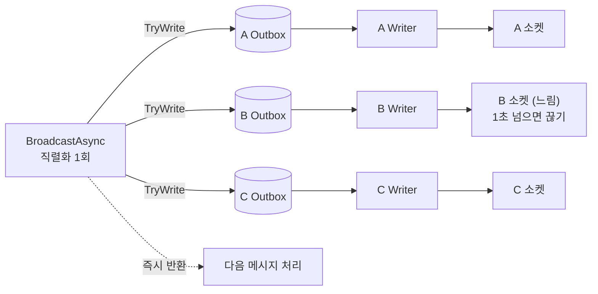

```csharp
// 보내기: 함에 넣고 바로 반환
    public Task BroadcastAsync(object message, string exceptId = null)
    {
        byte[] bytes = Encoding.UTF8.GetBytes(JsonSerializer.Serialize(message, message.GetType()));
        foreach (Member member in members.Values)
        {
            if (member.User.Id == exceptId) continue;
            member.Outbox.Writer.TryWrite(bytes); // 락 대기 없음, 순서 보장됨
        }
        return Task.CompletedTask;
    }
// 멤버별 Writer(WriterLoopAsync, 일부): 함에서 꺼내 보내고, 1초 넘게 걸리면 그 연결만 끊음
            await foreach (byte[] bytes in member.Outbox.Reader.ReadAllAsync(member.WriterCts.Token))
            {
                using var sendCts = CancellationTokenSource.CreateLinkedTokenSource(member.WriterCts.Token);
                sendCts.CancelAfter(TimeSpan.FromSeconds(1));
                try { await member.Socket.SendAsync(bytes, WebSocketMessageType.Text, true, sendCts.Token); }
                catch (OperationCanceledException) when (member.WriterCts.IsCancellationRequested == false)
                { member.Socket.Abort(); } // 나가려는 게 아니라 진짜 타임아웃 → 끊긴 걸로 간주
            }
```

두 번의 리팩토링을 돌아보면, 1차는 코드가 늘어나는 불편을 스스로 느껴서 바꿨고, 2차는 제가 보지 못한 위험(예외가 사라지는 곳, 믿으면 안 되는 입력)을 리뷰로 알게 됐습니다. 지적을 미루지 않고 바로 고치면서, 서버에서는 실패를 조용히 넘기지 않는 것과 클라이언트를 믿지 않는 것이 기본이라는 것을 배웠습니다.

### 4.3 서버가 판정하는 것과 아닌 것

대상이 교육과정 내부 사용자이고 일정이 약 2.5주라 보안은 의도적으로 뒤로 미뤘습니다. 그래도 결과에 직접 영향을 주는 판정에는 서버 권위를 적용했습니다.

| 영역 | 상태 |
|---|---|
| 아이템 소유권 | 서버 판정 — 먼저 온 한 명만 |
| 상태별 행동(투표 · 지목 등) | 현재 FSM 상태가 아니면 무시 |
| 라이어의 키워드 맞추기 | 라이어가 낸 답을 서버가 받아 판정하고 점수 계산 (그 상태일 때만 받음) |
| 준비 수 | 서버가 세어 보냄 |
| 이동 좌표 | 클라이언트 값 그대로 (검증 없음) |
| 채팅 닉네임 | 클라이언트 값 그대로 |

준비 수는 처음에는 클라이언트가 직접 셌습니다. 준비 메시지를 받을 때마다 클라이언트가 수를 하나씩 올렸는데, 클라이언트로 플레이하며 테스트해 보니 새 유저가 방에 들어오면 그 유저는 준비 수를 0부터 세고, 이미 준비한 사람의 준비 버튼이 다시 켜졌습니다. 같은 날 서버가 준비한 인원을 세어 준비 메시지와 입장 메시지에 담아 보내도록 프로토콜을 바꾸고, 클라이언트는 그 수를 그대로 쓰게 양쪽을 함께 고쳤습니다.

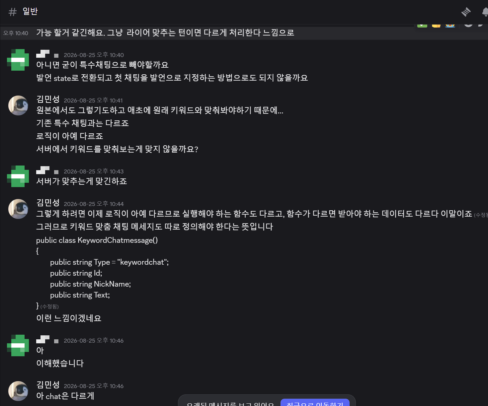

### 4.4 규칙의 빈틈을 서버에서 막기

여러 명이 함께 테스트 플레이를 하면서, 기획서에 없던 경우를 하나씩 찾았습니다. 투표를 안 한 사람, 동률, 같은 버튼을 여러 번 누르는 사람 등입니다. 하나씩 서버가 정한 규칙대로 처리했습니다.

| 생기는 경우 | 서버의 처리 |
|---|---|
| 투표하지 않은 사람이 있음 | '모르겠다'를 고른 것으로 보고 집계 |
| 투표 동률 | '라이어다'와 '모르겠다'의 동률은 라이어 확정, 그 밖의 동률은 미확정 |
| '지목 안 함'을 누른 사람이 과반 | 지목 대상 없음으로 처리 |
| 같은 사람이 '지목 안 함'을 여러 번 누름 | `ConcurrentDictionary.TryAdd`로 한 번만 셈 |
| 같은 카테고리 물건을 또 가방에 넣음 | 원래 물건과 바꾸고, 내려놓은 물건은 다시 주울 수 있게 |
| 마트에서 물건을 못 챙김 | 같은 카테고리 안에서 무작위로 채우되, 이미 가진 물건과 겹치지 않게 |
| 최종 점수 동점 | 최고 점수인 사람 모두를 우승자로 보냄 |
| 호스트가 나감 | 남은 사람에게 호스트를 넘김 |
| 2명 이하에서 시작 | 3명 이상일 때만 시작 |

클라이언트는 버튼을 누른 사실만 보내고, 집계와 판정은 모두 서버가 합니다. 그래서 위의 경우가 생겨도 모든 클라이언트가 같은 결과를 받습니다. 서버 로그에는 방 코드와 상태 이름을 붙여, 여러 방이 동시에 돌 때도 어느 방의 어느 상태에서 생긴 일인지 구분했습니다.

## 5. 고친 문제

목표로 한 게임 진행을 서버에서 끝까지 동작시켰습니다. 아래 세 문제는 개발과 플레이 테스트 중에 만났습니다. 앞의 두 문제는 해결했고, 마지막 문제는 서버 쪽 처리만 하고 클라이언트 쪽 처리가 남았습니다.

### 빌드 서버에서 TSV 표를 읽지 못한 문제

데이터 매니저와 TSV 표를 넣고 빌드 서버에 올렸더니, 로컬에서는 잘 읽히던 표를 서버가 읽지 못했습니다.

표는 빌드 결과 폴더(`AppContext.BaseDirectory`)를 기준으로 찾습니다. 그런데 .NET 프로젝트는 `.cs`나 `appsettings.json`처럼 정해진 파일만 빌드 결과에 넣고, 따로 지정하지 않은 `.tsv` 파일은 빌드 결과에서 빠집니다. 검색으로 이 동작을 알게 됐습니다.

그래서 프로젝트 설정 파일(`HelloServer.csproj`)에 `Table` 폴더의 TSV를 빌드 결과로 복사하라는 설정을 넣고, 파일이 없을 때 찾은 경로를 남기는 로그도 함께 넣었습니다. 직접 배포용으로 빌드해 본 결과에 `Table/*.tsv`가 들어간 것을 확인했고, 같은 날 46분 만에 고쳤습니다.

제 PC에서 읽히던 표가 빌드 결과에는 없었던 이 일로, 코드가 아닌 데이터 파일은 빌드 결과에 무엇이 들어가는지 직접 확인해야 한다는 것을 배웠습니다.

```xml
<!-- 바꾸기 전 — 패키지만 -->
  <ItemGroup>
    <PackageReference Include="CsvHelper" Version="33.1.0" />
  </ItemGroup>

</Project>

<!-- 바꾼 뒤 — TSV를 빌드 결과로 복사 -->
  <ItemGroup>
    <PackageReference Include="CsvHelper" Version="33.1.0" />
  </ItemGroup>
  <ItemGroup>
    <None Include="Table\**\*.tsv">
      <CopyToOutputDirectory>PreserveNewest</CopyToOutputDirectory>
    </None>
  </ItemGroup>
</Project>
```

### 채팅이 약 3초 늦게 도착하던 문제

4대 PC 플레이 테스트 중 채팅이 약 3초 늦게 도착했습니다.

의심 지점에 로그를 넣어 서버 송신 시각과 클라이언트 수신 시각을 비교해 보니, 병목은 로직이 아니라 송신 단계였습니다. 채팅을 받은 수신 루프가 방 전원에게 보내기가 모두 끝날 때까지(`Task.WhenAll`) 기다렸고, 멤버마다 보내기는 상태·위치 방송과 같은 송신 락을 시한 없이 기다렸습니다. 그래서 한 사람에게 보내기가 늦어지면, 채팅을 보낸 사람의 수신 루프도 다음 메시지를 읽지 못하고 대기가 쌓였습니다.

먼저 채팅 처리의 `await`를 빼서 급한 불을 끄고, 같은 날 멤버별 보낼 함과 Writer 루프로 송수신을 분리했습니다. 이후 게임 3판 동안 지연이 다시 나타나지 않았습니다.

### 게임 중 한 명이 나가면 망가진 채 진행되던 문제

게임 도중 한 명이 나가면, 나간 사람의 발언 차례에 타이머만 흐르고 인원 부족으로 투표가 무효가 되는 등 망가진 상태로 진행됐습니다.

퇴장 처리가 멤버만 지우고 게임 흐름은 그대로 두었기 때문입니다. 라이어 게임은 인원 구성 자체가 전제라서, 남은 인원으로 계속하지 않고 게임을 끝내도록 바꿨습니다. 방에 만료 표시를 하고 `GameEnd()`를 부른 뒤 방 전용 취소 토큰을 취소하면, 연결된 모든 수신 루프가 함께 끝나고 각자 정리됩니다.

서버는 남은 사람들에게 퇴장 메시지를 보냈지만, 클라이언트 쪽에서 이 상황을 처리하는 부분이 구현되지 않아 모두의 화면이 그대로 멈춰 버렸습니다. 서버가 게임을 끝낼 때는 끝난 이유까지 알려야, 받는 쪽이 화면을 정리할 수 있다는 것을 배웠습니다.

```csharp
            members.TryRemove(member.User.Id, out _);
            if (gameManager.IsGameRunning && roomExpiredCancellation.IsCancellationRequested == false)
            {
                Interlocked.Exchange(ref roomExpired, 1);
                gameManager.GameEnd();

                await roomExpiredCancellation.CancelAsync();
            }
```

## 6. 회고

### 아쉬운 점과 다시 만든다면

- 멤버별 보낼 함에 상한이 없어서, 느린 클라이언트의 함이 계속 쌓일 수 있습니다. 지금은 송신이 1초를 넘으면 연결을 끊는 것으로 막고 있습니다.
- 이동 좌표와 채팅 닉네임은 아직 클라이언트가 보낸 값을 그대로 믿습니다.
- 클라이언트가 서버로 보내는 메시지 타입은 첫날 정한 문자열 그대로 남았습니다. 상태 메시지처럼 enum으로 묶고 싶습니다.
- 게임 도중 누가 나가 게임이 끝나도, 끝난 이유를 클라이언트에 알리는 메시지가 아직 없습니다.
- 다시 만든다면 `Room.cs`(862줄)에 몰린 책임을 나누고 싶습니다.

### 돌아보며

시간을 가장 많이 쓴 버그는 여러 명이 함께 테스트하면서 나온, 기획서에 없는 경우였습니다. 투표하지 않은 사람, 동률, 같은 버튼을 여러 번 누르는 사람 같은 아홉 가지를 하나씩 서버 규칙으로 막느라, 기능을 더 넣고 완성도를 높이지 못한 것이 아쉽습니다. 다음에는 규칙을 구현하기 전에 "누르지 않으면 · 동시에 누르면 · 여러 번 누르면 · 중간에 나가면"을 먼저 표로 정해 두고 시작하겠습니다.

서버를 처음 제대로 다뤄 본 프로젝트였습니다. 채팅이 3초씩 늦게 도착하던 문제를 겪으며, 보내기를 기다리는 동안 받기까지 멈춰 있으면 한 사람의 느린 연결이 방 전체를 늦춘다는 것을 알았고, 그 뒤로 비동기 코드를 더 공부했습니다. 상태 메시지를 봉투 하나로 바꿀 때는 클라이언트 코드까지 바뀌었는데, 먼저 효과를 설명하고 하지 않을 수도 있다는 선택지를 드린 뒤 진행해야 한다는 것을 배웠습니다.

가장 아쉬운 점은 목표한 경험을 시스템으로 끌어내지 못한 것입니다. 머리를 맞대 아이디어를 짜냈지만, 약 2.5주라는 기한과 숙련도 부족으로 늘어난 버그 수정 시간 때문에 대부분 타협했습니다. 결국 피드백에서 라이어 게임 파트와 마트 물건 사이의 연결점과 설명할 동기가 약하다는 이야기를 들었고, 실제 플레이도 제작자의 의도대로 흘러가지 않았습니다.

다음 프로젝트에서는 '목표한 경험'을 중심으로 기획과 시스템을 먼저 짜고, 그 경험에 꼭 필요한 기능부터 넣겠습니다. 시간이 모자라 빠지던 기능은 AI를 활용해 개발 시간을 줄이는 방법도 써 보고 싶습니다.
