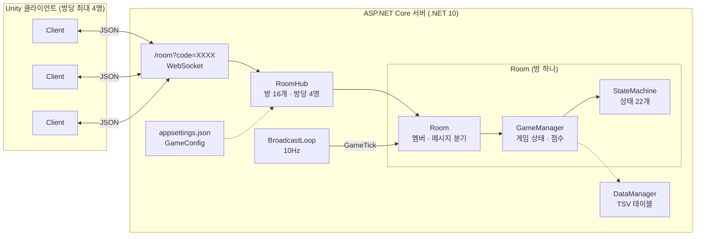
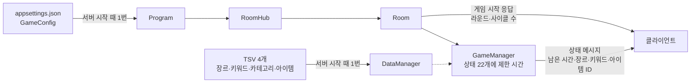
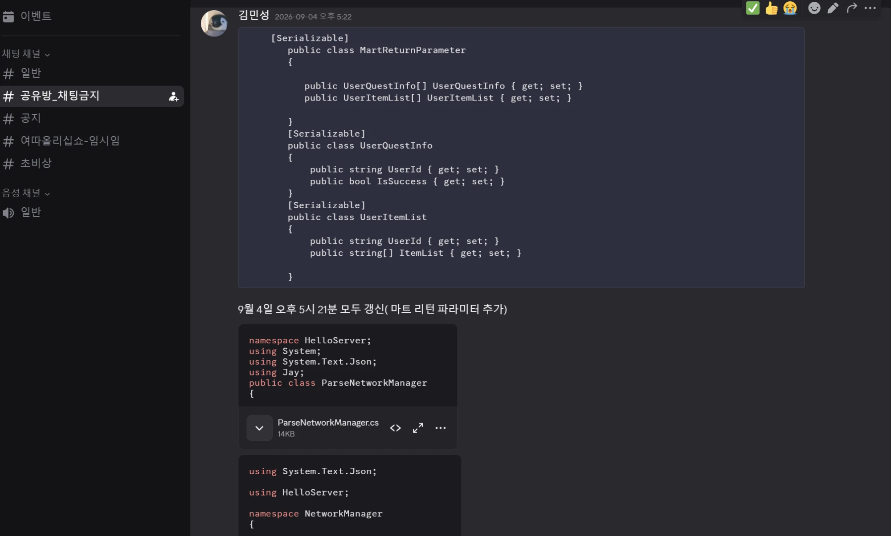
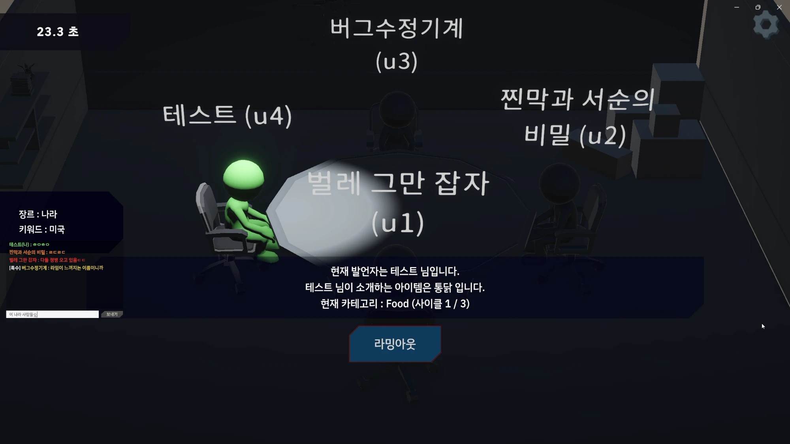
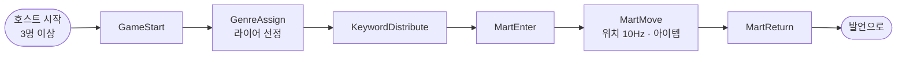
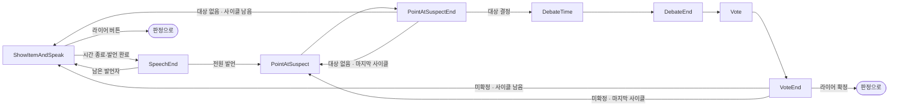
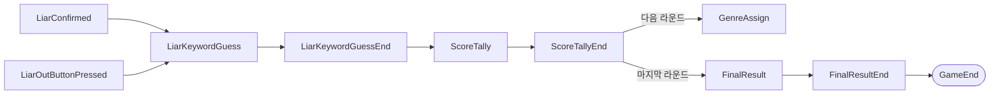
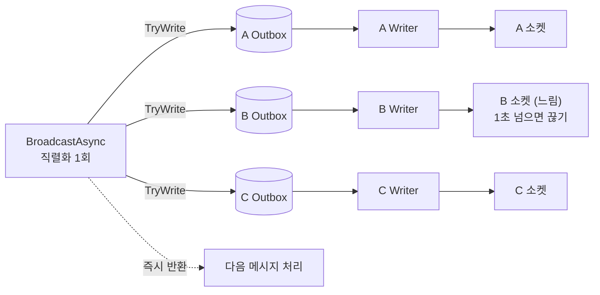
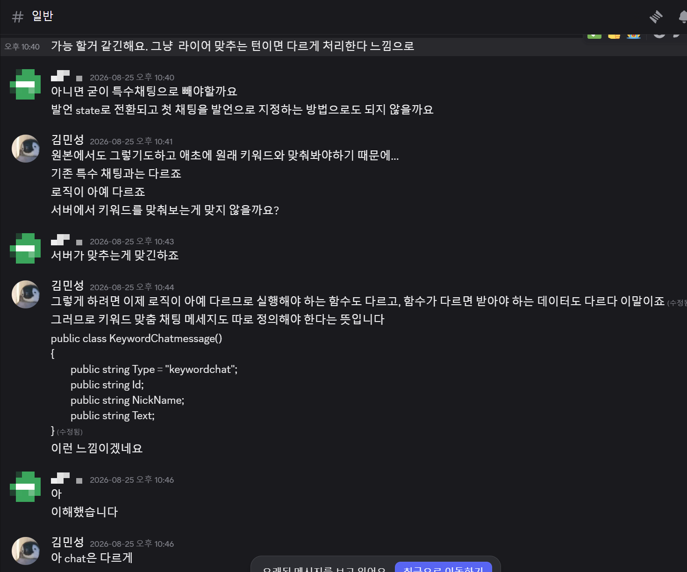

# 시장에 가면 — 라이어 게임 서버

> 4인 교육과정 팀 프로젝트에서 **서버를 혼자 맡았습니다.** 마트에서 물건을 고르고, 그 물건을 키워드와 엮어 소개하는 라이어 게임의 ASP.NET Core WebSocket 서버입니다.


## 1. 개요

### 무엇을 만들었나

물건을 고르고 설명하는 라이어 게임입니다. 마트에서 물건을 골라, 장르에 맞는 키워드(라이어는 다른 키워드)와 연관 지어 소개합니다(3~4인).


제가 맡은 부분은 서버입니다.

- 게임 시작, 라이어와 장르·키워드 배정 후 모두에게 보내기
- 시간에 따른 라이어 게임 턴 진행 (상태 22개)
- 마트에서 받은 움직임·아이템 줍기와 채팅 정보를 판정해 모두에게 보내기

### 왜 서버가 맡았나

랜덤 요소, 시간, 현재 턴은 모든 클라이언트가 똑같이 봐야 하는 동기화 요소이면서, 서버가 권위를 가져야 하는 요소라고 판단해 서버에서 맡기로 했습니다. 그리고 마트 파트에서 물리 요소나 버튼을 연속으로 누르는 경우처럼, **여러 요청이 동시에 들어올 때의 처리**를 풀어야 했습니다.

### 개발 환경

| 항목 | 내용 |
|---|---|
| 장르 | 마트에서 물건을 골라 키워드와 연관 지어 소개하는 라이어 게임 (3~4인) |
| 기간 | 2026.08.25 ~ 2026.09.10 (약 2.5주) |
| 인원 | 4인 팀 (서버 1 · 클라이언트 3) |
| 내 역할 | 서버 단독 — 주로 시간에 따른 게임 턴 시스템 |
| 환경 | ASP.NET Core (.NET 10) · WebSocket · System.Text.Json |
| 패키지 | CsvHelper 33.1.0 (TSV 데이터 테이블) |
| GitHub | https://github.com/KooHoo-Dev/3rd-TeamProject-SH-Server (원본 태그 `v1.0-project-end`) |
| 시연 영상 | 준비 중 |

### 팀과 내 역할

| 팀원 | 담당 |
|---|---|
| **본인** | **서버 전체** |
| 클라이언트 A | 맵 · UI |
| 클라이언트 B | 라이어 게임 로직 |
| 클라이언트 C | 마트 |

서버는 수업에서 제공된 **WebSocket 기반 코드** 위에 만들었습니다. 이 문서는 제가 만든 부분만 다룹니다.

| 영역 | 수업 기반 코드 | 내가 만들거나 고친 것 |
|---|---|---|
| `RoomHub` | 방 코드로 방 찾기·생성, 빈 방 삭제, 10Hz `PeriodicTimer` 루프 | 방당 4명 · 방 16개 상한, 틱마다 게임 진행 연결, 마트 이동 상태에서만 위치 송출 |
| `Room` | 입장(hello/welcome)·퇴장, 수신 루프, 이동·채팅, 멤버별 송신 | 송수신 분리(Outbox), 수신 1MB 상한, 호스트 지정·위임, 준비·시작, 게임 중 이탈 처리, 게임 메시지 처리 약 10종 (파일의 약 70%) |
| `Protocol` | 기본 메시지 몇 종 | 게임 전체 메시지 설계와 관리, `TurnMessage` 통합 (파일의 약 90%) |
| 새로 만든 것 | — | `GameManager`, FSM과 상태 22개, `DataManager`·TSV 읽기, `TurnMessageFactory`, 클라이언트에 전달한 네트워크 매니저 |


### 핵심 루프

게임을 시작하고, 마트에서 물건을 고르고, 라이어 게임을 진행해서, 점수를 얻거나 잃습니다. 한 판은 서버의 상태 22개를 차례로 지나갑니다.

### 이 문서에서 다루는 것

1. **시스템 구조** — 방마다 독립된 게임 흐름, 동시에 도는 루프와 공유 상태
2. **핵심 기능** — 설정 파일과 데이터 표를 읽어 클라이언트로 보내는 흐름 · 상태 메시지 하나(`TurnMessage`)와 클라이언트에 건넨 해석 매니저 · 시간으로 진행하는 FSM
3. **리팩토링 두 번** — ① 프로토콜 전면 정리 ② 코드 리뷰를 모두 기한 안에 반영
4. **결과와 회고** — 빌드 서버에서 TSV가 빠진 문제·채팅 지연·게임 중 이탈 해결, 원본을 남긴 채 다시 고친 버그 5건

## 2. 시스템 구조

### 전체 구조

방 코드 하나로 매칭하고, **방마다 독립된 `GameManager`와 FSM**을 가집니다. 상태별 제한 시간·라운드 수 같은 게임 규칙은 코드가 아니라 `appsettings.json`에, 장르·키워드·아이템은 TSV 표에 있습니다.



### 왜 이렇게 나눴나

방마다 하나의 게임 흐름이 존재한다고 생각했기 때문입니다. 그래서 `Room`(사람과 메시지)이 `GameManager`(그 방의 게임 상태와 점수)를 하나 갖고, `GameManager`가 그 방의 흐름을 진행하는 `StateMachine`을 하나 갖도록 나눴습니다.

### 동시에 도는 루프와 공유 상태

서버 안에서는 멤버마다 수신 루프와 송신 루프가 하나씩, 서버 전체에 10Hz 진행 루프가 하나 돕니다. 서로 다른 루프가 **같은 게임 상태를 건드리는 지점**마다 보호 방법을 따로 골랐습니다.

| 공유 상태 | 보호 방법 | 이유 |
|---|---|---|
| 방 목록 (`RoomHub`) | `lock(gate)` | 확인 → 생성 → 인원 증가가 한 덩어리여야 함 |
| 입장 · 퇴장 (`Room`) | `SemaphoreSlim` | 구간 안에 `await`가 있어 `lock`을 쓸 수 없음 |
| 아이템 소유권 · 투표 | `ConcurrentDictionary.TryAdd` | 확인과 등록을 한 번에 → 먼저 온 요청만 성공 |
| 게임 시작 · 종료 플래그 | `Interlocked.CompareExchange` | 동시에 불려도 한 번만 실행 |
| 송신 | 멤버별 `Channel` + Writer 1개 | 한 소켓에 송신자는 하나 → 동시 송신 없음, 순서 보장 |

## 3. 핵심 기능

### 3.1 설정 파일과 데이터 표 — 서버가 읽고 클라이언트로 보낸다

**사용법**: 게임 규칙을 바꿀 때 코드를 고치지 않고 `appsettings.json`의 값만 바꿉니다. 상태마다의 제한 시간, 라운드·사이클 수, 점수 변화량이 여기에 있습니다. 장르·키워드·아이템은 TSV 표로 두고, 서버가 켜질 때 한 번 읽습니다. TSV 표가 빌드 결과에 들어가도록 `csproj`를 설정했습니다(→ 5장 문제 해결 1).




**설정 파일** (`appsettings.json`, 일부)

```json
  "GameConfig": {
    "stateGameStartTime": 3,
    "stateGenreAssignAndLiarSelectTime": 5,
    "stateKeywordDistributeTime": 5,
    "stateMartEnterTime": 3,
    …
    "MaxRound": 3,
    "MaxCycle": 3,
    "MaxCategoryItemCount": 18,

    "VoteScoreChangeAmount": 1,
    "KeywordGuessScoreChangeAmount": 2,
    "LiarButtonScoreChangeAmount": 2,
    "QuestScoreChangeAmount": 1
```

**서버 시작 때 읽고, 방마다 넘긴다** (`Program.cs`)

```csharp
        DataManager.Instance.Load();
        GameConfig gameConfig = app.Configuration.GetSection("GameConfig").Get<GameConfig>();


        // 서버에 방을 추가해 줍시다.
        RoomHub hub = new RoomHub(perSecond,  gameConfig);
```

**상태마다 제한 시간을 설정 값으로** (`GameManager.cs` 생성자, 일부)

```csharp
        startState = new GameStartState(stateMachine, this, gameConfig.stateGameStartTime);
        genreAssignAndLiarSelectState =
            new GenreAssignAndLiarSelectState(stateMachine, this, gameConfig.stateGenreAssignAndLiarSelectTime);
        keywordDistributeState = new KeywordDistributeState(stateMachine, this, gameConfig.stateKeywordDistributeTime);
        martEnterState = new MartEnterState(stateMachine, this, gameConfig.stateMartEnterTime);
```

**클라이언트로 보내기** — 게임을 시작할 때 라운드·사이클 수를 먼저 알리고(`Room.cs`), 이후에는 상태가 바뀔 때마다 남은 시간과 그 상태에 필요한 데이터(장르 ID, 키워드 ID, 카테고리별 아이템 ID 등)를 보냅니다(→ 3.2).

```csharp
        Protocol.GameStartOKMessage gameStartOkMessage = new Protocol.GameStartOKMessage();
        Protocol.NewGameConfig newGameConfig = new Protocol.NewGameConfig();
        newGameConfig.MaxCycle = GameConfig.MaxCycle;
        newGameConfig.MaxRound = GameConfig.MaxRound;
        gameStartOkMessage.newGameConfig = newGameConfig;

        await BroadcastAsync(gameStartOkMessage);
```


**동작 원리**: 서버와 클라이언트가 같은 TSV 표를 갖고, 서버는 **ID만** 보냅니다. 클라이언트는 받은 ID로 자기 표에서 이름·그림을 찾습니다. 그래서 메시지가 작고, 표를 바꾸면 양쪽이 같은 데이터를 봅니다. 시간·라운드 같은 규칙 값은 서버만 갖고 있다가 필요한 때에 보내므로, 규칙을 바꿔도 클라이언트를 다시 빌드할 필요가 없습니다.

### 3.2 상태 메시지 하나와 클라이언트에 건넨 해석 매니저

**사용법**: 상태가 바뀔 때마다 서버는 `TurnMessage` 하나를 모두에게 보냅니다. 공통 필드(상태 종류, 남은 시간, 사이클, 라운드)는 봉투에, 상태마다 다른 데이터만 `Parameter`(JSON)에 담습니다.

```csharp
        public class TurnMessage
        {
            public string Type { get; set; } = "turnMessage";
            public TurnMessageType TurnMessageType { get; set; }
            public float TimerMs { get; set; } // 모든 타임은 MS로 들어옴
            public int CurrentCycle { get; set; }
            public int CurrentRound { get; set; }

            // 타입별로 달라지는 나머지 필드 (없을 수도, JSON 객체 하나일 수도 있음)
            public string Parameter { get; set; }

            /// <summary>Parameter를 원하는 파라미터 클래스 타입으로 역직렬화. 없으면 null.</summary>
            public T GetParameter<T>() where T : class
            {
                if (string.IsNullOrEmpty(Parameter)) return null;
                return JsonSerializer.Deserialize<T>(Parameter);
            }
        }
```

**서버 쪽 — 만드는 매니저**: 상태마다 빌더 메서드 하나로 만듭니다 (`CreateNetworkManager.cs`의 `TurnMessageFactory`).

```csharp
        public static Protocol.TurnMessage CreateSimple(Protocol.TurnMessageType type, float timerMs, int cycle,
            int round)
        {
            return new Protocol.TurnMessage
            {
                TurnMessageType = type,
                TimerMs = timerMs,
                CurrentCycle = cycle,
                CurrentRound = round,
                Parameter = null
            };
        }

        /// <summary>파라미터가 있는 상태 메시지 공용 빌더 (Payload를 JSON으로 직렬화).</summary>
        private static Protocol.TurnMessage Create<T>(Protocol.TurnMessageType type, float timerMs, int cycle,
            int round, T parameter)
        {
            return new Protocol.TurnMessage
            {
                TurnMessageType = type,
                TimerMs = timerMs,
                CurrentCycle = cycle,
                CurrentRound = round,
                Parameter = JsonSerializer.Serialize(parameter)
            };
        }
```

**클라이언트 쪽 — 해석하는 매니저**: 봉투를 받으면 상태 종류로 나눠 `Parameter`를 풀고, 상태마다 이벤트 하나를 부릅니다. 클라이언트 팀은 **필요한 이벤트만 구독**하면 됩니다. 이 파일(`ParseNetworkManager.cs`)은 제가 만들어 클라이언트 팀에 전달했습니다.

```csharp
// 상태마다 이벤트 하나 (모두 남은 시간 · 사이클 · 라운드가 앞에)
    public static Action<float, int, int> OnGameStartState;

    // GenreId, CurrentOwnerID
    public static Action<float, int, int, int, string> OnGenreAssignAndLiarSelectState;

    // KeywordId
    public static Action<float, int, int, int> OnKeywordDistributeState;

// 받은 봉투를 상태 종류로 나눠 Parameter를 풀고 이벤트 호출
    public static void MessageParse(Protocol.TurnMessage msg)
    {
        switch (msg.TurnMessageType)
        {
            case Protocol.TurnMessageType.GameStartState:
                OnGameStartState?.Invoke(msg.TimerMs, msg.CurrentCycle, msg.CurrentRound);
                break;

            case Protocol.TurnMessageType.GenreAssignAndLiarSelectState:
            {
                var p = Parse<Protocol.GenreAssignAndLiarSelectParameter>(msg.Parameter);
                OnGenreAssignAndLiarSelectState?.Invoke(msg.TimerMs, msg.CurrentCycle, msg.CurrentRound,
                    p.GenreId, p.CurrentOwnerID);
                break;
            }
            // … 상태 22개
```


전달할 때는 파일과 함께 **사용법**을 같이 남겼습니다. 서버가 새 메시지를 추가하면 이 파일을 다시 갱신해 전달했습니다(커밋 `b7fc9a8`·`dec473f`·`11f750f`).



### 3.3 시간으로 진행하는 FSM — 내가 만든 상태 22개

**사용법**: 서버가 권위를 가지는 게임 진행(시간에 따른 진행도와 분기)은 서버가 상태를 계산해서, 알맞은 때에 모든 클라이언트에게 **다음으로 넘어갈 최대 시간 정보와 함께** 보냅니다. 클라이언트는 받은 상태대로 화면만 바꿉니다. FSM 뼈대(`StateMachine`·`IState`)는 수업 코드이고, 그 위의 `BaseGameTurnState`와 상태 22개를 제가 만들었습니다.

<!-- ✍ Claude 초안: 스크린샷 설명은 화면에 보이는 것을 옮겼습니다 -->


**① 준비 · 마트**



**② 추리 — 발언 · 지목 · 변론 · 투표** (발언 사이클 최대 3회, 마지막 사이클은 지목만 반복)



**③ 판정 · 정산** (라운드 최대 3회)



**분기가 있는 상태만 `Tick()`을 다시 씁니다** (`VoteEndState.cs`)

```csharp
    public override void Tick()
    {
        base.Tick();
        if (currentMsTime > MaxMsTime)
        {

            if (result != Protocol.SelectNum.Liar.ToString() &&
                gameManager.currentCycle >= gameManager.currentRoom.GameConfig.MaxCycle)
            {
                stateMachine.ChangeState<PointAtSuspectState>();
            }
            else if(result != Protocol.SelectNum.Liar.ToString() &&
                    gameManager.currentCycle < gameManager.currentRoom.GameConfig.MaxCycle)
            {
                stateMachine.ChangeState<ShowItemAndSpeakState>();
            }
            else if(result == Protocol.SelectNum.Liar.ToString())
            {
                stateMachine.ChangeState<LiarConfirmedState>();
            }
        }
    }
```

**동작 원리**: 10Hz 진행 루프가 방마다 현재 상태의 `Tick()`을 부릅니다. 부모 `BaseGameTurnState`가 상태에 들어온 뒤 지난 시간을 재고, 제한 시간이 지나면 자식이 선언한 `NextState`로 넘깁니다(→ 4.2). 투표 결과나 사이클 수에 따라 갈라지는 상태만 `Tick()`을 다시 씁니다.

## 4. 고민과 선택 — 리팩토링 두 번

이 프로젝트에서는 큰 구조를 두 번 바꿨습니다. 한 번은 **앞으로 더 편하게 개발하는 구조로 바꾸려고**, 한 번은 **코드 리뷰를 받고** 바꿨습니다.

### 4.1 1차 — 프로토콜 전면 정리 (09-02, `61447ab`)

**문제**: 처음에는 상태마다 메시지 클래스를 따로 만들었습니다. 상태가 22개로 늘면서 클래스와 분기가 서버와 클라이언트 양쪽에서 계속 늘어났습니다.

**결정 과정**: 강사님 조언을 듣고, 바꿀 거면 빨리 바꾸는 게 낫다고 판단했습니다. 착수 전에 클라이언트 담당자에게 효과와 필요성을 설명하고 "일정 안에 어려우면 바꾸지 않겠다"는 선택지도 먼저 드렸고, 동의를 받은 뒤 바꿨습니다. 해석 쪽은 클라이언트용 매니저를 직접 만들어 전달했습니다(→ 3.2).

**바꾸기 전** — 상태마다 메시지 클래스 하나, 상태마다 직접 채워서 보냄

```csharp
// Protocol.cs (61447ab 이전) — 이런 클래스가 상태마다 있었음
    public class DebateTimeStateMessage
    {
        public string Type { get; set; } = "변론 시간 상태";
        public float TimerMs { get; set; }
        public int CurrentCycle { get; set; }
        public int CurrentRound { get; set; }
    }

// DebateTimeState.cs (61447ab 이전)
    public override void Enter()
    {
        base.Enter();
        debateTimeStateMessage.CurrentCycle = gameManager.currentCycle;
        debateTimeStateMessage.CurrentRound = gameManager.currentRound;
        debateTimeStateMessage.TimerMs = MaxMsTime;
        BroadcastAsync(debateTimeStateMessage);
    }
```

**바꾼 뒤** — 봉투 하나, 팩토리 한 줄

```csharp
// DebateTimeState.cs (61447ab)
    public override void Enter()
    {
        base.Enter();

        BroadcastAsync(TurnMessageFactory.DebateTime(MaxMsTime,gameManager.currentCycle,gameManager.currentRound));
    }
```


| 방법 | 장점 | 이 게임에서의 문제 |
|---|---|---|
| 상태마다 메시지 클래스 (처음) | 타입이 분명함 | 상태가 늘 때마다 서버·클라이언트 양쪽에 클래스와 분기가 늘어남 |
| 모든 필드를 담은 큰 클래스 하나 | 분기 없음 | 상태마다 쓰지 않는 필드가 섞여 무엇을 읽어야 하는지 흐려짐 |
| **공통 봉투 + `Parameter` JSON (선택)** | 공통 필드는 한 곳, 상태별 데이터만 따로 | `Parameter`를 한 번 더 해석해야 함 |

**결과**: 파일 30개를 바꿨고, 새 상태를 추가하는 일이 ① `TurnMessageType`에 값 추가 ② (필요할 때만) 파라미터 클래스 추가 ③ 팩토리 메서드 하나 추가, 3단계로 정리됐습니다.

### 4.2 2차 — 코드 리뷰를 하루이틀 만에 반영 (09-09 ~ 09-10)


09-08에 강사님께 서버 코드 리뷰를 받았고, 지적된 내용을 **이틀 동안 거의 모두** 고쳤습니다.

| 지적된 문제 | 고친 방법 | 커밋 |
|---|---|---|
| 게임 로직이 타이머 콜백 안에서 돌아, 거기서 난 예외가 사라짐 | 상태별 타이머를 없애고, 10Hz 진행 루프 안에서 게임을 진행 | `4c6fd5d` |
| 없는 아이템 ID, 게임 시작 중복 요청, 같은 사람의 중복 투표 | ID 예외 처리, 시작을 원자적으로 검사, 투표를 딕셔너리로 | `495a4df` |
| 방송 루프에서 다른 방끼리 묶여서 보내짐 | 방마다 따로 보내기, 채팅 대기 예외 처리 | `89d501e` |
| 상태 메시지를 보내고 실패를 확인하지 않음, 상태마다 같은 시간 조건 반복 | 실패를 붙잡아 로그로, 시간 조건을 부모로 올림 | `71ebad6` |
| 종료 처리 · 길이 · 개수 상한 없음 | 소켓 닫기 인사, 문자열·방 개수 상한, 안전 종료 | `2716e8d` |
| 락을 쥔 채로 전송 대기, 조용히 넘어가는 오류 | 전송을 락 밖으로, 메시지 길이 제한 | `4db1c07` |
| 클라이언트가 보낸 ID를 그대로 믿음 | 서버가 아는 연결 정보로 판단 | `6e2d4e7` |
| 수신 루프가 방 전원의 전송이 끝나기를 기다림 | 멤버별 보낼 함(Outbox)으로 송수신 분리 | `58a86eb` |

**바꾸기 전** — 상태마다 `System.Timers.Timer` 콜백에서 진행 (4c6fd5d 이전 `GameTurnState.cs`)

```csharp
        gameManager.currentRoom.timer.AutoReset = true;
     currentMsTime = 0;
     gameManager.currentRoom.timer.Elapsed += Tick;
     gameManager.currentRoom.timer.Start();
```

**바꾼 뒤** — 10Hz 진행 루프 한 곳에서 진행하고, 시간 판정은 부모 한 곳에서

```csharp
// RoomHub.cs — 방송 루프 안에서 게임 진행
                foreach (var room in snapshot)
                {
                    // 만약 게임 중이라면 게임 진행을 한다.
                    if (room.gameManager.IsGameRunning) room.GameTick();
                …

// BaseGameTurnState.cs — 지난 시간을 실제 시각으로 재고, 다음 상태로
    public virtual void Tick()
    {
        currentMsTime = (int)(DateTime.Now - startTime).TotalMilliseconds;
        if(currentMsTime % 5000 == 0)
            Console.WriteLine($"[{gameManager?.currentRoom?.code}][스테이트 머신][{GetGameStateString()?? "null"}] 현재 Timer 상태: {currentMsTime}");
        if (currentMsTime > MaxMsTime && NextState != null)
            stateMachine.ChangeState(NextState);
```

**송수신 분리 (Outbox)** — 리뷰에서는 다음 단계에서 배울 내용으로 권했지만, 플레이 테스트에서 채팅이 약 3초 늦게 도착하는 문제(→ 5장)가 나와 직접 적용했습니다.



```csharp
// 보내기: 함에 넣고 바로 반환
    public Task BroadcastAsync(object message, string exceptId = null)
    {

        byte[] bytes = Encoding.UTF8.GetBytes(JsonSerializer.Serialize(message, message.GetType()));
        foreach (Member member in members.Values)
        {
            if (member.User.Id == exceptId) continue;
            member.Outbox.Writer.TryWrite(bytes); // 락 대기 없음, 순서 보장됨
        }
        return Task.CompletedTask;
    }

// 멤버별 Writer: 함에서 꺼내 보내고, 1초 넘게 걸리면 그 연결만 끊음
    private static async Task WriterLoopAsync(Member member)
    {
        try
        {
            // 채널 자체 취소 + 개별 Send 타임아웃을 하나로 묶는다
            await foreach (byte[] bytes in member.Outbox.Reader.ReadAllAsync(member.WriterCts.Token))
            {
                if (member.Socket.State != WebSocketState.Open) continue;

                using var sendCts = CancellationTokenSource.CreateLinkedTokenSource(member.WriterCts.Token);
                sendCts.CancelAfter(TimeSpan.FromSeconds(1));

                try
                {
                    await member.Socket.SendAsync(bytes, WebSocketMessageType.Text, true, sendCts.Token);
                }
                catch (OperationCanceledException) when (member.WriterCts.IsCancellationRequested == false)
                {
                    // 멤버가 나가려는 게 아니라 진짜 타임아웃 → 끊긴 걸로 간주
                    member.Socket.Abort();
                }
                catch (WebSocketException) { }
            }
        }
        catch (OperationCanceledException)
        {
            // WriterCts가 취소됨 = 정상적인 퇴장/종료 신호. 조용히 빠져나온다.
        }
    }
```


**배운 점**: 1차는 "코드가 늘어나는 불편"을 내가 느껴서 바꿨고, 2차는 내가 보지 못한 위험(예외가 사라지는 곳, 믿으면 안 되는 입력)을 리뷰로 알게 됐습니다. 지적을 미루지 않고 바로 고치면서, 서버에서는 **실패를 조용히 넘기지 않는 것**과 **클라이언트를 믿지 않는 것**이 기본이라는 것을 배웠습니다.

### 4.3 서버가 판정하는 것과 아닌 것

대상이 교육과정 내부 사용자이고 일정이 약 2.5주라 보안은 의도적으로 뒤로 미뤘습니다. 그래도 **결과에 직접 영향을 주는 판정**에는 서버 권위를 적용했습니다.

| 영역 | 상태 |
|---|---|
| 아이템 소유권 | 서버 판정 — `ConcurrentDictionary.TryAdd`로 먼저 온 한 명만 |
| 상태별 행동(투표 · 지목 등) | 현재 FSM 상태가 아니면 무시 |
| 라이어의 키워드 맞추기 | 라이어가 낸 답을 서버가 받아 판정하고 점수 계산 (그 상태일 때만 받음) |
| 이동 좌표 | 클라이언트 값 그대로 (검증 없음) |
| 채팅 닉네임 | 클라이언트 값 그대로 |



## 5. 결과와 배운 점

### 결과

목표로 한 게임 진행을 서버에서 끝까지 동작시켰습니다. 아래 세 문제는 개발과 플레이 테스트 중에 만나 해결했습니다.

### 문제 해결 1 — 빌드 서버에서 TSV 표를 읽지 못함


- **문제**: 데이터 매니저와 TSV 표를 넣고(`1411dac`) 빌드 서버에 올렸더니, 로컬에서는 잘 읽히던 표를 서버가 읽지 못했습니다.
- **원인**: 표는 빌드 결과 폴더(`AppContext.BaseDirectory`)를 기준으로 찾습니다. 그런데 .NET 프로젝트는 `.cs`나 `appsettings.json`처럼 정해진 파일만 빌드 결과에 넣고, **따로 지정하지 않은 `.tsv` 파일은 빌드 결과에서 빠집니다.** 검색으로 이 동작을 알게 됐습니다.
- **해결**: 프로젝트 설정 파일(`HelloServer.csproj`)에 `Table` 폴더의 TSV를 빌드 결과로 복사하라는 설정을 넣었습니다. 파일이 없을 때 찾은 경로를 남기는 로그도 함께 넣었습니다.
- **결과**: 직접 배포용으로 빌드해 본 결과(`publish_test`)에 `Table/*.tsv`가 들어간 것을 확인했고, 같은 날 46분 만에 고쳤습니다(`918cfe0`).
- **배운 점**: "내 PC에서 된다"와 "빌드 결과에 들어 있다"는 다릅니다. 코드가 아닌 데이터 파일은 빌드 결과에 무엇이 들어가는지 직접 확인해야 합니다.

**표를 찾는 위치** (`GenreTable.cs`)

```csharp
    private const string TableName = "Table/genre_keywords.tsv";

        string filePath = Path.Combine(AppContext.BaseDirectory, TableName);;
```

**바꾸기 전 · 바꾼 뒤** (`HelloServer.csproj`)

```xml
<!-- 바꾸기 전 (1411dac) — 패키지만 -->
  <ItemGroup>
    <PackageReference Include="CsvHelper" Version="33.1.0" />
  </ItemGroup>

</Project>

<!-- 바꾼 뒤 (918cfe0) — TSV를 빌드 결과로 복사 -->
  <ItemGroup>
    <PackageReference Include="CsvHelper" Version="33.1.0" />
  </ItemGroup>
  <ItemGroup>
    <None Include="Table\**\*.tsv">
      <CopyToOutputDirectory>PreserveNewest</CopyToOutputDirectory>
    </None>
  </ItemGroup>
</Project>
```

### 문제 해결 2 — 채팅이 약 3초 늦게 도착

- **문제**: 4대 PC 플레이 테스트 중 채팅이 약 3초 늦게 도착했습니다.
- **원인**: 의심 지점에 로그를 넣어 서버 송신 시각과 클라이언트 수신 시각을 비교해 보니, 병목은 로직이 아니라 **송신 단계**였습니다. 브로드캐스트가 멤버마다 순서대로 보내고 기다려서, 느린 클라이언트 하나가 모든 메시지를 막고 있었습니다.
- **해결**: 먼저 채팅 처리의 `await`를 빼서 급한 불을 끄고(`8a2ac1d`), 같은 날 멤버별 보낼 함과 Writer 루프로 송수신을 분리했습니다(`58a86eb`, → 4.2).
- **결과**: 이후 게임 3판 동안 지연이 다시 나타나지 않았습니다.

### 문제 해결 3 — 게임 중 한 명이 나가면 망가진 채 진행


- **문제**: 게임 도중 한 명이 나가면, 나간 사람의 발언 차례에 타이머만 흐르고 인원 부족으로 투표가 무효가 되는 등 망가진 상태로 진행됐습니다.
- **원인**: 퇴장 처리가 멤버만 지우고 게임 흐름은 그대로 두었습니다. 라이어 게임은 인원 구성 자체가 전제입니다.
- **해결**: 남은 인원으로 계속하지 않고 **게임을 끝냅니다.** 방 만료 표시 → `GameEnd()` → 방 전용 취소 토큰을 취소해, 연결된 모든 수신 루프가 함께 끝나고 각자 정리됩니다.

```csharp
            members.TryRemove(member.User.Id, out _);
            if (gameManager.IsGameRunning && roomExpiredCancellation.IsCancellationRequested == false)
            {
                Interlocked.Exchange(ref roomExpired, 1);
                gameManager.GameEnd();

                await roomExpiredCancellation.CancelAsync();
            }
```

### 회고 — 원본을 남기고 다시 고친 버그 5건

프로젝트가 끝난 뒤 기술 문서를 쓰며 코드를 다시 읽었습니다. 원본은 git 태그 `v1.0-project-end`로 남겼고, 고친 것은 `retrospective-fixes` 브랜치에 **한 건에 커밋 하나씩** 남겼습니다.


| # | 문제 | 당시의 나 | 지금의 나 | 수정 |
|---|---|---|---|---|
| 1 | 5번째 유저 입장 시 서버 예외, 4인 방에 5명 | 4인 게임이라 최대 인원까지만 테스트 | 경계값은 "최대 + 1"까지 테스트해야 함 | 입장 실패 시 사유를 담아 연결을 닫고, 인원을 줄이지 않음 (`60c5a97`) |
| 2 | lock 안의 쓸모없는 `TryAdd` 분기 | 방이 두 개 생길까 봐 추가 | 이미 `lock` 안이라 실패할 수 없음 | 분기를 지우고 이유를 주석으로 (`6c157fa`) |
| 3 | 방 개수 상한 16개가 적용되지 않음 | 상한 조건을 넣었으니 된다고 생각 | 방을 먼저 만들고 검사해 조건이 항상 거짓 | 만들기 전에 검사 (`75252ba`) |
| 4 | 남의 물건을 내려놓게 할 수 있음 | 내려놓기가 깨지자 소유자 확인 코드를 지워서 해결 | 원인은 키를 잘못 넣은 한 줄. 막던 코드를 지우면 그 의도도 사라짐 | 키와 값이 모두 맞을 때만 지우는 `TryRemove(KeyValuePair)` (`8986862`) |
| 5 | 퇴장 시 잡지 못한 세마포어를 해제 | 퇴장이 멈추지 않게 대기를 1초로 제한 | 시간 제한 대기는 "실패할 수 있다"는 반환값이 핵심 | 잡았을 때만 해제 (`2a58d4c`) |

### 아쉬운 점과 다시 만든다면

- **아직 제한되지 않아 위험한 부분**: 멤버별 보낼 함에 상한이 없습니다. 느린 클라이언트의 함이 계속 쌓일 수 있습니다(지금은 송신 1초 타임아웃으로 연결을 끊어 막음).
- **서버 권위**: 이동 좌표와 채팅 닉네임을 클라이언트 값 그대로 믿습니다.
- **메시지 타입 문자열**: 클라이언트 → 서버 메시지 타입은 첫날 정한 문자열 그대로 남았습니다. 상태 메시지처럼 enum으로 묶고 싶습니다.
- **게임 종료 후 클라이언트 멈춤**: 종료 이유를 알리는 메시지 없이 연결이 끊겨 클라이언트 화면이 멈춥니다.
- 다시 만든다면 `Room.cs`(862줄)에 몰린 책임을 나누고 싶습니다.
