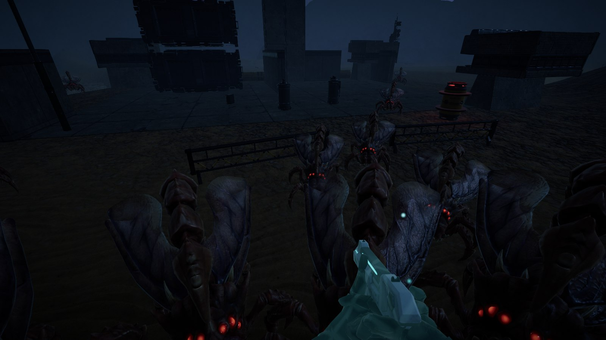
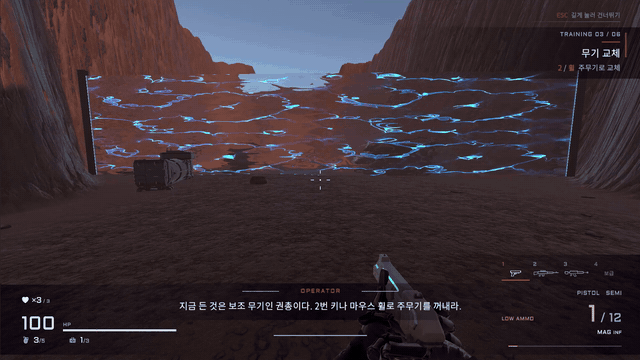
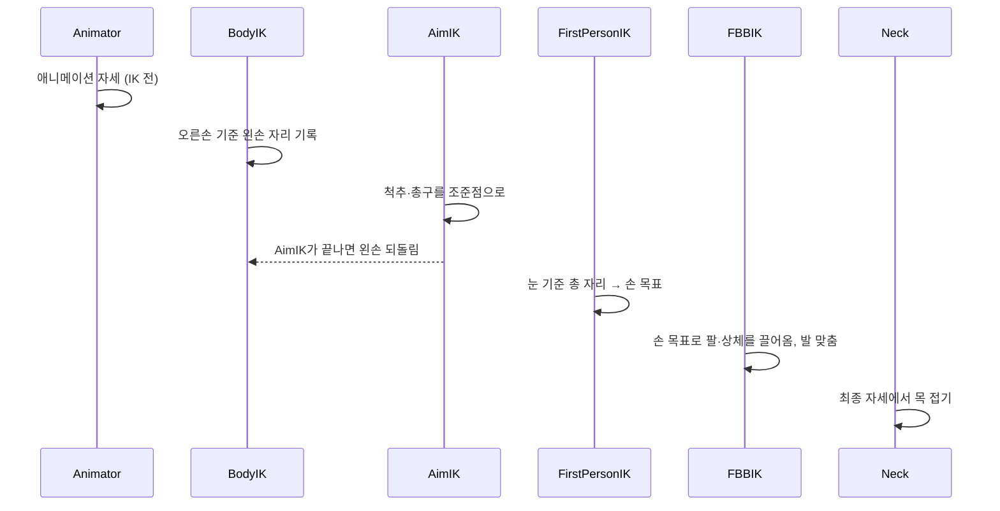
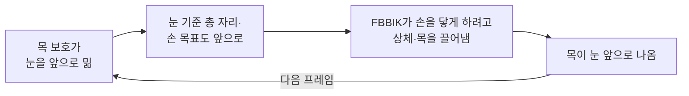
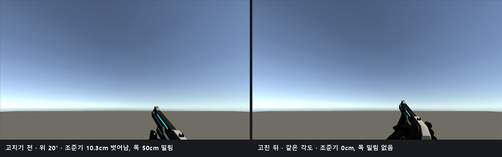
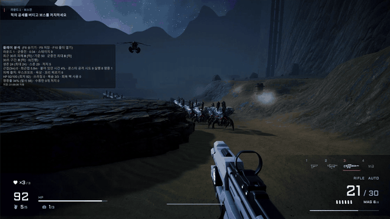

# 하이브 퍼지 — 3D 생존 슈터

> 4인 팀이 2주 동안 만든 3D 생존 슈터에서 플레이어를 맡았습니다. 처음 다뤄 본 IK(Inverse Kinematics)로 총을 든 플레이어를 만들면서, 범위를 좁히고, 이상 수치를 찾은 다음, 수치가 정상값에 가까워지도록 수정하고 수치를 다시 주고 범위를 좁히는 과정을 반복했습니다. 1인칭 조준기 오차를 47.5cm에서 0.9cm로 줄인 것이 그 결과입니다.



## 1. 개요

몰려오는 적을 버티며 살아남는 3D 생존 슈터입니다. 평소에는 1인칭으로 군중을 쓸어내고, 보스가 나타나면 3인칭으로 바뀌어 거대한 보스와 싸웁니다. 끝없이 밀려오는 적을 한꺼번에 쓸어 냈을 때의 쾌감을 플레이어에게 주는 것이 목표였습니다.

저는 플레이어(이동·애니메이션·IK·1인칭/3인칭 시점)를 중심으로 두 번째 보스, 총기와 해금, 인트로와 엔딩, 폭발 VFX와 맵 분위기·라이팅을 맡았습니다. 이 문서는 그중 가장 오래 붙잡은 플레이어의 IK를 다룹니다. 이 게임에서 IK는 조준하는 방향으로 상체와 총구를 돌리고, 두 손이 총을 쥐게 하고, 발이 경사와 계단을 딛게 합니다.


IK는 처음 다뤄 보는 분야였고, 코드는 대부분 AI(Claude Code)와 함께 썼습니다. 그래서 이 프로젝트에서 제가 스스로에게 던진 질문은 하나였습니다.

**"잘 모르는 분야를, AI와 함께, 마감 안에 제대로 고치려면 어떻게 해야 하나?"**

| 항목 | 내용 |
|---|---|
| 기간 · 인원 | 2026.10.19 ~ 11.03 (약 2주) · 4인 팀 |
| 엔진 | Unity 6000.3.15f1 · URP |
| IK | Final IK — AimIK · FullBodyBipedIK(FBBIK) · LimbIK · GrounderFBBIK |
| 도구 | Claude Code (Claude Opus 5.5) |
| GitHub | https://github.com/KooHoo-Dev/3rd_3D_1-3D-Project-team_even |
| 시연 영상 | https://youtu.be/h8nFAuI8KAY (숏츠: https://youtube.com/shorts/cJZfjStR3s0) |

| 팀원 | 담당 |
|---|---|
| 나 | 플레이어 · 두 번째 보스 · 총기 · 해금 · 인트로/엔딩 · 폭발 VFX · 맵 분위기와 라이팅 |
| 팀원 A | 몬스터(군중) 행동·이동 |
| 팀원 B | 맵 · 보급 · 메인 메뉴 · 튜토리얼 |
| 팀원 C | 첫 번째 보스 · UI 테마 |

IK 계산 자체는 Final IK 에셋이 합니다. 제 몫은 그 위에서 IK 여러 개를 어떤 순서로, 어떤 목표를 주어 돌릴지 정하는 것이었습니다.

## 2. 시스템 구조

### 2.1 한 프레임 안에서 뼈를 움직이는 순서

플레이어 한 명에게 IK와 보정 스크립트가 일곱 개 걸려 있습니다. 애니메이션이 자세를 만든 뒤, 이들이 같은 뼈를 차례로 고칩니다. 뒤에 도는 것은 앞에서 움직여 놓은 뼈를 다시 움직이므로, 같은 값을 넣어도 순서가 바뀌면 자세가 달라집니다.

| 실행 순서 | 스크립트 | 하는 일 |
|---|---|---|
| 9995 | PlayerItemIK | 회복 아이템을 쓸 때 왼손 목표를 정함 |
| 9996 | PlayerBodyIK | AimIK가 돌기 전에 오른손 기준 왼손 자리를 적어 둠 |
| 9997 | AimIK | 총구가 조준점을 향하도록 척추를 돌림. 끝나면 왼손을 적어 둔 자리로 되돌림 |
| 9998 | PlayerFirstPersonIK | 1인칭일 때 눈을 기준으로 총이 있어야 할 자리를 정함 |
| 9999 | FBBIK + Grounder | 두 손을 그 자리로 끌어오고, 발을 땅에 맞춤 |
| 10000 | PlayerGunRecoil | 반동 |
| 10002 | PlayerFirstPersonNeck | 1인칭에서 목 뼈를 접어 화면에 안 보이게 함 (프레임 끝에 복구) |



아래 그림은 같은 순서를 한 프레임의 흐름으로 그린 것입니다.



만들면서 세 번, 어떤 코드가 IK 전 자세를 보는지 IK 후 자세를 보는지 놓쳐서 버그가 났습니다. 수류탄 모형이 IK 전의 손에 붙어 팔꿈치 옆에 떠 있었고, 총구 화염의 불똥이 IK 전 자세의 총구에서 튀었고, 목 보호 처리가 IK 후의 목을 보다가 손 IK와 서로를 밀어내는 순환을 만들었습니다.

### 2.2 문제를 보이게 만든 도구

IK 문제는 눈으로 보면 어딘가 이상하다는 것까지만 알 수 있었습니다. 그래서 질문이 생길 때마다 그 질문에 답하는 도구를 만들었습니다. 이 문서에서 원인을 찾는 데 쓴 것은 세 가지입니다.

| 도구 | 답한 질문 |
|---|---|
| IK Pose Lab | Play 중 자세를 멈춰 두고 손잡이를 옮기면, IK가 푼 결과는 어떻게 보이나 |
| 떨림 측정 | 상체가 튀는 프레임은 애니메이션·IK 중 어느 단계에서 처음 튀나 |
| 1인칭 조준 측정 | 총 8자루 × 시선 7각도 × 설정별로 조준기가 화면 중앙에 오나 |

측정 도구는 모두 같은 틀로 돕니다. 에디터 메뉴를 누르면 테스트 씬이 Play되고, 정해진 입력과 시선 각도를 넣는 동안 프레임마다 뼈 위치를 기록하고, 끝나면 기준을 통과했는지 판정을 붙인 결과표를 남깁니다. 손으로 조작하면 매번 조건이 조금씩 달라서 고친 뒤 나아졌는지를 확신할 수 없었기 때문입니다. 측정 코드는 게임 코드와 분리한 디버그 전용 코드이고, 문제를 다 고친 뒤 정리했습니다.

## 3. 1인칭에서 총을 눈앞에 두기

1인칭 전용 팔 모델 없이, 3인칭 몸 하나로 1인칭을 만들기로 했습니다. 총이 있어야 할 자리를 눈 기준으로 정하고 두 손을 IK로 끌어오는 방식은 정면에서는 잘 맞았지만, 아래를 보면 팔이 꺾이고 위를 보면 조준기가 화면 중앙에서 최대 47.5cm 벗어났습니다. 처음에는 척추 탓이라고 짐작했지만, 측정 도구를 만들어 여섯 번 잰 끝에 진짜 원인 두 가지(목 보호와 손 IK가 서로를 미는 순환, 처음부터 팔 길이 밖에 있던 총 자리)를 찾았고, 총 8자루의 최악 오차를 0.9cm로 줄였습니다.

### 3.1 몸 하나로 만든 1인칭

1인칭을 만드는 흔한 방법은 화면에 팔과 총만 따로 그리는 것입니다. 하지만 이 게임은 1인칭과 3인칭을 오가므로 몸이 둘이 되면 애니메이션과 IK도 두 벌이 됩니다. 그래서 몸 하나를 유지하고, 1인칭일 때는 3인칭 몸의 머리만 숨기고 눈 위치에 카메라를 두기로 했습니다.

문제는 몸이 걷고 숨 쉴 때마다 손에 든 총도 출렁인다는 점이었습니다. 카메라는 눈 높이에 고정되어 있으니 화면 속 총이 흔들리고 조준기가 중앙에 오지 않습니다. 그래서 순서를 뒤집었습니다. 1인칭에서는 총이 있어야 할 자리를 먼저 눈 기준으로 정하고(평소에는 화면 오른쪽 아래, 조준하면 화면 정중앙), 그 총을 쥐려면 손이 어디 있어야 하는지 거꾸로 계산해 FBBIK의 손 목표로 줍니다. 손이 닿지 않으면 FBBIK가 상체를 끌어옵니다. 1인칭 손 IK가 FBBIK 바로 앞에서 도는 이유입니다.

IK Pose Lab에 조준기가 화면 중앙에서 벗어난 정도를 띄워 두고 총마다 조준기 자리를 맞췄고, 정면에서는 오차가 0에 가깝게 나왔습니다.

### 3.2 아래를 보면 꺾이던 팔

권총을 들고 아래를 내려다보면, 안쪽으로 꺾인 위팔이 화면에 들어왔습니다. 처음에는 총 위치 보정, 척추 가중치, 팔꿈치 목표를 한꺼번에 넣었다가 되돌리고, 1인칭에서 아래를 볼 수 있는 각도를 55°로 제한하는 것부터 넣었습니다.

그다음 Final IK의 팔꿈치 처리(`IKConstraintBend`) 소스를 AI와 함께 읽었습니다. 손 목표에 회전까지 맞추게 하면(회전 가중치 1), FBBIK는 팔꿈치를 접는 방향을 손의 회전에서 정하고, 그 기준은 초기화 때 한 번만 잡힙니다. 1인칭에서는 손이 시선을 따라 돌기 때문에, 아래를 보면 팔꿈치 방향도 함께 돌아가 안쪽으로 꺾였던 것입니다. 처음 넣었던 팔꿈치 목표가 듣지 않은 이유도 같았습니다. 목표를 눈 기준에 두어 시선과 같이 돌았고, 가중치가 0.7이라 잘못된 방향이 30% 섞였습니다.

그래서 팔꿈치 목표를 어깨에 두되, 위아래 시선은 무시하고 몸이 바라보는 좌우 방향만 따르게 했습니다.

```csharp
// 팔꿈치 bend goal: 어깨에서 몸 기준(시선 yaw 만) elbowDirection 쪽. 왼팔은 좌우 반전
Quaternion bodyYaw = Quaternion.Euler(0f, player.LookYaw, 0f);
Vector3 mirrored = new Vector3(-elbowDirection.x, elbowDirection.y, elbowDirection.z);
rightElbowGoal.position = refs.rightUpperArm.position + bodyYaw * elbowDirection.normalized * 0.4f;
leftElbowGoal.position  = refs.leftUpperArm.position  + bodyYaw * mirrored.normalized * 0.4f;
```

이 목표의 가중치에는 1인칭 손 IK 가중치를 곱해서, 3인칭·반동·재장전 중에는 영향이 없게 했습니다. 팔이 꺾이지 않자, 고개를 숙일 때 상체가 앞으로 굽으면서 목의 단면이 카메라 앞으로 나오는 것이 보였습니다. 머리는 숨겼지만 목은 몸 메시의 일부였기 때문입니다. 모든 IK가 끝난 뒤 목 뼈를 접어 그리고 프레임 끝에 되돌리는 처리와, 목이 눈보다 15cm 이상 앞으로 나오면 그만큼 눈을 앞으로 밀어내는 목 보호를 넣어 해결했습니다.

### 3.3 위를 보면 어긋나던 조준기

며칠 뒤, 1인칭에서 조준한 채 위를 볼수록 총의 조준기가 화면 중앙에서 벗어나 어디를 겨누는지 알 수 없게 되었습니다.

AI가 코드와 프리팹 값을 읽고 낸 첫 가설은 "위를 볼 때 척추가 시선을 70% 따라 젖혀져 팔이 목표에 닿지 못하니, 위를 볼 때 척추 가중치를 낮추자"였습니다. 바로 고치게 하지 않고, 이 수정이 기존 코드의 의도와 부딪히는지부터 확인하게 했습니다. 확인해 보니 `PlayerAimIK`의 주석에 반대 의도가 적혀 있었습니다. 척추가 시선을 따라가야 팔이 덜 뻗는다는 것이었습니다. 측정 없이 가중치를 낮추면 오히려 나빠질 수 있었습니다.

의심 가는 곳을 하나씩 고쳐 보는 방식으로는 어디가 원인인지, 어떤 데이터를 봐야 하는지 시간 안에 알 수 없다고 판단했습니다. 3.2에서 세 가지를 한꺼번에 넣었다가 무엇이 듣는지 알 수 없어 되돌린 일도 있었습니다. 그래서 떨림 문제에서 먼저 만들어 둔 측정 틀로 자동으로 재기로 했습니다. 벽의 영향이 없는 평지에서, 시선 각도 7개(아래 55° ~ 위 70°) × 허리/조준 × 설정 후보 × 총을 조합해 돌렸습니다. 지표는 조준기가 목표 자리에서 벗어난 거리(cm), 목 보호가 눈을 민 거리, 그리고 도달 비율(어깨에서 손 목표까지 거리 ÷ 팔 길이, 1을 넘으면 손이 닿지 않음)입니다.


### 3.4 첫 가설은 틀렸다: 서로를 미는 순환

첫 측정에서 척추 가설은 맞지 않았습니다. 척추 가중치를 0.1까지 낮춰도 손 오차는 24cm에서 21cm로 거의 그대로였습니다. 대신 목 보호가 눈을 40~54cm나 밀고 있었고, 눈과 목 사이 거리가 모든 각도에서 목 보호의 기준값인 15cm에 붙어 있었습니다. 목 보호가 쉬지 않고 최대로 일하고 있었습니다.

| 차수 | 확인하려던 것 | 결과 | 다음 결정 |
|---|---|---|---|
| 1 | 척추 가중치를 낮추면 나아지나 | 0.1까지 낮춰도 손 오차 24→21cm. 목 보호가 눈을 40~54cm 밂 | 척추 가설 폐기, 목 보호를 의심 |
| 2 | 목 보호를 끄면(대조군) | 위 40°까지 오차 0~0.3cm로 원인 확정. 하지만 목이 눈보다 23cm 앞에 나와 화면을 가림 | 끌 수는 없음. 목 보호가 보는 기준을 바꿔 보기로 |
| 3 | 목 보호가 FBBIK 직전의 목을 보게 하면 | 밀기 54~65cm → 0~7cm, 조준 오차는 위 40°까지 0.4cm 이하 | 순환은 끊김. 위 55°보다 위에서는 여전히 손이 안 닿음 |

3차 측정에서 FBBIK 전과 후의 목 위치를 따로 기록하자 구조가 보였습니다. 애니메이션만 반영된 자세에서는 목이 항상 눈 뒤에 있었고, FBBIK가 손을 목표에 닿게 하려고 상체를 끌면서 목을 12~48cm 앞으로 끌어내고 있었습니다. 목 보호는 그 FBBIK 후의 목을 보고 눈을 밀었고, 눈이 밀리면 눈 기준으로 정한 총 자리도 밀려서 다음 프레임에 FBBIK가 목을 더 끌어냈습니다.



목 보호가 FBBIK보다 늦게 나온 결과를 보고, FBBIK보다 먼저 정해야 할 총 자리를 바꾸고 있었던 것입니다. 목 보호가 FBBIK 직전의 목을 보게 바꾸자 순환이 끊겼습니다. 다만 위로 55° 이상 볼 때 손이 닿지 않는 문제는 남았습니다.

### 3.5 진짜 원인: 팔 길이 밖의 총

4차 측정에 FBBIK 전의 도달 비율과 어깨가 끌려간 거리를 추가했습니다. 조준 정면에서 이미 1.01, 위 70°에서는 1.53, 허리 자세는 정면 1.26에서 1.82였습니다. 1인칭 총 자리가 애초에 팔이 닿지 않는 거리에 있었던 것입니다. 카메라는 몸 뼈와 따로 눈 높이에 고정되어 있어서, 위를 볼수록 눈 앞의 총 자리가 어깨에서 멀어졌습니다. FBBIK는 손을 닿게 하려고 어깨를 최대 33cm(고치기 전에는 58cm) 끌어당겼고, 그 끌림이 목을 앞으로 내보내 순환의 출발점이 되었습니다.

그래서 5차에서는 총 자리가 팔 길이 × 0.95를 넘으면, 총을 시선 정면 축을 따라 몸 쪽으로 당기게 했습니다. 시선 축 위에서만 움직이므로, 조준 중이라면 조준기는 화면 중앙에 그대로 남습니다.

```csharp
// 오른손 목표가 FBBIK 전 오른 어깨에서 팔 길이 × maxReachRatio 안에 들어오도록,
// 조준기 자리를 시선 정면 축을 따라 당길 거리(m)
float radius = maxReachRatio * (Vector3.Distance(refs.rightUpperArm.position, refs.rightForearm.position)
                              + Vector3.Distance(refs.rightForearm.position, refs.rightHand.position));
Vector3 handTarget = eye.position + eye.rotation * sightLocal + gunRotation * (handInGun - sightInGun);
Vector3 d = handTarget - refs.rightUpperArm.position;
if (d.sqrMagnitude <= radius * radius) return 0f;
// |d - forward·p| = radius 의 작은 해
float df = Vector3.Dot(d, eye.rotation * Vector3.forward);
float disc = df * df - d.sqrMagnitude + radius * radius;
float pull = disc >= 0f ? df - Mathf.Sqrt(disc) : df;
return Mathf.Clamp(pull, 0f, Mathf.Max(0f, sightLocal.z - MinReachSightDistance));
```

측정은 6차에서 끝내기로 정하고, 마지막 측정의 조건을 직접 골랐습니다. 총을 당기는 처리와 위쪽 척추 가중치 0.3을 공통으로 두고, 목 보호의 기준 위치만 세 가지(FBBIK 전 / FBBIK 후 / 각도에 따라 섞기)로 바꿔 총 8자루 전부를 쟀고, 걸을 때도 함께 쟀습니다. 자동 판정은 섞는 안을 추천했지만, 정면에서 38~53cm의 순환이 남아 있어 뺐습니다.

| | 고치기 전 | 고친 뒤 (총 8자루 중 최악) |
|---|---|---|
| 조준기 오차 (위 55°까지) | 47.5cm | 0.9cm |
| 조준기 오차 (위 70° · 걷기) | — | 4.2cm · 2.4cm |
| 목 보호가 눈을 민 거리 (서 있기) | 70cm | 약 7cm |

적용한 것은 값 세 개입니다. 목 보호는 FBBIK 직전의 목을 보고, 총 자리는 팔 길이의 95% 안으로 당기고, 위를 볼 때 척추는 시선을 30%만 따릅니다.

권총을 허리 자세로 들고 위를 20° 볼 때로 비교하면, 고치기 전 설정에서는 조준기가 10.3cm 벗어나고 어깨가 43.9cm 끌려 나왔으며 목 보호가 눈을 50.3cm 밀었습니다. 지금 설정에서는 조준기 오차와 밀기가 0이고 어깨는 0.7cm만 움직입니다. 다만 조준한 채 걸을 때 조준기 오차가 1.5cm로 기준(1cm)을 넘고, 긴 총으로 허리 자세를 잡고 정면을 볼 때 목 여유가 줄어드는 점은 남아 있습니다.





## 4. 고민과 선택

### 4.1 IK를 두 번 처음부터 다시 만든 이유

첫 시도에서는 애니메이션 컨트롤러, 무기별 상태, IK, 입력 연동, 가이드 문서까지 한 번에 요청했습니다. AI는 컨트롤러와 IK를 만들고 컴파일 오류가 없다고 보고했지만, 실제로 플레이해 보니 총이 손을 따라오지 않고, 앞뒤가 뒤집히고, 개머리판이 몸을 뚫고, 어깨가 비틀렸습니다. 고칠 때마다 여러 곳이 함께 바뀌어서, 어떤 변경이 팔을 망가뜨렸는지 기능을 하나씩 끄며 찾아야 했습니다.

이때 총마다 손가락과 팔 자세까지 AI에게 맡길 수 있는지 물었고, AI는 조절 도구는 만들 수 있지만 화면을 볼 수 없어 각도를 맞추는 일은 비효율적이고 품질도 장담할 수 없다고 답했습니다. 그래서 도구는 AI가 만들고, 세부 위치는 제가 씬에서 직접 맞추기로 나눴습니다. 첫 시도의 구조는 다음 날 모두 지웠습니다.

두 번째에는 애니메이션부터 다시 만들었는데, 걸을 때 어기적거리고 상체가 튀는 문제가 몇 번을 고쳐도 남았습니다. 원인은 상체 레이어의 마스크에 골반(휴머노이드 Body)이 들어 있어, 다리와 골반이 서로 다른 클립의 박자로 움직이던 것이었습니다. 이때는 컨트롤러와 애니메이션 코드를 다 지우고, 이동 → 점프 → 상체 조준 → 재장전·반동 → 구르기·피격 → IK 순서로 한 단계씩 만들면서 단계마다 제가 플레이로 확인한 뒤에 다음으로 넘어갔습니다.

세 번째는 IK만 다시 시작했습니다. 그 전의 손 자세 도구는 편집 모드에서 애니메이션 한 프레임을 입혀 손 위치를 맞추는 방식이었는데, 편집 모드에서는 IK가 돌지 않아서 IK가 만든 결과를 볼 수 없었습니다. 그래서 원칙 세 가지를 먼저 정했습니다. 손 위치는 사람이 보고 정하는 것이니 IK가 실제로 도는 Play 중에 결과를 보며 작업하고, 정한 값은 Play를 끝내도 남게 ScriptableObject에 저장하고, 사람이 손댈 일을 줄이도록 손잡이 초기값은 총 메시 모양에서 자동으로 찾게 했습니다. 이 원칙으로 만든 것이 IK Pose Lab입니다.

### 4.2 내장 IK 대신 Final IK

두 번째 재구축의 설계안에서 AI는 상하 조준에 Unity 내장 LookAt IK를 쓰려 했습니다. 프로젝트에 이미 Final IK가 있었으므로, 두 가지를 견주어 더 나은 쪽을 쓰게 했고 Final IK로 정했습니다. 내장 LookAt은 몸을 시선 쪽으로 돌릴 뿐 총구가 조준점을 향한다는 보장이 없지만, AimIK는 총구 방향을 기준으로 척추를 돌립니다. 그 밖에도 양손으로 총을 쥐는 FBBIK 데모, 발 IK(Grounder), 일반 스크립트보다 늦게 도는 실행 순서가 이미 갖춰져 있었습니다.

### 4.3 총을 어디에 붙일 것인가

총을 어느 뼈에 붙이느냐는 2주 동안 다섯 번 바뀌었습니다.

| 총의 부모 | 바꾼 이유 |
|---|---|
| 오른손 뼈 | 처음 구조. 오른손 IK를 따로 조작할 수 없어 손 위치가 부자연스러움 |
| 어깨 앞에 떠 있는 자리 + 양손 IK | 슈터에서 흔한 방식으로 전환. 이후 구조 전체를 지움 |
| 오른손 아래 소켓 | 애니메이션부터 재구축. 그런데 소품 총 기준 애니메이션이라 긴 라이플은 개머리판이 가슴을 뚫음 |
| 가슴 뼈 + 양손 IK | 개머리판 문제를 피하려고 선택 |
| 다시 오른손 아래 소켓 | 가슴에 붙은 총은 걷는 자세에서도 조준 자리에 떠 있고, 왼손 IK가 그 총을 쫓다가 팔이 꺾임 |

지금은 3인칭에서는 애니메이션의 오른손에 총을 붙이고, 1인칭에서는 총 자리를 눈 기준으로 따로 계산해서 손을 끌어옵니다.

## 5. 고친 문제

### IK가 경고 없이 한 번도 돌지 않던 문제

1인칭 총 자리 슬라이더를 아무리 움직여도 화면이 바뀌지 않았습니다. IK Pose Lab에 진단 값을 하나씩 늘려 보니, IK가 끝난 뒤에 불려야 할 측정 코드가 한 번도 불리지 않고 있었습니다. 마지막으로 초기화 여부와 계산 횟수를 띄우자 "초기화 안 됨 · 계산 0회"가 나왔습니다.

Final IK의 초기화 함수는 첫 줄에서 `executedInEditor`가 켜져 있으면 그대로 빠져나가는데, 예전에 편집 모드 미리보기를 쓰면서 이 값이 켜진 채 씬에 저장되어 있었습니다. 유효성 검사보다 앞에서 빠져나가기 때문에 경고도 없었습니다. 그 전까지 발 IK와 반동도 한 번도 돌지 않았던 것입니다.

```csharp
/// Final IK 의 EditorIK(편집 모드 미리보기)를 썼던 솔버는 executedInEditor 가 켜진 채 저장되고,
/// 그 상태로는 Play 에서 초기화를 조용히 건너뛰어 IK 가 전혀 풀리지 않는다 (경고도 없음). 시작할 때 꺼 준다
foreach (IK ik in GetComponentsInChildren<IK>(true))
{
    IKSolver solver = ik.GetIKSolver();
    if (solver == null || solver.executedInEditor == false) continue;
    solver.executedInEditor = false;
    Debug.LogWarning($"{ik.GetType().Name}({ik.name}): 편집 모드 실행 표시(executedInEditor)가 남아 있어 껐습니다. 씬의 값도 꺼 두세요", ik);
}
```

### 걷거나 뛸 때 상체가 튀던 문제

상체가 버벅이며 튀는데, IK 때문인지 애니메이션끼리 부딪히는지 알 수 없었습니다. AI의 첫 계획은 디버그 키로 IK를 하나씩 끄며 눈으로 비교하는 것이었는데, 테스트를 더 자동화해서 빨리 수치가 나오는 방식으로 다시 계획하게 했습니다. 그렇게 만든 것이 떨림 측정 도구입니다. 한 프레임 안에서 같은 뼈의 위치를 네 번(애니메이션 직후 · AimIK와 왼손 IK 직후 · 모든 IK 후 · 카메라 기준) 기록하고, 가속도가 그 실행 중앙값의 4배(최소 5 m/s²)를 넘은 프레임을 튐으로 셉니다. 그 튐이 처음 나타난 단계를 원인으로 봅니다.

```csharp
bool[] final = pop[AnimJitterProbe.StageFinal];
for (int i = 0; i < n; i++)
{
    if (final[i])
    {
        r.pops++;
        if (Near(pop[AnimJitterProbe.StageAnim], i)) r.origin[OriginAnim]++;
        else if (Near(pop[AnimJitterProbe.StagePreFullBody], i)) r.origin[OriginAimHand]++;
        else r.origin[OriginFullBody]++;
    }
    else if (pop[AnimJitterProbe.StageCamera][i] && Near(final, i) == false) r.cameraOnlyPops++;
}
```

72회를 재 보니 튐의 90%가 IK가 돌기 전, 애니메이션 단계에서 이미 생겼고, IK를 하나씩 꺼도 4~7%만 줄었습니다. 튐은 이동 클립이 끝에서 처음으로 돌아가는 순간에 우연보다 5배 자주 몰려 있었습니다. 원인은 클립의 이음새였습니다.

고치는 데는 세 번이 걸렸습니다. 끝과 처음의 자세 차이를 없앤 1차와, 이음새가 가장 매끄러운 끝 프레임을 찾은 2차는 둘 다 효과가 없었습니다(튐 301회 → 271회, 287회). 실제 근육 커브를 열어 보니 원본의 첫 프레임 자체가 뾰족한 꼭짓점이라 끝을 어디로 잡아도 꺾임이 남았습니다. 3차에서 이음새 앞뒤 몇 프레임을 바깥 값과 기울기를 잇는 곡선으로 다시 만들었고, 같은 측정에서 기준 설정의 튐이 301회에서 121회로 줄고 이음새와 겹치는 튐은 0이 되었습니다. 남은 튐의 대부분은 전력질주 클립이었고, 골반까지 함께 튀는 클립 자체의 결함이었습니다.

### IK 전 자세를 보던 두 버그

| 문제 | 원인 | 고친 방법 |
|---|---|---|
| 1인칭에서 던지는 수류탄 모형이 손이 아니라 팔꿈치 옆에 생김 | 모형을 붙이는 코드가 IK보다 먼저 돌아 IK 전의 손에 붙었고, 위치를 저장하는 도구는 IK 후의 손을 기준으로 저장해 기준까지 어긋남 | FBBIK가 끝난 직후에 모형을 붙임 |
| 총구 화염의 불똥이 몸 왼쪽에서 왼쪽으로 튐 | 사격 → 애니메이터가 총을 애니메이션 자세로 되돌림 → 파티클이 그 자세의 총구에서 나옴 → 그 뒤에 IK가 총을 눈앞으로 옮김 | 화염을 총구의 자식이 아닌 따로 된 오브젝트로 만들고, 모든 IK 이후 매 프레임 총구를 따라가게 함 |

총구 화염은 처음에 AI가 총구 자리를 계산하는 코드가 이전 위치 값을 쓴다고 추정해 고쳤지만 그대로였습니다. 스크린샷을 다시 보니 화염의 빛은 총구에 있고 날아가는 불똥만 왼쪽에 있어서, 프레임 안의 순서가 원인으로 좁혀졌습니다.

### 1인칭으로 점프하면 목이 화면을 가리던 문제

점프 동작은 골반을 위로 올리는데 1인칭 카메라는 고정이라, 공중에서 목과 어깨가 카메라 앞으로 올라왔습니다. 점프 측정 도구로 재 보니 점프 클립이 목을 지상보다 약 53cm 올리고 있었습니다. FBBIK가 손 목표를 읽기 직전에, 목이 눈보다 10cm 아래에 오도록 골반째 몸 전체를 내리게 했습니다. 고치기 전에는 공중에서 목이 눈보다 28.8cm 위까지 올라왔고, 지금은 10cm 아래에 머뭅니다.


### 그 밖에 고친 문제

| 문제 | 원인 | 고친 방법 |
|---|---|---|
| 반동 때 총구가 내려가고 개머리판이 올라감 | Final IK Recoil이 손 뼈의 축을 기준으로 돌리는데, 이 캐릭터의 손 뼈 축에서는 그 방향이 총구를 숙이는 쪽이었음 | 손잡이 축 기준으로 총구를 들고 뒤로 미는 반동을 직접 만들고 Final IK Recoil을 뺌 |
| 1인칭에서 고개를 끝까지 숙이기 전에는 팔·손이 안 보임 | 스킨드 메시는 원래 자세 기준의 고정된 상자로 화면에 그릴지 정하는데, IK가 팔을 카메라 앞으로 끌어와도 상자는 몸 옆에 남아 화면 밖으로 판정됨 | 팔 메시가 실제 자세 기준으로 화면 판정을 하게 함 (Update When Offscreen) |
| 한 맵에서만 발이 지형에 박힘 | 그 맵의 지형 레이어가 발 IK의 레이어 마스크에서만 빠져 있었음 | 발 IK가 캐릭터 컨트롤러와 같은 마스크를 쓰게 함 |
| 1인칭 허리 사격 때 저절로 정조준 자세가 됨 | 3인칭의 "쏜 직후 0.5초 조준 자세" 값을 1인칭 총 위치에도 같이 써서, 보기엔 정조준인데 탄은 허리 사격으로 퍼짐 | 우클릭 조준만 따르는 값을 따로 두고 1인칭 총 위치에는 그 값을 씀 |

## 6. AI와 함께 일한 방식

### 6.1 IK를 배운 방식

IK를 강의나 책으로 먼저 배우고 시작하지 않았습니다. 계획을 세우기 전에 다른 FPS 게임이 IK를 어떻게 구성하는지부터 AI에게 조사하게 했고, 그 뒤로는 문제가 생길 때마다 원리를 묻고, 필요하면 Final IK 소스를 함께 읽고, 이해한 것이 맞는지는 측정으로 확인했습니다. 팔꿈치 방향 규칙은 Final IK 소스에서, 도달 비율은 측정 지표를 정하면서, IK 결과는 IK가 끝난 직후에 재야 한다는 것(LateUpdate는 IK 전 자세를 봄)은 총구 조준 오차를 재다가 배웠습니다.

### 6.2 일을 나눈 방식

코드는 대부분 AI가 썼습니다. 제가 맡은 것은 무엇을 만들고 무엇을 잴지 정하고, 결과를 화면과 숫자로 확인하고, 다음에 무엇을 할지 고르는 일이었습니다. 일할 때 지킨 원칙은 두 가지입니다.

- 모르겠으면 확실하게 테스트로 데이터를 뽑아본다.
- 데이터는 확인하기 좋게 만들고 검수한다.

이 원칙 아래에서 이렇게 일했습니다.

- 큰 작업은 계획을 먼저 받아 제 생각과 다른 곳을 고친 뒤에 시작했습니다. 첫 시도처럼 한 번에 크게 맡기면, 틀렸을 때 어디서 틀렸는지 알 수 없었기 때문입니다.
- 고치기 전에 기존 코드의 의도와 부딪히는 곳이 있는지 먼저 확인하게 했습니다. 1인칭 조준 문제에서 척추 가설을 그대로 실행하지 않은 것이 이 확인에서 나왔습니다.
- 결과에서 기준을 크게 벗어난 데이터가 보이면, 결과 전체가 아니라 그 부분 데이터만 골라 다시 AI에게 주고 원인을 분석하게 했습니다. 결과 전체를 다시 주면 분석이 흐려졌기 때문입니다.
- 원인 찾기와 고치기를 나눴습니다. 1인칭에서 팔이 사라지는 문제는 원인만 맡겼고, 발이 지형에 박히는 문제는 고치는 방법만 받아 제가 고쳤습니다.
- 1인칭 허리 사격 문제에서 AI는 무기 수치를 바꾸자고 했지만, 수치는 그대로 두고 플레이어가 눈으로 차이를 느끼는 방향으로 다시 계획하게 했습니다.
- 보스 소환 프리팹이 없을 때 AI가 건너뛰고 경고하는 방어 코드를 넣자, 문제는 개발 중에 미리 터지고 실제 게임에서는 나오지 않아야 한다고 보고 빼게 했습니다. 대신 데이터를 읽는 시점에 검증하게 했습니다.
- 커밋은 제가 직접 나눠 올렸습니다. AI가 한 번 커밋을 임의로 올린 뒤로는 되돌리게 하고, AI는 변경 요약만 쓰게 했습니다.

AI의 해석이 틀린 적도 있었습니다. `executedInEditor` 버그를 찾을 때, AI는 처음에 IK 직후 각도가 0.0°로 나온 것을 정상으로 읽었다가, 다음 측정에서 변화량이 정확히 180.0°로 나오자 두 값 모두 한 번도 계산되지 않은 기본값이었다고 스스로 정정했습니다.

### 6.3 머지 뒤 모델이 바닥에 묻힌 문제

아이템 작업 중 갑자기 플레이어 몸이 바닥에 절반쯤 묻히기 시작했습니다. AI는 이번 변경에서 위치·콜라이더·Animator·이동 코드가 바뀌지 않았으니 이번 작업과는 무관하다고 판단하고, 씬 안에서 콜라이더와 새 컴포넌트를 하나씩 꺼 보는 진단을 제안했습니다. 저도 이번 작업 탓은 아니라고 봤지만, 묻히는 것이 몸 전체가 아니라 모델뿐이라는 점에서 직전 머지에서 모델 쪽 원본 파일이 바뀌었을 거라고 가설을 세웠고, git 이력에서 누가 언제 바꿨는지 추적하게 했습니다.

추적해 보니 팀원의 머지에서 에셋의 `.meta` 파일이 대량으로 사라졌다가 다른 PR로 복구되었고, 그중 544개는 원본과 내용이 달랐습니다. 저는 그 결과를 보고, 애니메이션 원본의 `.meta`가 새로 만들어지면서 애니메이터 컨트롤러가 가리키던 모션의 참조가 끊어진 것이라고 원인을 짚었습니다. 확인해 보니 애니메이션 파일의 ID가 바뀌고 임포트 설정이 초기화되어 있었고, 544개를 머지 전 버전으로 되돌리자 끊겼던 참조가 모두 돌아왔습니다.

### 6.4 팀원과 맞물린 작업

- 흡입 패턴: 플레이어 이동 코드는 물리 프레임마다 속도를 덮어써서 보스가 바깥에서 힘을 더해도 사라졌습니다. 제가 낸 두 안(보스가 직접 밀기 / 여러 외부 소스를 받아 모두 적용)을 비교하게 해, 플레이어가 물리 프레임마다 외부 소스에게 속도를 물어 합치는 방식으로 정하고, 보스 담당에게 사용법 문서로 넘겼습니다. "반대로 달려도 끌려간다"는 보고를 받았을 때는 보고가 맞는지부터 수치로 다시 계산해 확인했습니다.
- 탄착 이펙트: 총이 맞은 자리의 효과를 총이 낼지 맞은 대상이 낼지 정해야 했습니다. 선택지를 비교한 문서를 만들어 몬스터 담당과 먼저 상의했습니다.
- 팀원이 보낸 보스 버그 분석도 그대로 믿지 않고 로그와 git으로 확인하게 했습니다. 원인 줄은 맞았지만 발생 시점과 원인 커밋은 틀렸고, 같은 수정이 이미 develop에 들어가 있어 제 수정은 백업한 뒤 버렸습니다.

## 7. 회고

### 목표한 경험

처음에는 핵앤슬래시 느낌과 디펜스 요소까지 계획했습니다. 만들면서 방향이 바뀌어, 압도적인 느낌을 주는 많은 적이 어렵고 까다로운 상황을 만들고 플레이어가 강력한 광역 무기로 그 상황을 벗어나는 게임이 되었습니다. 방향은 팀이 함께 정했고, 그 경험을 내기 위한 제 몫은 총기의 종류와 수치 밸런스, 플레이어의 속도·목숨·부활 여부 같은 요소였습니다.

제가 AI를 사용해 생성하고 다듬은 폭발 VFX와 환경 분위기, 라이팅, 그리고 다른 사람들이 만든 여러 요소로 긴장감 넘치는 플레이를 만들 수 있었습니다. 목표를 완전히는 아니지만, 긴장감의 해소라는 요소로 비슷하게 달성한 것 같습니다. 초기 기획을 꼭 그대로 지키는 것만이 좋은 것은 아니라는 것을 느꼈습니다.

### 배운 점

- 측정으로 범위를 좁히는 방식이 원인을 찾는 데 효과적이었습니다. 1인칭 조준 문제에서 코드만 읽고 세운 첫 가설(척추)은 첫 측정에서 맞지 않았고, 여섯 번의 측정을 거치며 목 보호의 순환과 팔 길이 밖의 총 자리를 찾았습니다. 떨림 문제도 측정 전에는 IK를 의심했지만, 튐의 90%가 IK 전 애니메이션 단계에서 생긴다는 것을 보고 범위를 클립 이음새로 좁힐 수 있었습니다.
- 측정 데이터는 사람이 보기 좋게 정리해야 판단할 수 있었습니다. 1인칭 조준 측정의 첫 결과는 조준기 오차를 각도로 보여 줬는데, 조준기가 눈에서 15cm밖에 떨어져 있지 않아 작은 어긋남도 크게 보였습니다. 그래서 판정을 cm로 바꾸고, 결과표는 cm 위주로, 각도는 원본 데이터에만 남겼습니다. 결과표에는 기준 통과 여부도 함께 적어 한눈에 보이게 했습니다. 데이터도 검수했습니다. 마지막 측정에서 걸을 때 목 보호가 34cm 미는 것을 측정 도구가 순환으로 세고 있었는데, 그것은 목 보호가 원래 하라고 만든 일이어서 판정 기준을 고쳤습니다.
- AI와 협업하면 모르는 분야도 풀 수 있었습니다. 측정 도구처럼 손이 많이 가는 코드를 빠르게 만들 수 있었고, Final IK 소스처럼 혼자 읽기 어려운 코드도 함께 읽을 수 있었습니다. 다만 효율이 떨어지고, 문제는 반드시 생깁니다. 첫 주에는 AI가 컴파일 오류가 없다고 보고해도 IK가 실제로 무엇을 푸는지 볼 수 없어 두 번 처음부터 다시 만들었습니다. 제가 원하는 움직임을 위해 고쳐야 하는 부분과, AI가 생각한 목표에 따라 당장 고쳐야 한다고 본 부분이 달라서, AI가 제 의도와 어긋나는 곳이 아닌 다른 문제를 분석하고 필요 없는 데이터까지 해석하려 한 적도 있었습니다. AI가 쓴 코드라도 제가 이해하고 있어야 그런 어긋남을 알아챌 수 있고, 그 문제를 해결하는 과정에서 제가 배워야 다음에 같은 문제를 막을 수 있다는 것을 배웠습니다.
- 팀 작업에서는 다른 사람의 영역을 최대한 건드리지 않았습니다. 플레이어를 고치기 전에는 다른 브랜치가 같은 폴더를 건드리는지 먼저 확인했고, 보급처럼 다른 팀원이 맡은 시스템은 고치지 않고 그쪽에서 쓸 수 있는 API만 제 영역에 만들었습니다. 팀 공용 데이터 표와 공용 사운드·조명 설정은 건드리지 않았고, 바꿔야 할 때는 먼저 공유했습니다. 보스 흡입 패턴은 보스 코드를 제가 고치는 대신 사용법 문서로 넘겼고, 탄착 이펙트나 통합 씬 설정처럼 다른 사람의 영역에 걸치는 일은 먼저 담당 팀원에게 여쭤보고 대답을 받은 뒤에 작업했습니다.

### 아쉬운 점과 다시 한다면

- 토큰 소모가 컸습니다. 자동 테스트라도 측정 한 번이 길게 잡혀(떨림 측정 약 5분, 조준 측정은 총마다 약 3분), 기능이 크고 경우의 수가 많으면 테스트가 오래 걸렸습니다. 다시 한다면 제가 IK를 먼저 공부해서, 잴 대상을 더 좁게 정하고 테스트 과정을 줄이겠습니다.
- 조준하며 걸을 때의 오차(1.5cm)와 긴 총의 목 여유가 아직 기준 밖입니다.
