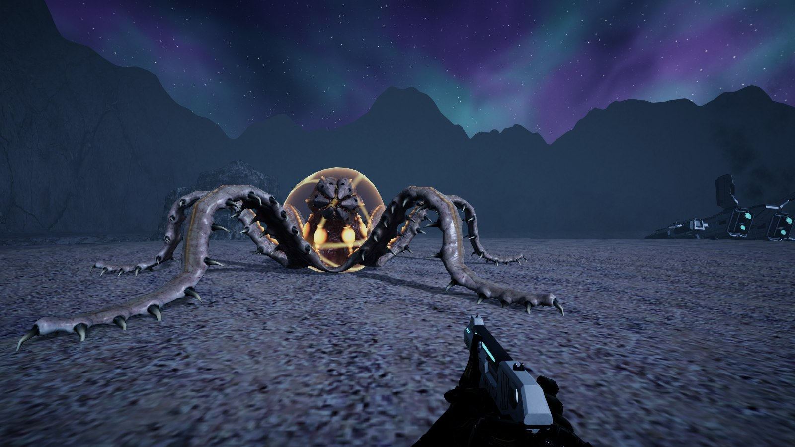
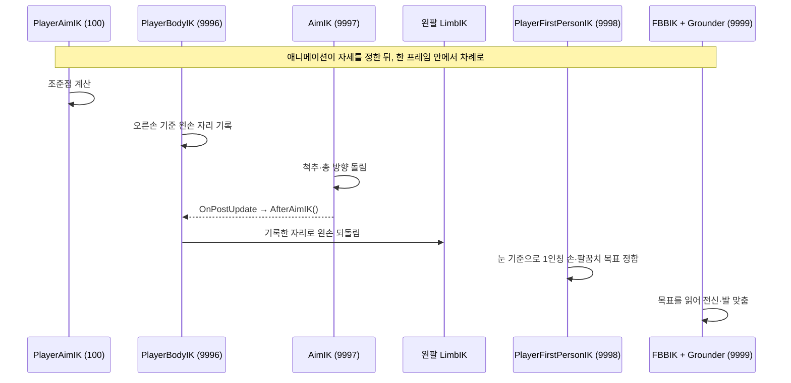
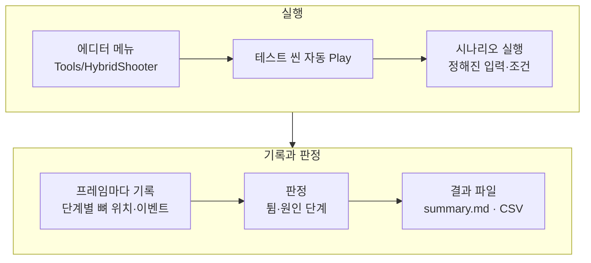
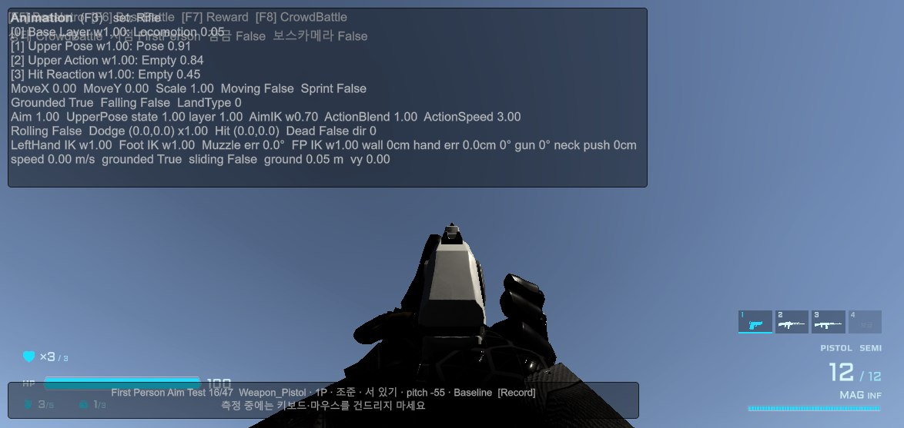
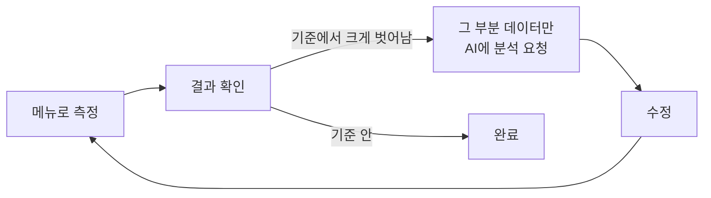
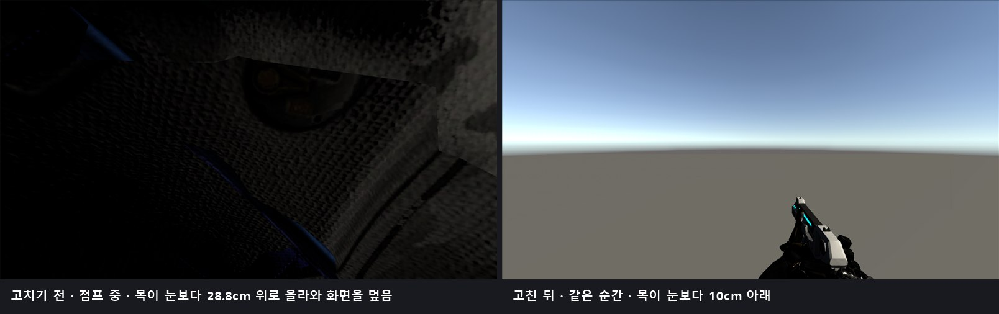

# 하이브 퍼지 — 3D 생존 슈터

> 4인 팀으로 2주 동안 만든 3D 생존 슈터에서 플레이어 캐릭터를 맡았습니다. 애니메이션과 IK는 제가 약한 분야라서, 감으로 고치는 대신 AI와 함께 측정 도구를 만들어 문제가 생기는 단계를 찾아내고 고쳤습니다.


## 1. 개요

몰려오는 적들을 버티며 살아남는 3D 생존 슈터입니다. 1인칭으로 몰려오는 군중을 쓸어내다가, 보스가 나타나면 3인칭으로 바뀌어 거대한 보스와 싸웁니다. 끝없이 밀려오는 적을 한꺼번에 쓸어 냈을 때의 쾌감을 플레이어에게 주는 것이 목표였습니다.

저는 플레이어(이동, 애니메이션, IK, 1인칭·3인칭 시점)를 중심으로 두 번째 보스, 총기와 해금, 인트로와 엔딩, 맵 분위기와 라이팅을 맡았습니다. 이 문서는 그중 가장 오래 붙잡았던 **플레이어의 애니메이션과 IK**를 다룹니다. IK(Inverse Kinematics)는 손이나 발을 목표 위치에 두면 팔과 다리의 관절 각도를 거꾸로 계산해 주는 기술로, 이 게임에서는 총을 쥔 두 손과 조준하는 상체, 땅을 딛는 발을 맞추는 데 썼습니다.



### 개발 환경

| 항목 | 내용 |
|---|---|
| 장르 | 3D 생존 슈터 |
| 기간 | 2026.10.19 ~ 2026.11.03 (약 2주) |
| 인원 | 4인 팀 |
| 엔진 | Unity 6000.3.15f1 · URP |
| IK | Final IK (에셋 스토어) — AimIK · FullBodyBipedIK · LimbIK · GrounderFBBIK |
| 도구 | Visual Studio · Claude Code (Claude Opus 5.5) |
| GitHub | https://github.com/KooHoo-Dev/3rd_3D_1-3D-Project-team_even |
| 시연 영상 | https://youtu.be/h8nFAuI8KAY (숏츠: https://youtube.com/shorts/cJZfjStR3s0) |

### 팀과 내 역할

| 팀원 | 담당 |
|---|---|
| **나** | **플레이어 · 두 번째 보스 · 총기 · 해금 · 인트로/엔딩 · 맵 분위기와 라이팅** |
| 팀원 A | 몬스터(군중) 행동·이동 |
| 팀원 B | 맵 · 보급 · 메인 메뉴 · 튜토리얼 |
| 팀원 C | 첫 번째 보스 · UI 테마 |

IK 계산 자체는 Final IK 에셋이 하고, 저는 그 위에서 IK들을 어떤 순서로, 어떤 값으로 돌릴지를 정했습니다. 플레이어 IK 스크립트와 측정 도구는 Claude Code에 맡겨 만든 코드이고, 저는 무엇을 어떻게 잴지와 결과를 보고 다음에 무엇을 할지를 정했습니다.

## 2. 시스템 구조

### 한 프레임 안에서 IK가 도는 순서

플레이어 한 명에 IK가 다섯 개(AimIK, 왼팔 LimbIK, 1인칭 손 IK, FBBIK, Grounder) 걸려 있고, 뒤에 도는 IK는 앞의 IK가 움직여 놓은 뼈를 다시 고칩니다. 그래서 같은 값을 넣어도 순서가 바뀌면 자세가 달라집니다.



괄호 안 숫자는 Unity 실행 순서(`[DefaultExecutionOrder]`)입니다. 왼손 위치를 AimIK보다 먼저 기록하는 데는 이유가 있습니다. 애니메이션에서는 두 손이 함께 총을 쥐고 있는데, AimIK가 척추를 돌려 오른손의 총이 움직이면 왼손이 총에서 떨어집니다. 그래서 AimIK가 돌기 전에 오른손을 기준으로 한 왼손 자리를 적어 두었다가, AimIK가 끝나자마자 왼팔 LimbIK로 그 자리에 되돌립니다. 1인칭 손 IK가 전신 IK(FBBIK) 앞에 있는 것도 같은 이유입니다. 1인칭에서는 총이 있어야 할 자리를 눈을 기준으로 먼저 정하고, 전신 IK가 그 목표를 읽어 두 손을 끌어옵니다. 코드 주석에도 이 순서를 그대로 적어 두었습니다.

```csharp
/// 실행 순서: 이 스크립트(9996, 기록) → AimIK(9997) → [왼손 LimbIK] → PlayerFirstPersonIK(9998) → FullBodyBipedIK(9999, 반동·발)
```

### 측정 도구의 구조

측정 도구는 게임 코드와 분리한 디버그 전용 코드입니다. 에디터 메뉴(`Tools/HybridShooter` — HybridShooter는 이 프로젝트의 코드 이름)를 누르면 테스트 씬이 실행되고, 시나리오가 정해진 입력을 넣는 동안 기록기가 프레임마다 자세를 남깁니다. 끝나면 보고서가 판정까지 해서 결과 파일로 남깁니다.



문제를 다 고친 뒤에는 프로젝트를 깨끗하게 유지하려고 측정 코드를 삭제했습니다(10-31). 이 문서의 측정 코드는 삭제 직전 커밋 [`86ea77cb`](https://github.com/KooHoo-Dev/3rd_3D_1-3D-Project-team_even/tree/86ea77cb)에서 가져왔습니다. 5장의 "포트폴리오를 정리하면서 다시 잰" 수치도, 이 커밋에서 측정 코드를 잠시 되살려 고치기 전 설정과 지금 설정을 같은 조건으로 잰 것입니다.

## 3. 핵심 기능

### 3.1 메뉴 하나로 같은 조건을 반복해서 재기

에디터 메뉴를 누르면 테스트 씬이 자동으로 돌면서, 정해 둔 입력값과 실험값을 넣어 플레이어가 어떤 상태인지 기록합니다. 측정이 끝나면 Play를 스스로 멈추고 결과 파일을 남깁니다.



측정은 세 가지를 만들었습니다. 애니메이션 떨림 측정은 이동하거나 조준하는 동안 상체가 튀는 프레임을 찾고, 그 튐이 어느 단계에서 생겼는지 가릅니다. 평지와 지형, IK 설정, 144fps, 1인칭 조건을 바꿔 가며 잽니다. 1인칭 조준 측정은 모든 총을 들고 위아래 일곱 각도를 보며, 조준할 때는 조준기가 화면 중앙에, 허리에 총을 둘 때는 정해진 자리에 오는지, 목이 카메라 앞으로 나와 화면을 가리지 않는지 확인합니다. 1인칭 점프 측정은 점프할 때 목과 어깨가 카메라 앞으로 올라와 화면을 가리는지 봅니다.

손으로 매번 똑같이 조작하기는 어렵지만, 메뉴로 돌리면 매번 같은 자리에서 같은 입력과 같은 각도로 다시 잴 수 있습니다. 이 방법을 고른 이유는 4.1에 적었습니다.

### 3.2 어느 단계에서 튀었는지 가르기

눈에 보이는 결과만으로는 애니메이션과 여러 IK 중 어느 단계가 문제인지 알 수 없었습니다. 그래서 정상이라면 나올 값과 크게 다른 값이 처음 나타나는 단계를 찾으면 원인을 좁힐 수 있다고 보고, 연관된 단계를 차례로 검사했습니다.

한 프레임 안에서 같은 뼈(골반, 가슴, 머리, 양손, 총구)의 위치를 처리 단계마다 네 번 기록합니다.

| 기록하는 시점 | 여기서 처음 튀면 의심하는 곳 |
|---|---|
| 애니메이션 직후, IK가 돌기 전 | 애니메이션 클립, 블렌드, 전환 |
| 조준 IK와 왼손 IK 직후, 전신 IK 전 | 조준·왼손 IK |
| 모든 IK가 끝나 화면에 그려지는 자세 | 전신 IK·발 IK |
| 위 자세를 카메라 기준으로 바꾼 값 | 카메라나 캐릭터 루트의 흔들림 |

상체 뼈(가슴, 머리, 양손, 총구)의 가속도가 그 실행 중앙값의 4배(최소 5 m/s²)를 넘은 프레임을 "튐"으로 봅니다. 골반은 기록만 하고 판정에서는 뺍니다. 그리고 그 프레임(또는 바로 앞뒤 프레임)에 이미 튀어 있던 가장 이른 단계를 원인으로 봅니다. 아래 코드에서 `StageAnim`, `StagePreFullBody`, `StageFinal`, `StageCamera`가 위 표의 네 시점입니다.

```csharp
bool[] final = pop[AnimJitterProbe.StageFinal];
for (int i = 0; i < n; i++)
{
    if (final[i])
    {
        r.pops++;
        if (Near(pop[AnimJitterProbe.StageAnim], i)) r.origin[OriginAnim]++;
        else if (Near(pop[AnimJitterProbe.StagePreFullBody], i)) r.origin[OriginAimHand]++;
        else r.origin[OriginFullBody]++;
    }
    else if (pop[AnimJitterProbe.StageCamera][i] && Near(final, i) == false) r.cameraOnlyPops++;
}
```

### 3.3 결과를 읽고 다시 묻기

결과 파일에서 기준을 크게 벗어난 데이터가 보이면, 결과 전체가 아니라 그 부분 데이터만 골라 다시 AI에게 주고 원인을 분석하게 했습니다. 그렇게 나온 수정을 넣은 뒤에는 같은 메뉴로 다시 재서 정말 나아졌는지 확인했습니다.



## 4. 고민과 선택

### 4.1 감으로 고치기를 멈추고 측정부터 한 이유

IK와 애니메이션은 제가 약한 분야였습니다. 총을 든 손이 떨리거나, 1인칭으로 위를 보면 조준이 어긋나는 문제가 생겼습니다. 처음에는 의심 가는 곳을 고치고 다시 플레이해 보는 방식으로 고쳐 보려 했지만, 그 한 곳만 문제인지 다른 곳도 함께 문제인지 알 수 없었고 시간도 오래 걸렸습니다. 그래서 이대로는 **어디가 원인인지, 어떤 데이터를 봐야 하는지 시간 안에 알 수 없다고 판단했습니다.**

손으로 조작해서 확인하면 매번 조건이 조금씩 달라서, 고친 뒤에 나아졌는지조차 확신할 수 없었습니다. 측정 도구를 만들면 도구를 만드는 시간과 AI 토큰이 더 들지만, 같은 조건에서 고치기 전과 후를 비교할 수 있고 처음 튄 단계가 숫자로 나옵니다. 마감까지 남은 시간을 생각하면 막연히 여러 곳을 고쳐 보는 것보다 이쪽이 빠르다고 보고 측정을 택했습니다.

그래서 **테스트 과정을 코드로 자동화해 데이터를 뽑고**, 그 데이터로 원인을 좁히는 방식으로 바꿨습니다. AI와 일을 어떻게 나눴는지는 4.2에 적었습니다.

### 4.2 AI와 일을 나눈 방식

측정 코드 전체(메뉴, 시나리오, 기록, 보고서)와 수정 코드는 Claude Code가 작성했고, 데이터 분석과 원인 후보도 AI가 내놓았습니다. 저는 무엇을 잴지(상체 뼈 위치, IK 단계, 조준기 위치, 목 위치)와 어떤 조건으로 잴지(지형, 프레임, 시점, 총, 각도, 고치기 전과 지금)를 정했고, 결과에서 어떤 데이터를 다시 볼지와 다음에 무엇을 할지를 판단했습니다.

AI에게 일을 맡길 때는 세 가지 방식을 지켰습니다.

- **"고쳐 줘"가 아니라 계획 세우기부터** — 테스트 과정을 코드로 자동화해서 데이터를 뽑을 수 있도록 계획하라고 지시했습니다. 계획을 단계로 나눠 받으면 제 생각과 다른 부분을 미리 고칠 수 있습니다. 또 손으로 하면 부정확한 테스트는 코드에 맡기고, 저는 결과를 검수하고 다음 방향만 정하면 된다고 생각했기 때문입니다.
- **잴 대상과 조건은 제가 정해서 준다** — 무엇을 어떤 조건에서 잴지 정해 주고, 고치기 전 설정과 지금 설정을 같은 조건에서 비교하게 했습니다.
- **벗어난 데이터만 다시 준다** — 결과 전체를 다시 주면 분석이 흐려지기 때문에, 기준에서 크게 벗어난 부분만 골라 원인 분석을 맡겼습니다.

## 5. 고친 문제

### 이동하거나 조준할 때 상체가 떨리던 문제

측정해 보니 튐의 90%가 IK가 아니라 애니메이션 단계에서 처음 생겼고, 튐의 41%가 이동·전력질주 루프 클립이 처음으로 돌아가는 순간과 겹쳤습니다. 그 순간이 전체 프레임에서 차지하는 비율보다 5배 높아, 튐이 루프 순간에 몰려 있었습니다. 루프 클립의 이음새를 보정하고, 전력질주의 상체 커브를 부드럽게 다듬고, 상체 자세 가중치를 IK와 분리했습니다. ([`3d984f0b`](https://github.com/KooHoo-Dev/3rd_3D_1-3D-Project-team_even/commit/3d984f0b))

같은 메뉴로 다시 재 보니 기준 설정 전체의 튐이 301회에서 121회로 줄었고(다시 재서 133회), 10초당으로는 36.1회에서 14.5~16.0회입니다. 루프 이음새와 겹치는 튐은 더 이상 보이지 않았습니다. 다만 절반 이하로 줄었을 뿐 다 없어진 것은 아닙니다. 남은 튐은 조준하며 옆으로 걸을 때의 상체 조준 자세, 실제 지형에서의 발 IK, 1인칭으로 회전할 때의 전신 IK에서 생기는 것으로 좁혀 두었습니다.

튐을 세는 기준은 3.2와 같습니다.

### 1인칭으로 위를 보면 조준이 어긋나던 문제

이 프로젝트에서 원인을 찾기가 가장 어려웠던 문제입니다. 1인칭 카메라는 눈 높이에 고정되어 있어서 위를 볼수록 총이 있어야 할 자리가 팔 길이 밖으로 나갑니다. 그러면 전신 IK가 손을 닿게 하려고 어깨와 목을 앞으로 끌어내고, 목이 화면을 가리지 않게 막는 처리가 다시 목을 뒤로 밀어냅니다. 두 처리가 서로 밀고 당기는 사이에 조준기가 화면 중앙에서 벗어났습니다.

손이 닿는 거리 안으로 들어오도록 총을 시선 축을 따라 몸 쪽으로 당기고, 위를 볼 때의 척추 가중치를 따로 두었습니다. 시선 축을 따라 당기기 때문에 조준 중에도 조준기는 화면 중앙에 남습니다. ([`eb073bdb`](https://github.com/KooHoo-Dev/3rd_3D_1-3D-Project-team_even/commit/eb073bdb))

포트폴리오를 정리하면서 같은 측정을 다시 돌려 보았습니다. 총을 허리에 둔 채 위를 20° 보면, 고치기 전 설정에서는 조준기가 제자리에서 10.3cm 벗어나고 어깨가 43.9cm 앞으로 끌려 나왔으며 목이 50cm 밀렸습니다. 고친 뒤에는 조준기 오차와 목 밀림이 0이고, 어깨는 0.7cm만 움직였습니다.


### 1인칭으로 점프하면 목이 화면을 가리던 문제

점프 동작은 골반을 위로 올리는데 1인칭 카메라는 고정이라, 공중에서 목과 어깨가 카메라 앞으로 올라와 화면을 가렸습니다. 손 목표를 정하기 전에 목이 눈보다 일정 거리 아래에 오도록 몸 전체를 내리게 했습니다. ([`2f6c0f30`](https://github.com/KooHoo-Dev/3rd_3D_1-3D-Project-team_even/commit/2f6c0f30))

포트폴리오를 정리하면서 측정을 다시 돌려 보니, 몸 내리기를 끈 설정에서는 공중에서 목이 눈보다 28.8cm 위까지 올라와 화면 전체를 덮었고, 지금 설정에서는 목이 눈보다 10cm 아래에 머물러 기준(눈보다 8cm 이상 아래)을 통과했습니다.



### 그 밖에 고친 문제

| 문제 | 원인 | 고친 방법 | 커밋 |
|---|---|---|---|
| 1인칭으로 아래를 보면 팔이 안쪽으로 꺾임 | 1인칭 손 IK가 손의 회전으로 팔꿈치 방향을 정해서, 아래를 보면 팔꿈치도 함께 돌아감 | 팔꿈치가 접히는 방향을 시선이 아니라 몸을 기준으로 고정하고, 1인칭에서 아래를 볼 수 있는 각도를 55°로 제한 | [`c79912bf`](https://github.com/KooHoo-Dev/3rd_3D_1-3D-Project-team_even/commit/c79912bf) |
| 경사와 계단에서 발이 땅을 찾지 못함 | 발 IK가 땅을 찾는 레이어 설정이 캐릭터 컨트롤러와 따로 있어서, 씬마다 땅 레이어가 다르면 못 찾음 | 발 IK도 컨트롤러와 같은 설정을 쓰게 함 | [`35352751`](https://github.com/KooHoo-Dev/3rd_3D_1-3D-Project-team_even/commit/35352751) |
| 1인칭 허리 사격 때 저절로 정조준 자세가 됨 | 쏜 직후의 자세 값과 조준 값을 하나의 값으로 써서, 쏘기만 해도 총이 정조준 자리로 올라옴 | 우클릭 조준만 따르는 값을 따로 두고 1인칭 총 위치에는 그 값을 씀 | [`7e50b513`](https://github.com/KooHoo-Dev/3rd_3D_1-3D-Project-team_even/commit/7e50b513) |

## 6. 회고

### 배운 점

- 모르는 분야도 AI의 도움을 받아 풀 수 있었습니다. 다만 **효율이 떨어지고, 문제는 반드시 생깁니다.** 제가 원하는 움직임을 위해 고쳐야 하는 부분과, AI가 생각한 목표에 따라 당장 고쳐야 한다고 본 부분이 달랐습니다. 그래서 AI가 제 의도와 어긋나는 곳이 아닌 다른 문제를 분석하고, 필요 없는 데이터까지 해석하려 한 적이 있었습니다. 그 문제를 해결하는 과정에서 제가 배워야 다음에 같은 문제를 막을 수 있다는 것을 배웠습니다.
- AI에게 바로 고치게 하기보다 **재고, 비교하고, 벗어난 데이터만 다시 묻는 순서**(3.3)가 원인을 좁히는 데 효과적이었습니다.
- 가장 처음에는 핵앤슬래시 느낌과 디펜스 요소까지 계획했습니다. 만들면서 방향이 바뀌어, 압도적인 느낌을 주는 많은 적이 어렵고 까다로운 상황을 만들고 플레이어가 강력한 광역 무기로 그 상황을 벗어나는 시스템이 되었습니다. 방향은 팀이 함께 정했고, 그 경험을 내기 위한 제 몫은 총기의 종류와 수치 밸런스, 플레이어의 속도·목숨·부활 여부 같은 요소였습니다. 목표한 경험은 어느 정도 채웠고 재미있게 나왔다고 생각합니다. 초기 기획을 꼭 그대로 지키는 것만이 좋은 것은 아니라는 것을 느꼈습니다.

### 아쉬운 점과 다시 한다면

- 토큰 소모가 컸습니다. 자동 테스트라도 측정 한 번이 길게 잡혀(떨림 측정 약 5분, 조준 측정은 총마다 약 3분), 기능이 크고 경우의 수가 많으면 테스트가 오래 걸렸습니다.
- 다시 한다면 제가 IK를 먼저 공부해서, 잴 대상을 더 좁게 정하고 테스트 과정을 줄이겠습니다.
