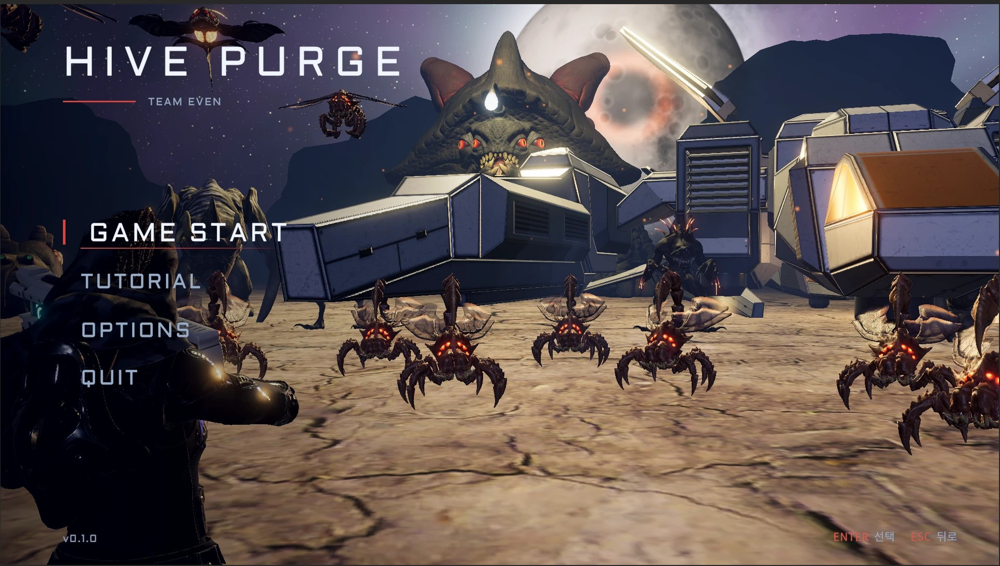
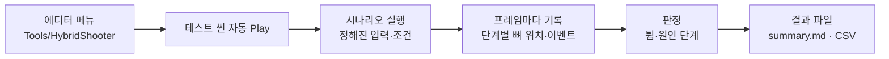
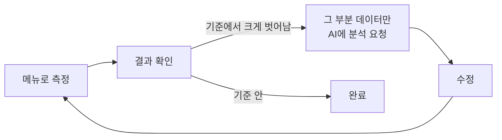

# 하이브 퍼지 — 3D 생존 슈터

> 4인 교육과정 팀 프로젝트에서 **플레이어**를 맡았습니다. 이 문서는 제가 약했던 **애니메이션·IK 문제**를, AI로 **테스트를 반자동화**해 원인을 좁히고 고친 과정을 다룹니다.



## 1. 개요

### 무엇을 만들었나


압도적으로 몰려오는 적들을 버티는 3D 생존 슈터입니다. 1인칭으로 몰려오는 군중을 쓸어내고, 3인칭으로 거대한 보스와 싸웁니다.

제가 맡은 것은 **플레이어**(이동·애니메이션·IK·1인칭/3인칭 시점), **두 번째 보스**, 총기와 해금 시스템, 인트로·엔딩, 맵 분위기와 라이팅입니다.

### 왜 이 문제를 골랐나


IK와 애니메이션은 제가 약한 분야였습니다. 총을 든 손이 떨리거나, 1인칭으로 위·아래를 보면 조준이 어긋나는 문제가 생겼는데, **어디가 원인인지 어떤 데이터를 봐야하는지 시간안에 알 수 없다고 판단했습니다.** 
먼저 의심 가는 곳을 고치고 다시 플레이해 보는 방식으로는 고치려해보았지만, 그 한 곳만 문제인지, 혹은 다른 곳도 함께 문제인지 알 수 없었고 시간도 오래 걸렸습니다.

그래서 **테스트 과정을 코드로 자동화해 데이터를 뽑고**, 그 데이터로 원인을 좁히는 방식으로 바꿨습니다. 모르는 분야를 AI로 보충하면서도, **무엇을 어떻게 잴지는 제가 정했다**는 것을 보여 주려고 이 주제를 골랐습니다.

### 개발 환경

| 항목 | 내용 |
|---|---|
| 장르 | 3D 슈팅 생존 게임 |
| 기간 | 2026.10.19 ~ 2026.11.03 (2주 1일) |
| 인원 | 4인 팀 |
| 내 역할 | 플레이어 · 두 번째 보스 · 총기 · 해금 · 인트로/엔딩 · 맵 분위기와 라이팅 |
| 엔진 | Unity 6000.3.15f1 · URP |
| IK | Final IK (에셋 스토어) — AimIK · FullBodyBipedIK · LimbIK · GrounderFBBIK |
| 도구 | Visual Studio · Claude Code (Opus 5.5) |
| GitHub | https://github.com/KooHoo-Dev/3rd_3D_1-3D-Project-team_even |
| 시연 영상 | 준비 중 |

### 팀과 내 역할

| 팀원 | 담당 |
|---|---|
| **나** | **플레이어 · 두 번째 보스 · 총기 · 해금 · 인트로/엔딩 · 맵 랜더링 분위기** |
| 팀원 A | 몬스터(군중) 행동·이동 |
| 팀원 B | 맵 · 보급 · 메인 메뉴 · 튜토리얼 |
| 팀원 C | 첫 번째 보스 · UI 테마 |

이 문서는 **플레이어의 애니메이션·IK 문제를 푼 과정**만 다룹니다. IK 계산 자체는 Final IK 에셋이 하고, 저는 그 위에서 IK들을 어떤 순서로, 어떤 값으로 돌릴지를 정했습니다. 플레이어 IK 스크립트와 측정 도구는 **Claude Code에 시켜서 만든 코드**이고, 저는 **무엇을 어떻게 잴지**와 **결과를 보고 다음에 무엇을 할지**를 정했습니다.

### 이 문서에서 다루는 것

1. **시스템 구조** — 한 프레임 안에서 IK가 도는 순서, 측정 도구의 구조
2. **핵심 기능** — 메뉴 하나로 도는 반자동 측정, 단계별 기록으로 원인 가르기, 결과를 읽고 다시 묻기
3. **고민과 선택** — 눈으로 찾기에서 측정해서 찾기로, AI와 나눈 일, 주요 프롬프트 방식
4. **결과와 배운 점** — 고친 문제 5가지, AI를 쓰며 배운 것

## 2. 시스템 구조

### 한 프레임 안의 IK 순서

플레이어 한 명에 IK가 여러 개 걸려 있고, 앞의 IK가 뼈를 움직이면 뒤의 IK가 그 결과를 다시 고칩니다. 그래서 **순서가 곧 결과**입니다.


괄호 안 숫자는 Unity 실행 순서(`[DefaultExecutionOrder]`)입니다. 코드 주석에도 순서를 그대로 적어 두었습니다.

```csharp
/// 실행 순서: 이 스크립트(9996, 기록) → AimIK(9997) → [왼손 LimbIK] → PlayerFirstPersonIK(9998) → FullBodyBipedIK(9999, 반동·발)
```

### 측정 도구의 구조


측정 도구는 게임 코드와 분리된 **디버그 전용 코드**입니다. 에디터 메뉴가 테스트 씬을 실행하고, 시나리오가 정해진 입력을 넣고, 기록기가 프레임마다 자세를 남기고, 보고서가 판정까지 합니다.



측정용 코드는 문제를 다 고친 뒤 깨끗한 프로젝트를 유지하려고 삭제했습니다(10-31). 이 문서의 측정 코드는 삭제 직전 커밋 `86ea77c`의 것입니다.

## 3. 핵심 기능

### 3.1 반자동 측정 — 메뉴 하나로 같은 조건을 반복

에디터 메뉴를 누르면 테스트 씬이 자동으로 돌고, **정해진 입력값과 실험값**을 넣어 플레이어가 어떤 상태인지 기록합니다. 끝나면 Play를 스스로 멈추고, 입력값과 상태에 따른 수치 파일이 남습니다.

| 측정 | 하는 일 | 조건 |
|---|---|---|
| 애니메이션 떨림 | 이동·조준 중 상체가 튀는 프레임을 찾고 원인 단계를 가름 | 평지 / 지형 · IK 설정 비교 · 144fps · 1인칭 |
| 1인칭 조준 | 조준기가 화면 중앙(조준)·정해진 자리(허리)에 오는지, 목이 카메라 앞으로 나오지 않는지 | 모든 총 × 고치기 전 / 지금 설정 × 허리 / 조준 × 서서 위아래 7각도 · 걸으며 3각도 |
| 1인칭 점프 | 점프할 때 총·팔이 화면을 가리는지 | 1인칭 점프 |

손으로 매번 똑같이 조작하기는 어렵지만, 메뉴로 돌리면 **매번 같은 자리, 같은 입력, 같은 각도**로 다시 잴 수 있습니다. 그래서 "고친 뒤 정말 나아졌는지"를 같은 조건에서 비교할 수 있습니다.

### 3.2 단계별 기록 — 어느 단계에서 튀었는지 가르기

한 프레임 안에서 같은 뼈(골반·가슴·머리·양손·총구)의 위치를 **IK 단계마다** 기록합니다.

| 단계 | 기록 시점 | 여기서 처음 튀면 |
|---|---|---|
| Anim | 애니메이션 직후, IK 전 | 클립·블렌드·전환 문제 |
| PreFBBIK | AimIK·왼손 직후 | 조준·왼손 IK 문제 |
| Final | 모든 IK 뒤, 화면에 그려지는 자세 | 전신 IK·발 IK 문제 |
| Camera | Final을 카메라 기준으로 | 카메라·루트 흔들림 |

가속도가 그 실행의 중앙값보다 크게 벗어난 프레임을 "튐"으로 보고, **그 프레임에 이미 튄 가장 이른 단계**를 원인으로 봅니다.

```csharp
bool[] final = pop[AnimJitterProbe.StageFinal];
for (int i = 0; i < n; i++)
{
    if (final[i])
    {
        r.pops++;
        if (Near(pop[AnimJitterProbe.StageAnim], i)) r.origin[OriginAnim]++;
        else if (Near(pop[AnimJitterProbe.StagePreFullBody], i)) r.origin[OriginAimHand]++;
        else r.origin[OriginFullBody]++;
    }
    else if (pop[AnimJitterProbe.StageCamera][i] && Near(final, i) == false) r.cameraOnlyPops++;
}
```

### 3.3 결과를 읽고 다시 묻기

결과 파일을 보고, 특정 데이터가 기준에서 크게 벗어나면 **그 부분 데이터만 골라 다시 AI에게 주고** 원인을 분석하게 했습니다. 그렇게 나온 수정을 넣고, 같은 메뉴로 다시 재서 확인했습니다.



## 4. 고민과 선택

### 4.1 눈으로 찾기에서 측정해서 찾기로

| | 바꾸기 전 | 바꾼 뒤 |
|---|---|---|
| 찾는 법 | 전체 코드를 뒤지고, 의심 가는 곳을 고치고, 다시 플레이 | 메뉴로 같은 조건을 돌리고 단계별 데이터로 원인 단계를 좁힘 |
| 원인 | 그 한 곳만 문제인지, 다른 곳도 문제인지 알 수 없음 | 처음 튄 단계가 나옴 |
| 확인 | 손으로 다시 조작 — 매번 조건이 다름 | 고치기 전 설정과 같은 조건에서 비교 |
| 비용 | 시간이 오래 걸리고 번거로움 | 측정 시간과 AI 토큰이 듦 |

### 4.2 AI와 나눈 일


| 내가 정한 것 | AI(Claude Code)가 한 것 |
|---|---|
| 무엇을 잴지 — 상체 뼈 위치, IK 단계, 조준기 위치, 목 위치 | 측정 코드 전체(메뉴·시나리오·기록·보고서) 작성 |
| 어떤 조건으로 잴지 — 지형, 프레임, 시점, 총, 각도, 고치기 전과 지금 | 데이터 분석과 원인 후보 제시 |
| 결과에서 어떤 데이터를 다시 볼지, 다음에 무엇을 할지 | 수정 코드 작성 |

### 4.3 주요 프롬프트 방식


- **"고쳐 줘"가 아니라 계획세우기 부터** — 테스트 과정을 코드로 자동화해서 데이터를 뽑을 수 있도록 계획하라고 지시했습니다. 원인을 모르는 채로 바로 고치게 하면 추측으로 고치기 때문입니다.
- **무엇을 어떻게 잴지는 내가 정해서 준다** — 잴 대상과 조건을 정해 주고, 고치기 전 설정과 지금 설정을 같은 조건에서 비교하게 했습니다.
- **벗어난 데이터만 다시 준다** — 결과 전체가 아니라 기준에서 크게 벗어난 부분 데이터만 골라 원인 분석을 맡겼습니다.

## 5. 결과와 배운 점

### 고친 문제

| 문제 | 원인 | 해결 | 커밋 |
|---|---|---|---|
| 이동·조준 중 상체가 떨림 | 이동·전력질주 루프 클립의 이음새가 튐(애니메이션 단계) | 루프 클립 이음새 보정, 전력질주 상체 커브 평활화, 상체 자세 가중치를 IK와 분리 | `3d984f0b` |
| 1인칭으로 아래를 보면 팔이 안쪽으로 꺾임 | 팔꿈치 방향 기준이 없음 | 팔꿈치 방향을 몸 기준으로 고정, 1인칭 아래 보기 각도 제한(55°) | `c79912bf` |
| 경사·계단에서 발이 땅을 못 찾음 | IK의 레이어 마스크가 컨트롤러 설정과 따로 놀았음 | 컨트롤러와 같은 설정을 쓰도록 수정 | `35352751` |
| 1인칭으로 위·아래를 보면 조준이 어긋남 | 총 자리가 팔 길이 밖으로 나가면 전신 IK가 어깨·목을 앞으로 끌고, 목 보호가 다시 밀어내는 순환 | 손이 닿도록 총을 시선 축을 따라 당김, 위를 볼 때 척추 가중치를 따로 둠 | `eb073bdb` |
| 1인칭 허리 사격 때 저절로 정조준 자세가 됨 | 쏜 직후 자세 값과 조준 값을 한 값으로 씀 | 우클릭 조준만 따르는 값을 따로 두고 1인칭 총 위치에 사용 | `7e50b513` |

### 측정 결과 (약식)

아래는 당시 작업 기록에 남아 있던 요약 수치입니다.

| 측정 | 고치기 전 | 고친 뒤 |
|---|---|---|
| 상체 튐 — 기준 설정 전체 (10-26, 72회 실행) | 301회 (10초당 36.1회) | 121회 (10초당 14.5회) · 다시 재서 133회 (16.0회) |
| 튐이 처음 생긴 단계 | 애니메이션 90% · 전신 IK 10% | 애니메이션 84% · 전신 IK 16% |
| 루프 이음새 순간과 겹친 튐 | 튐의 41% (평소의 5.0배) | 뚜렷하게 겹치는 이벤트 없음 |
| 1인칭 점프 — 공중에서 눈과 목의 높이 차 (10-29, 8회 실행) | −14.1cm (목이 눈보다 위 → 화면을 가림) | 13.5cm (기준 8cm 이상) |

- 튐 기준: 상체 뼈(가슴·머리·양손·총구)의 가속도가 그 실행 중앙값의 4배(최소 5 m/s²)를 넘는 프레임
- 상체 튐의 "고친 뒤"는 루프 클립 이음새를 보정한 뒤 같은 메뉴로 다시 잰 값입니다.


### 배운 점

- 모르는 분야도 AI의 도움을 받아 풀 수 있었습니다. 다만 **효율이 떨어지고, 문제는 반드시 생깁니다.** 그 문제를 해결하는 과정에서 제가 배워야 다음에 같은 문제를 막을 수 있다는 것을 배웠습니다.
- AI에게 바로 고치게 하기보다 **재고, 비교하고, 벗어난 데이터만 다시 묻는 순서**가 원인을 좁히는 데 효과적이었습니다.

### 아쉬운 점과 다시 한다면

- 토큰 소모가 컸습니다. 자동 테스트라도 AI가 테스트 시간 간격을 길게 잡아, 기능이 크고 경우의 수가 많으면 테스트가 오래 걸렸습니다.
- 다시 한다면 제가 IK를 먼저 공부해서, 잴 대상을 더 좁게 정하고 테스트 과정을 줄이겠습니다.
