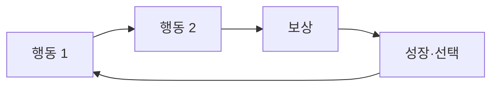

# (가제) 게임 이름 — 컨셉 기획서

<!--
쓰는 법
- 만들기 "전에" 쓰는 문서입니다. 정답을 쓰는 게 아니라, 지금 생각과 아직 모르는 것을 적어 둡니다.
- 한 절에 3~5줄이면 충분합니다. 전체가 2~3화면을 넘으면 줄이세요.
- 바뀌면 지우지 말고 맨 아래 「결정 기록」에 날짜와 이유를 남기세요. 나중에 프로젝트 문서의
  "고민과 선택"·"계획 대비 실제"가 여기서 나옵니다.
- 이런 안내 주석은 화면에 보이지 않으니 지우지 않아도 됩니다.
-->

| 항목 | 내용 |
|---|---|
| 버전 · 작성일 | v0.1 · YYYY-MM-DD |
| 장르 | 예: 2D 탑다운 로그라이트 |
| 플랫폼 · 엔진 | 예: PC · Unity 6000.x |
| 예정 기간 · 인원 | 예: 4주 · 1명 |
| 한 줄 소개 | 누가 · 무엇을 하는 게임인지 한 문장 |

---

## 1. 목표한 경험

<!-- 이 게임을 한 사람이 끝나고 뭐라고 말하면 성공인가요? 한 문장. 기능 이름이 아니라 "느낌·행동"으로. -->

> "………………………………"

## 2. 왜 만드나

<!--
두 가지를 따로 적습니다.
- 게임으로서: 어떤 재미가 아직 없어서 / 내가 좋아하는 무엇을 다르게 해 보고 싶어서
- 나에게: 이 프로젝트로 익히거나 증명하고 싶은 것 (예: 상태 패턴으로 적 AI, 오브젝트 풀링, 세이브 구조)
-->

- **게임으로서:**
- **나에게 (배우고 싶은 것):**

## 3. 플레이 소개 — 한 판의 흐름

<!-- 시작 → 중간 → 끝까지 플레이어가 보는 것을 순서대로 3~6줄. 한 판이 몇 분인지도. -->

1.
2.
3.

## 4. 코어 루프

<!-- 플레이어가 되풀이하는 행동. 화살표가 처음으로 돌아와야 루프입니다. 아래 그림의 이름만 바꾸세요. -->

- 이 반복이 **목표한 경험**을 어떻게 만드는지 한 줄:

## 5. 핵심 메커닉

<!-- 2~4개만. 많으면 코어 루프를 직접 만드는 것만 남기고 나머지는 7절 "하면 좋은 것"으로. -->

| 메커닉 | 규칙 (어떻게 동작) | 목표한 경험에 어떻게 기여 | 아직 모르는 것 |
|---|---|---|---|
| | | | |
| | | | |

## 6. 참고한 게임

<!-- 이름과 "무엇을 빌리고 무엇을 다르게 할지"만. 원작 그림·글을 문서에 옮기지 않습니다. -->

| 참고작 | 빌려 올 것 | 다르게 할 것 |
|---|---|---|
| | | |

## 7. 범위

<!-- "안 하는 것"이 가장 중요합니다. 기간 안에 끝낼 수 있는지 판단하는 기준이 됩니다. -->

- **꼭 (MVP):**
- **하면 좋은 것:**
- **안 하는 것:**

## 8. 기술 과제와 리스크

<!--
구현하면서 가장 어려울 것 같은 부분. 방법 후보를 미리 두 개 적어 두면,
나중에 프로젝트 문서의 "고민과 선택"이 거의 다 써집니다.
-->

| 과제 | 후보 A | 후보 B | 지금 기울어진 쪽 · 이유 |
|---|---|---|---|
| | | | |

- **가장 큰 리스크 / 막히면 줄일 방법:**

## 9. 일정

<!-- 주 단위로 충분합니다. "실제" 칸은 끝난 뒤에 채웁니다. -->

| 단계 | 계획 | 완료 기준 | 실제 |
|---|---|---|---|
| 1. 프로토타입 (코어 루프만) | W1 | 한 판을 끝까지 할 수 있음 | |
| 2. 핵심 메커닉 | W2–3 | 5절 MVP 전부 동작 | |
| 3. 다듬기 · 빌드 | W4 | 시연 영상 촬영 | |

## 10. 결정 기록

<!-- 기획이 바뀔 때마다 한 줄. 이 표가 면접에서 "왜 그렇게 했어요?"의 답이 됩니다. -->

| 날짜 | 바꾼 것 | 이유 |
|---|---|---|
| YYYY-MM-DD | 기획서 초안 작성 | — |
